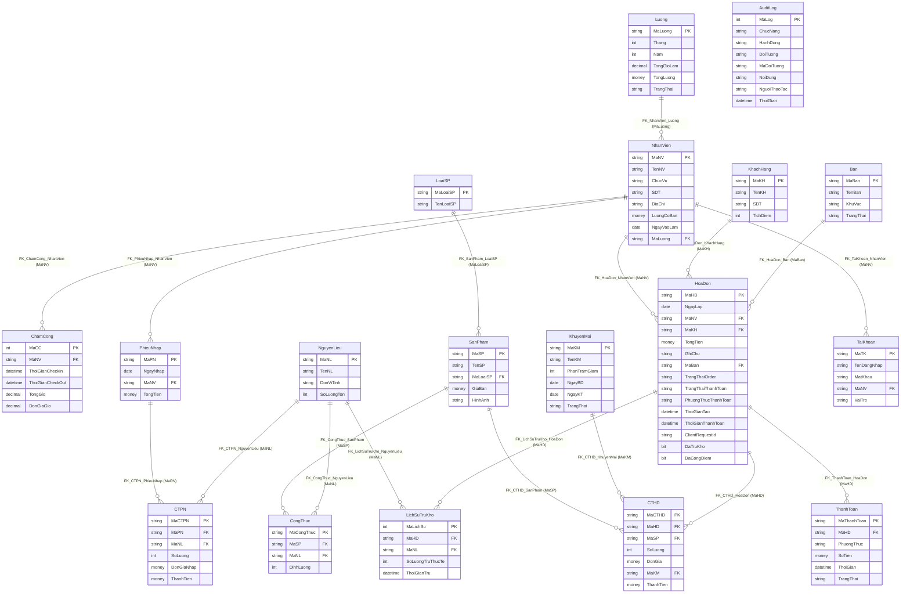
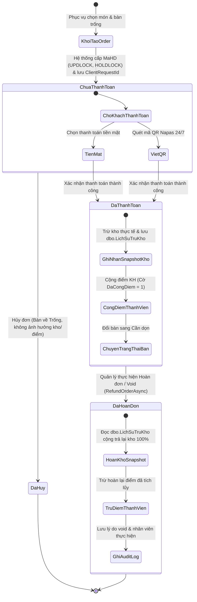

# WebQLCHCF — Hệ Thống POS Quán Cà Phê, Quản Trị Kho & Nhân Sự Đa Phân Hệ

[](https://github.com/nguyenxp3n/WebQLCHCF/actions/workflows/ci.yml)


-brightgreen?logo=xunit)


> **WebQLCHCF** là giải pháp phần mềm quản trị toàn diện dành cho chuỗi quán cà phê và điểm bán lẻ ẩm thực (F&B POS & ERP thu nhỏ). Dự án được thiết kế chuẩn mực theo kiến trúc **4-Tier Clean MVC** trên nền tảng **.NET 10 (C# 14)** kết hợp **Entity Framework Core 10** và **SQL Server 2022 Enterprise**, đóng gói hoàn chỉnh bằng **Docker Compose** và xác thực chất lượng với **394 ca kiểm thử tự động (xUnit - 100% Passed)** trên quy trình CI/CD GitHub Actions.

---

## 📑 Mục Lục
- [1. Điểm Nhấn Công Nghệ (Tech Highlights)](#1-điểm-nhấn-công-nghệ-tech-highlights)
- [2. Danh Mục 18 Thực Thể Dữ Liệu (Domain Entity Catalog)](#2-danh-mục-18-thực-thể-dữ-liệu-domain-entity-catalog)
- [3. Danh Sách Phân Hệ & Tính Năng Nghiệp Vụ (Feature Catalog)](#3-danh-sách-phân-hệ--tính-năng-nghiệp-vụ-feature-catalog)
  - [3.1. Phân hệ Bán Hàng & POS Tại Quầy](#31-phân-hệ-bán-hàng--pos-tại-quầy)
  - [3.2. Phân hệ Quản Lý Bàn & Điều Phối Bàn](#32-phân-hệ-quản-lý-bàn--điều-phối-bàn)
  - [3.3. Phân hệ Quản Lý Kho, Công Thức & Snapshot Trừ Kho](#33-phân-hệ-quản-lý-kho-công-thức--snapshot-trừ-kho)
  - [3.4. Phân hệ Nhân Sự, Chấm Công & Bảng Lương Phút](#34-phân-hệ-nhân-sự-chấm-công--bảng-lương-phút)
  - [3.5. Phân hệ Khách Hàng, Khuyến Mãi & Tích Điểm Idempotent](#35-phân-hệ-khách-hàng-khuyến-mãi--tích-điểm-idempotent)
  - [3.6. Phân hệ Báo Cáo Thống Kê & Nhật Ký Kiểm Toán (Audit Log)](#36-phân-hệ-báo-cáo-thống-kê--nhật-ký-kiểm-toán-audit-log)
  - [3.7. Phân hệ An Toàn Bảo Mật & Xác Thực](#37-phân-hệ-an-toàn-bảo-mật--xác-thực)
- [4. Ma Trận Phân Quyền Vai Trò (Role-Based Matrix)](#4-ma-trận-phân-quyền-vai-trò-role-based-matrix)
- [5. Kiến Trúc Phần Mềm & Sơ Đồ Thiết Kế](#5-kiến-trúc-phần-mềm--sơ-đồ-thiết-kế)
  - [5.1. Sơ đồ Kiến trúc Phân Tầng (Clean 4-Tier Architecture)](#51-sơ-đồ-kiến-trúc-phân-tầng-clean-4-tier-architecture)
  - [5.2. Sơ Đồ Thực Thể CSDL (Mermaid ERD - 18 Bảng)](#52-sơ-đồ-thực-thể-csdl-mermaid-erd---18-bảng)
  - [5.3. Sơ Đồ Trạng Thái Đơn Hàng & Vòng Đời Kho (State Machine)](#53-sơ-đồ-trạng-thái-đơn-hàng--vòng-đời-kho-state-machine)
- [6. Tiêu Chuẩn Kỹ Thuật & Giải Pháp Chuyên Sâu (Technical Deep-Dive)](#6-tiêu-chuẩn-kỹ-thuật--giải-pháp-chuyên-sâu-technical-deep-dive)
- [7. Bộ Lệnh CLI & Vận Hành Toàn Diện (Operations & CLI Catalog)](#7-bộ-lệnh-cli--vận-hành-toàn-diện-operations--cli-catalog)
- [8. Bộ Kiểm Thử Tự Động (Automated Testing Suite - 394 Tests)](#8-bộ-kiểm-thử-tự-động-automated-testing-suite---394-tests)
- [9. Hướng Dẫn Cài Đặt & Chạy Nhanh (Quick Start)](#9-hướng-dẫn-cài-đặt--chạy-nhanh-quick-start)
- [10. Kịch Bản Trải Nghiệm Demo Trong 3 Phút (Demo Walkthrough)](#10-kịch-bản-trải-nghiệm-demo-trong-3-phút-demo-walkthrough)

---

## 1. Điểm Nhấn Công Nghệ (Tech Highlights)

* **Hiệu Năng & Khả Năng Mở Rộng (.NET 10 + EF Core 10):** Tận dụng tối đa C# 14, Asynchronous/Await không chặn I/O, LINQ tối ưu với `AsNoTracking()`, Transaction linh hoạt hỗ trợ `ExecutionStrategy` với Connection Resiliency tự động khôi phục kết nối khi mạng chập chờn.
* **Xử Lý Concurrency Chuẩn Doanh Nghiệp (Pessimistic Locking):** Áp dụng khóa bi quan `WITH (UPDLOCK, HOLDLOCK)` ở các giao dịch nhạy cảm (Cấp mã hóa đơn không trùng lặp, thanh toán, điều phối bàn) triệt tiêu hoàn toàn rủi ro Race Condition khi nhiều nhân viên thao tác đồng thời.
* **Idempotency Token Chuẩn 3 Lớp:** Quản lý mã định danh `ClientRequestId` (UUID v4 36 ký tự) xuyên suốt từ giao diện đến DB, kết hợp Unique Partial Index `UX_HoaDon_ClientRequestId` loại bỏ triệt để lỗi double-tap hoặc mạng retry tạo đơn trùng lặp.
* **Snapshot Trừ Kho Bất Biến (`dbo.LichSuTruKho`):** Ghi nhận chính xác số lượng nguyên vật liệu thực tế đã trừ (`SoLuongTruThucTe`) tại thời điểm thanh toán. Cơ chế hoàn kho (Refund) đọc trực tiếp từ snapshot, ngăn chặn tuyệt đối lỗi hoàn khống khi thiếu tồn kho ban đầu và độc lập 100% với việc công thức pha chế bị chỉnh sửa sau này.
* **Idempotent Post-Payment & Điểm Thành Viên:** Bổ sung cờ `DaTruKho` và `DaCongDiem` trên thực thể `HoaDon`, đi kèm hàm đối soát phục hồi `ReconcilePendingPostPaymentAsync` bảo đảm không bao giờ cộng lặp điểm hay trừ trùng nguyên liệu khi có sự cố mạng.
* **Phân Định Nghiệp Vụ Hoàn Đơn / Hủy Đơn Rõ Ràng:** Phân định rạch ròi giữa `CancelOrderAsync` (Hủy đơn chưa thanh toán - Phục vụ/Quản lý) và `RefundOrderAsync` (Hoàn tiền / Void đơn đã thanh toán - Nghiệp vụ đặc quyền chỉ dành cho Quản lý với đầy đủ ghi nhận Audit Log).
* **Động Cơ Tính Lương Chuẩn Từng Phút (`TinhTienCongTuPhut`):** Thuật toán tính tiền công dựa trên số phút công thực tế, loại bỏ sai số do làm tròn giờ thông thường, đảm bảo quyền lợi minh bạch cho người lao động.
* **Thanh Toán Không Tiếp Xúc VietQR Động:** Tích hợp trực tiếp chuẩn VietQR Napas 24/7 sinh mã QR chuyển khoản theo thời gian thực chứa chính xác mã đơn hàng và số tiền phải trả, hỗ trợ xác nhận demo hoặc thanh toán tiền mặt truyền thống.
* **Bảo Mật Cấp Ngân Hàng (Bank-Grade Security):** Mã hóa mật khẩu PBKDF2 (SHA-256, 100,000 iterations, salt 128-bit), khóa tài khoản sau 5 lần đăng nhập thất bại liên tiếp, triệt tiêu việc bind hash ra HTML ở trang chỉnh sửa, Anti-CSRF Token trên 100% endpoint POST, phân quyền RBAC 3 vai trò và ghi vết kiểm toán toàn diện (`AuditLog`).

---

## 2. Danh Mục 18 Thực Thể Dữ Liệu (Domain Entity Catalog)

Hệ thống được chuẩn hóa trên 18 thực thể Domain Entity tương ứng với 18 bảng trong cơ sở dữ liệu quan hệ SQL Server:

| # | Model (C# Entity) | Bảng CSDL | Khóa Chính (PK) | Khóa Ngoại (FK) & Quan Hệ | Mục Đích Nghiệp Vụ |
| :-: | :--- | :--- | :--- | :--- | :--- |
| 1 | `AuditLog` | `dbo.AuditLog` | `MaLog` (int IDENTITY) | *Độc lập* | Ghi vết kiểm toán bảo mật: người thực hiện, chức năng, hành động (Thêm/Sửa/Xóa/Đăng nhập), IP client, dữ liệu JSON trước/sau thay đổi. |
| 2 | `Ban` | `dbo.Ban` | `MaBan` (varchar(5)) | $1 \rightarrow N$ `HoaDon` | Quản lý danh mục bàn, khu vực và trạng thái vận hành (`Trống`, `Đang phục vụ`, `Cần dọn`). |
| 3 | `ChamCong` | `dbo.ChamCong` | `MaCC` (int IDENTITY) | `MaNV` $\rightarrow$ `NhanVien` | Ghi nhận thời gian Check-in, Check-out ca làm việc của nhân viên, số giờ/phút công và đơn giá giờ. |
| 4 | `CongThuc` | `dbo.CongThuc` | `MaCongThuc` (varchar(5)) | `MaSP` $\rightarrow$ `SanPham`, `MaNL` $\rightarrow$ `NguyenLieu` | Bảng định lượng pha chế: xác định tỷ lệ tiêu hao nguyên liệu (`DinhLuong`) cho từng đơn vị sản phẩm bán ra. |
| 5 | `CTHD` | `dbo.CTHD` | `MaCTHD` (varchar(10)) | `MaHD` $\rightarrow$ `HoaDon`, `MaSP` $\rightarrow$ `SanPham`, `MaKM` $\rightarrow$ `KhuyenMai` | Chi tiết dòng sản phẩm trong hóa đơn: số lượng, đơn giá thời điểm bán, chiết khấu, thành tiền. Bất biến sau thanh toán. |
| 6 | `CTPN` | `dbo.CTPN` | `MaCTPN` (varchar(10)) | `MaPN` $\rightarrow$ `PhieuNhap`, `MaNL` $\rightarrow$ `NguyenLieu` | Chi tiết dòng nguyên liệu nhập kho: số lượng nhập, đơn giá nhập, thành tiền. Tự động tăng tồn kho nguyên liệu. |
| 7 | `HoaDon` | `dbo.HoaDon` | `MaHD` (varchar(9)) | `MaBan` $\rightarrow$ `Ban`, `MaNV` $\rightarrow$ `NhanVien`, `MaKH` $\rightarrow$ `KhachHang` | Thực thể trung tâm lưu thông tin đơn hàng: tổng tiền, trạng thái (`ChuaThanhToan`, `DaThanhToan`, `DaHuy`), `ClientRequestId`, `DaTruKho`, `DaCongDiem`. |
| 8 | `KhachHang` | `dbo.KhachHang` | `MaKH` (varchar(5)) | $1 \rightarrow N$ `HoaDon` | Quản lý hồ sơ khách hàng thành viên, số điện thoại, điểm thưởng tích lũy (`TichDiem`) và lịch sử mua hàng. |
| 9 | `KhuyenMai` | `dbo.KhuyenMai` | `MaKM` (varchar(5)) | $1 \rightarrow N$ `CTHD` | Chương trình khuyến mãi: tỷ lệ giảm giá (`PhanTramGiam`), ngày bắt đầu, ngày kết thúc và trạng thái kích hoạt. |
| 10 | `LichSuTruKho` | `dbo.LichSuTruKho` | `MaLichSu` (int IDENTITY) | `MaHD` $\rightarrow$ `HoaDon`, `MaNL` $\rightarrow$ `NguyenLieu` | **Snapshot bất biến**: Ghi nhận số lượng thực tế đã trừ kho (`SoLuongTruThucTe`) tại thời điểm thanh toán để phục vụ hoàn kho chính xác 100%. |
| 11 | `LoaiSP` | `dbo.LoaiSP` | `MaLoaiSP` (varchar(5)) | $1 \rightarrow N$ `SanPham` | Danh mục phân loại sản phẩm (Cà phê, Trà hoa quả, Đá xay, Bánh ngọt, Đồ uống đóng chai). |
| 12 | `Luong` | `dbo.Luong` | `MaLuong` (varchar(5)) | $1 \rightarrow N$ `NhanVien` | Bảng lương định kỳ: lưu tháng/năm, tổng giờ công, tổng tiền lương thực nhận và trạng thái chi trả (`DaThanhToan`, `ChuaThanhToan`). |
| 13 | `NguyenLieu` | `dbo.NguyenLieu` | `MaNL` (varchar(5)) | $1 \rightarrow N$ `CongThuc`, `CTPN`, `LichSuTruKho` | Kho nguyên vật liệu thô: tên nguyên liệu, đơn vị tính (g, ml, gói), số lượng tồn kho và ngưỡng cảnh báo tồn tối thiểu. |
| 14 | `NhanVien` | `dbo.NhanVien` | `MaNV` (varchar(5)) | `MaLuong` $\rightarrow$ `Luong`, $1 \rightarrow N$ `HoaDon`, `ChamCong`, `PhieuNhap` | Hồ sơ nhân sự: họ tên, ngày sinh, chức vụ, mức lương cơ bản (theo giờ/tháng), trạng thái làm việc. |
| 15 | `PhieuNhap` | `dbo.PhieuNhap` | `MaPN` (varchar(5)) | `MaNV` $\rightarrow$ `NhanVien`, $1 \rightarrow N$ `CTPN` | Phiếu nhập kho: mã phiếu, ngày lập, nhân viên thực hiện nhập, tổng tiền nhập hàng từ nhà cung cấp. |
| 16 | `SanPham` | `dbo.SanPham` | `MaSP` (varchar(5)) | `MaLoaiSP` $\rightarrow$ `LoaiSP`, $1 \rightarrow N$ `CongThuc`, `CTHD` | Danh mục thức uống / món ăn: tên món, đơn giá niêm yết, hình ảnh minh họa, trạng thái kinh doanh. |
| 17 | `TaiKhoan` | `dbo.TaiKhoan` | `MaTK` (varchar(10)) | `MaNV` $\rightarrow$ `NhanVien` | Tài khoản bảo mật: tên đăng nhập, hash mật khẩu PBKDF2 (255 ký tự), vai trò (`QuanLy`, `PhaChe`, `PhucVu`), số lần đăng nhập sai. |
| 18 | `ThanhToan` | `dbo.ThanhToan` | `MaThanhToan` (varchar(10)) | `MaHD` $\rightarrow$ `HoaDon` | Bản ghi giao dịch thanh toán: phương thức (`TienMat`, `ChuyenKhoan`), số tiền thanh toán, thời gian giao dịch, trạng thái (`DaThanhToan`, `DaHuy`). |

---

## 3. Danh Sách Phân Hệ & Tính Năng Nghiệp Vụ (Feature Catalog)

### 3.1. Phân hệ Bán Hàng & POS Tại Quầy
* **Giao diện POS bán lẻ tối ưu tốc độ**: Tìm kiếm sản phẩm nhanh, lọc theo danh mục, thêm món vào giỏ với số lượng tùy chỉnh.
* **Tự động điều phối bàn**: Hệ thống tự động gợi ý bàn trống khả dụng gần nhất hoặc cho phép nhân viên chọn bàn tùy ý.
* **Cấp mã hóa đơn không trùng lặp (Concurrency Safe)**: Sử dụng Transaction kết hợp `WITH (UPDLOCK, HOLDLOCK)` trên dải tiền tố ngày `HDyyyyMMdd...` triệt tiêu xung đột mã khi nhiều thu ngân cùng tạo hóa đơn tại cùng một thời điểm.
* **Bảo vệ Idempotency 3 lớp**: Trình duyệt sinh `ClientRequestId` (UUID v4 36 ký tự), ứng dụng kiểm tra trùng lặp trong bộ đệm và giao dịch, database chặn trùng lặp qua Unique Index `UX_HoaDon_ClientRequestId`.
* **Đa dạng phương thức thanh toán**:
  * **Tiền mặt**: Nhập số tiền khách đưa, tự động tính tiền thừa trả khách, hoàn tất đơn tức thì.
  * **VietQR Động Napas 24/7**: Sinh mã QR chuẩn chứa đầy đủ thông tin tài khoản thụ hưởng, mã đơn hàng và số tiền thanh toán chính xác.
* **Phân định Hủy đơn (Cancel) & Hoàn đơn (Refund/Void)**:
  * Nhân viên phục vụ được phép hủy đơn **chưa thanh toán** nếu khách đổi ý, bàn lập tức được giải phóng.
  * Chỉ **Quản lý** mới có quyền hoàn đơn **đã thanh toán**, hệ thống tự động hoàn kho theo snapshot thực tế, hoàn lại điểm thưởng khách hàng và lưu vết Audit Log.

### 3.2. Phân hệ Quản Lý Bàn & Điều Phối Bàn
* **Vòng đời trạng thái bàn 3 giai đoạn**:
  $$\text{Trống (SanSang)} \xrightarrow{\text{Tạo Order}} \text{Đang phục vụ (CoKhach)} \xrightarrow{\text{Thanh toán xong}} \text{Khách đi / Cần dọn (CanDon)} \xrightarrow{\text{Nhân viên dọn xong}} \text{Trống (SanSang)}$$
* **Ràng buộc an toàn thanh toán**: Chặn dọn dẹp hoặc trả bàn nếu hóa đơn gắn với bàn chưa thanh toán xong.
* **Khôi phục bàn an toàn (Concurrency-Safe Table Restore)**: Cơ chế làm sạch EF Core Change Tracker và khóa độc quyền giúp nhiều nhân viên cùng bấm "Khôi phục bàn" không gây lỗi `DbUpdateConcurrencyException`.

### 3.3. Phân hệ Quản Lý Kho, Công Thức & Snapshot Trừ Kho
* **Quản lý nguyên vật liệu**: Theo dõi số lượng tồn, đơn vị tính quy chuẩn (gam, mililit, hộp), hiển thị cảnh báo trực quan khi tồn kho chạm ngưỡng tối thiểu.
* **Công thức định lượng sản phẩm**: Ánh xạ quan hệ nhiều-nhiều giữa Món ăn và Nguyên liệu, định nghĩa định lượng tiêu hao chính xác cho mỗi ly đồ uống (ví dụ: 1 ly Bạc xỉu = 25g cà phê hạt + 40ml sữa đặc + 60ml sữa tươi).
* **Phiếu nhập kho & Cập nhật tồn tự động**: Lập phiếu nhập từ nhà cung cấp, chi tiết số lượng và đơn giá nhập, tự động cộng dồn tồn kho nguyên liệu tương ứng.
* **Snapshot trừ kho bất biến (`LichSuTruKho`)**:
  * Khi thanh toán thành công, hệ thống tính toán nhu cầu nguyên liệu và trừ kho theo số lượng thực tế: $\text{actualDeduct} = \min(\text{currentStock}, \text{targetDeduct})$.
  * Ghi một bản ghi bất biến vào `LichSuTruKho`.
  * Khi hoàn đơn, hệ thống đọc lại chính xác số lượng đã ghi trong snapshot để cộng ngược lại vào kho, **triệt tiêu hoàn toàn nguy cơ hoàn khống** hoặc sai lệch khi công thức món đã bị sửa sau ngày bán.

### 3.4. Phân hệ Nhân Sự, Chấm Công & Bảng Lương Phút
* **Hồ sơ nhân viên & Phân quyền**: Quản lý thông tin cá nhân, phân loại chức vụ, gắn liền với một tài khoản bảo mật duy nhất.
* **Chấm công ca linh hoạt**: Ghi nhận thời điểm Check-in và Check-out thực tế bằng đồng hồ hệ thống máy chủ, hỗ trợ tính toán các ca làm việc qua nửa đêm.
* **Động cơ tính lương chính xác theo phút (`PayrollCalculator.TinhTienCongTuPhut`)**:
  $$\text{Tiền công} = \left( \frac{\text{Tổng phút làm việc}}{60} \right) \times \text{Đơn giá giờ}$$
  Triệt tiêu hoàn toàn sai số tích lũy do làm tròn số giờ dạng thập phân ngắn, đảm bảo công bằng cho người lao động.
* **Chốt bảng lương định kỳ**: Tự động tổng hợp dữ liệu chấm công trong tháng, tính tổng lương thực nhận và theo dõi trạng thái thanh toán lương của nhân sự.

### 3.5. Phân hệ Khách Hàng, Khuyến Mãi & Tích Điểm Idempotent
* **Quản lý khách hàng thân thiết**: Lưu trữ mã định danh, số điện thoại, ngày tham gia và tổng điểm tích lũy lũy kế.
* **Cơ chế tích điểm Idempotent**:
  * Tích lũy điểm dựa trên giá trị đơn hàng thực tế đã thanh toán.
  * Cờ `DaCongDiem` trên bảng `HoaDon` đảm bảo một hóa đơn chỉ được cộng điểm đúng một lần duy nhất, kể cả khi quá trình hậu thanh toán được gọi lại nhiều lần do mạng chập chờn.
* **Quản lý khuyến mãi chặt chẽ**:
  * Khai báo mã giảm giá, tỷ lệ chiết khấu (%).
  * Ràng buộc nghiệp vụ kiểm tra tính hợp lệ: $\text{NgayBD} \le \text{NgayKT}$, từ chối lưu chương trình nếu ngày kết thúc trước ngày bắt đầu.
  * Tự động áp dụng chiết khấu vào chi tiết hóa đơn tại quầy thu ngân.

### 3.6. Phân hệ Báo Cáo Thống Kê & Nhật Ký Kiểm Toán (Audit Log)
* **Báo cáo doanh thu trực quan**: Tổng hợp doanh thu theo ngày, theo tháng và theo năm; phân tích tỷ trọng doanh thu theo từng nhóm đồ uống.
* **Thống kê sản phẩm bán chạy**: Nhận diện top các món được gọi nhiều nhất để hỗ trợ kế hoạch chuẩn bị nguyên liệu kho.
* **Nhật ký kiểm toán bảo mật (`AuditLog`)**:
  * Tự động ghi lại mọi thao tác nhạy cảm: Đăng nhập hệ thống, Tạo hóa đơn, Thanh toán, Hủy đơn, Nhập kho, Chỉnh sửa nhân viên.
  * Lưu trữ địa chỉ IP của client, định danh người thao tác, thời gian UTC và nội dung thay đổi dạng JSON.

### 3.7. Phân hệ An Toàn Bảo Mật & Xác Thực
* **Chuẩn mã hóa mật khẩu PBKDF2**: Sử dụng thuật toán PBKDF2 với HMAC-SHA256, 100,000 vòng lặp (iterations) và Salt ngẫu nhiên 128-bit, xuất ra chuỗi băm chuẩn 255 ký tự.
* **Chính sách mật khẩu nghiêm ngặt (`PasswordPolicyValidator`)**: Bắt buộc độ dài tối thiểu 8 ký tự, phải chứa đồng thời chữ hoa, chữ thường, chữ số và ký tự đặc biệt.
* **Cơ chế khóa tài khoản tạm thời (Account Lockout)**: Khóa tài khoản sau 5 lần nhập sai liên tiếp nhằm vô hiệu hóa các cuộc tấn công Brute-Force hoặc Dictionary Attack.
* **Triệt tiêu nguy cơ lộ Hash mật khẩu**: Màn hình chỉnh sửa thông tin tài khoản (`Edit.cshtml`) để trống trường mật khẩu, không bao giờ render hash mật khẩu cũ vào mã nguồn HTML.
* **Phân quyền dựa trên vai trò (RBAC)**: Phân định rạch ròi quyền truy cập của Quản Lý, Phục Vụ và Pha Chế.
* **Bảo vệ toàn diện Anti-CSRF & XSS**: 100% form POST được bảo vệ bởi `@Html.AntiForgeryToken()`, toàn bộ dữ liệu phản hồi được encode chống XSS.

---

## 4. Ma Trận Phân Quyền Vai Trò (Role-Based Matrix)

Hệ thống triển khai kiểm soát truy cập dựa trên vai trò (RBAC) nghiêm ngặt thông qua Custom Authorization Filter `[RoleAuthorize]`:

| Phân Hệ / Chức Năng Cụ Thể | Quản Lý (`QuanLy`) | Phục Vụ (`PhucVu`) | Pha Chế (`PhaChe`) | Ghi Chú Bảo Mật & Nghiệp Vụ |
| :--- | :---: | :---: | :---: | :--- |
| **Xem Dashboard & Báo cáo doanh thu** |  Full | ❌ Chặn | ❌ Chặn | Dữ liệu tài chính nhạy cảm chỉ dành cho quản lý. |
| **Xem & Tra cứu Nhật ký kiểm toán (Audit Log)** |  Full | ❌ Chặn | ❌ Chặn | Ngăn chặn việc nhân viên xem hoặc can thiệp nhật ký vết. |
| **Quản trị Tài khoản & Phân quyền nhân sự** |  Full | ❌ Chặn | ❌ Chặn | Chỉ Quản lý được cấp tài khoản, đổi quyền, reset mật khẩu. |
| **Tính toán, Chốt & Duyệt bảng lương** |  Full | ❌ Chặn | ❌ Chặn | Dữ liệu tiền lương bảo mật tuyệt đối. |
| **Cấu hình Chương trình Khuyến mãi** |  Full | ❌ Chặn | ❌ Chặn | Quản lý kiểm soát chính sách chiết khấu của quán. |
| **Nhập kho nguyên vật liệu (`PhieuNhap`)** |  Full | ❌ Chặn |  Được phép | Pha chế được phép kiểm đếm và xác nhận phiếu nhập kho. |
| **Quản lý Công thức định lượng (`CongThuc`)** |  Full | ❌ Chặn |  Xem & Sửa | Pha chế quản lý tiêu chuẩn định lượng món đồ uống. |
| **Xem Tồn kho nguyên liệu (`NguyenLieu`)** |  Full | ❌ Chặn |  Full | Pha chế theo dõi ngưỡng tồn để kịp thời đề xuất nhập hàng. |
| **Tạo Order & Thêm món tại quầy (`Order`)** |  Full |  Full | ❌ Chặn | Phục vụ và Quản lý thực hiện ghi order cho khách. |
| **Thu tiền & Hoàn tất hóa đơn (Tiền mặt / VietQR)** |  Full |  Full | ❌ Chặn | Phục vụ và Quản lý thực hiện thanh toán tại quầy. |
| **Hủy hóa đơn CHƯA thanh toán** |  Full |  Full | ❌ Chặn | Khi khách đổi ý hoặc hủy bàn trước khi thanh toán. |
| **Hoàn đơn / Void hóa đơn ĐÃ thanh toán (`Refund`)**|  Full | ❌ Chặn | ❌ Chặn | **Nghiệp vụ đặc quyền**: Phục vụ không thể tự ý hoàn tiền. |
| **Điều phối bàn & Khôi phục bàn trống (`Ban`)** |  Full |  Full | ❌ Chặn | Phục vụ dọn bàn và cập nhật trạng thái bàn sẵn sàng. |
| **Chấm công cá nhân (Check-in / Check-out)** |  Full |  Full |  Full | Mọi nhân viên đều thực hiện điểm danh ca làm việc. |

---

## 5. Kiến Trúc Phần Mềm & Sơ Đồ Thiết Kế

### 5.1. Sơ đồ Kiến trúc Phân Tầng (Clean 4-Tier Architecture)

```mermaid
flowchart TD
    subgraph Tier1["1. PRESENTATION TIER (Tầng Giao Diện & Điều Khiển)"]
        UI["Razor Views (HTML5 / Bootstrap 5 / Modern CSS)"]
        Controllers["ASP.NET Core Controllers (RoleAuthorize, ValidateAntiForgeryToken)"]
        UI -->|HTTP Request / Post Back| Controllers
    end

    subgraph Tier2["2. APPLICATION & DOMAIN SERVICES (Tầng Nghiệp Vụ)"]
        OrderService["OrderService (Concurrency Lock, Idempotency, VietQR)"]
        PayrollCalc["PayrollCalculator (TinhTienCongTuPhut)"]
        AuditService["AuditLogService (Live IP, Payload Logging)"]
        PasswordValidator["PasswordPolicyValidator (Complexity & Length)"]
        Controllers -->|Invoke Business Commands| Tier2
    end

    subgraph Tier3["3. DATA PERSISTENCE TIER (Tầng Truy Xuất Dữ Liệu)"]
        EFCore["Entity Framework Core 10 (DbContext, LINQ, ExecutionStrategy)"]
        StoredProcs["SQL Stored Procedures (Pessimistic Locking, Safe Updates)"]
        Snapshots["Inventory Deduct Snapshot Engine (LichSuTruKho)"]
        Tier2 -->|Unit of Work & Transactions| Tier3
    end

    subgraph Tier4["4. INFRASTRUCTURE & DATABASE TIER (Tầng Hạ Tầng & CSDL)"]
        SQLServer["Microsoft SQL Server 2022 Enterprise / Linux Container"]
        DockerEnv["Docker Engine & Compose Multi-Container Orchestration"]
        PBKDF2["Crypto Provider (PBKDF2 HMAC-SHA256 100k rounds)"]
        Tier3 -->|TCP/IP TDS Protocol 1433| SQLServer
    end
```

---

### 5.2. Sơ Đồ Thực Thể CSDL (Mermaid ERD - 18 Bảng)

Toàn bộ 18 thực thể, khóa chính, khóa ngoại và quan hệ tham chiếu khớp 100% với tệp định nghĩa cơ sở dữ liệu `database/init.sql`:



---

### 5.3. Sơ Đồ Trạng Thái Đơn Hàng & Vòng Đời Kho (State Machine)



---

## 6. Tiêu Chuẩn Kỹ Thuật & Giải Pháp Chuyên Sâu (Technical Deep-Dive)

### 6.1. Xử Lý Tranh Chấp Mã Đơn & Race Condition Bằng Pessimistic Locking
Tại các hệ thống POS bán lẻ, rủi ro phổ biến nhất là hai thu ngân bấm thanh toán đồng thời dẫn đến việc hệ thống cấp trùng mã hóa đơn hoặc tranh chấp trạng thái bàn.
* **Giải pháp**: Trong phương thức `OrderService.CreateOrderAsync`, truy vấn tìm mã hóa đơn lớn nhất được thực thi bên trong một Transaction độc quyền với gợi ý khóa:
  ```sql
  SELECT MAX(TRY_CONVERT(int, RIGHT(MaHD, 3))) AS Value
  FROM dbo.HoaDon WITH (UPDLOCK, HOLDLOCK)
  WHERE MaHD LIKE {0}
  ```
* Khóa `UPDLOCK, HOLDLOCK` đảm bảo SQL Server giữ khóa phạm vi (Range Lock) trên dải hóa đơn của ngày hiện tại cho đến khi Transaction hoàn tất, ngăn chặn tuyệt đối tình trạng cấp trùng số thứ tự hóa đơn.

### 6.2. Cơ Chế Idempotency Token 3 Lớp Ngăn Chặn Đơn Hàng Trùng Lặp
Khi mạng chập chờn hoặc nhân viên bấm nút tạo đơn nhiều lần liên tiếp (double-tap):
1. **Lớp 1 (Client-side)**: Trình duyệt tự sinh một mã định danh duy nhất `ClientRequestId = Guid.NewGuid().ToString()` (UUID v4 36 ký tự) gắn vào payload POST.
2. **Lớp 2 (Application-level In-Transaction Verification)**: Khi luồng xử lý nhận được Transaction Lock, hệ thống kiểm tra lại lần thứ hai trong DB xem `ClientRequestId` đã được cấp đơn chưa. Nếu đã tồn tại, lập tức trả về hóa đơn cũ thay vì tạo hóa đơn mới.
3. **Lớp 3 (Database Constraint)**: Ràng buộc duy nhất trên CSDL:
  ```sql
  CREATE UNIQUE INDEX UX_HoaDon_ClientRequestId
  ON dbo.HoaDon(ClientRequestId)
  WHERE ClientRequestId IS NOT NULL;
  ```
  Nếu có bất kỳ request nào vượt qua được hai lớp trên, DB sẽ chủ động từ chối với mã lỗi 2601/2627, bảo vệ toàn vẹn dữ liệu ở mức vật lý.

### 6.3. Giải Quyết Triệt Để Bài Toán Trừ Kho & Hoàn Kho Bằng Snapshot Bất Biến
* **Vấn đề thực tế**: Nếu hoàn kho chỉ dựa vào việc nhân số lượng món đã bán với công thức pha chế hiện tại, hệ thống sẽ gặp 2 lỗi nghiêm trọng:
  1. *Thiếu tồn kho ban đầu*: Lúc bán kho chỉ còn 100g (thiếu 20g), nhưng lúc hủy lại hoàn trả 120g $\rightarrow$ Kho bị cộng khống 20g.
  2. *Thay đổi công thức sau ngày bán*: Món đồ uống được đổi công thức sau 1 tháng, khi kế toán hoàn đơn cũ sẽ làm sai lệch định mức kho hiện tại.
* **Giải pháp thiết kế**: Bảng `dbo.LichSuTruKho` đóng vai trò là một Snapshot bất biến:
  ```csharp
  // Tính toán trừ đúng số lượng kho thực tế có thể trừ
  var actualDeduct = Math.Min(Math.Max(0, currentStock), targetDeduct);
  // Lưu snapshot vào LichSuTruKho
  _context.LichSuTruKhos.Add(new LichSuTruKho {
      MaHD = invoice.MaHD,
      MaNL = item.MaNL,
      SoLuongTruThucTe = actualDeduct,
      ThoiGianTru = DateTime.UtcNow
  });
  ```
* Khi thực hiện hoàn đơn (`RefundOrderAsync`), hệ thống chỉ hoàn trả đúng `SoLuongTruThucTe` đã ghi nhận trong snapshot, bảo đảm chính xác 100% về mặt kế toán kho.

---

## 7. Bộ Lệnh CLI & Vận Hành Toàn Diện (Operations & CLI Catalog)

Bảng tổng hợp toàn bộ các câu lệnh vận hành hệ thống từ môi trường phát triển cục bộ đến triển khai container hóa:

| Nhóm Tác Vụ | Câu Lệnh CLI | Mô Tả & Mục Đích Thực Thi |
| :--- | :--- | :--- |
| **Docker Compose** | `docker compose up --build -d` | Khởi tạo toàn bộ hệ sinh thái (SQL Server 2022 + Auto DB Init + Web App) dưới nền. |
| **Docker Compose** | `docker compose ps` | Kiểm tra trạng thái sức khỏe (health status) và port mapping của các container. |
| **Docker Compose** | `docker compose logs -f webqlchcf-web` | Xem trực tiếp log runtime của ứng dụng Web ASP.NET Core theo thời gian thực. |
| **Docker Compose** | `docker compose logs -f webqlchcf-db` | Xem log khởi tạo CSDL và tiến trình chạy migration trong container SQL Server. |
| **Docker Compose** | `docker compose down -v` | Dừng và xóa toàn bộ container kèm theo dữ liệu volume (phục vụ reset môi trường sạch). |
| **Build Dự Án** | `dotnet build WebQLCHCF.slnx -c Release` | Biên dịch toàn bộ solution với cấu hình Release (bắt buộc 0 Cảnh báo, 0 Lỗi). |
| **Chạy Kiểm Thử** | `dotnet test WebQLCHCF.slnx` | Chạy toàn bộ **394 bài kiểm thử tự động (xUnit)** trên solution. |
| **Kiểm Thử Đơn Lẻ** | `dotnet test --filter "FullyQualifiedName~SecurityArchitectureTests"` | Chạy riêng bộ kiểm thử kiến trúc bảo mật, xác thực Controller và Anti-CSRF. |
| **Kiểm Thử Concurrency** | `dotnet test --filter "FullyQualifiedName~OrderConcurrencyTests"` | Kiểm thử xử lý tải đồng thời (10 luồng cùng tạo đơn hàng và kiểm tra mã hóa đơn). |
| **Chạy Ứng Dụng** | `dotnet run --project src/WebQLCHCF/WebQLCHCF.csproj` | Khởi chạy máy chủ phát triển Kestrel tại máy cục bộ (mặc định port 5000/5001). |
| **Khởi Tạo CSDL** | `sqlcmd -S 127.0.0.1,14334 -U sa -P Password@123 -i database/init.sql` | Chạy thủ công kịch bản khởi tạo toàn bộ 18 bảng CSDL, views và stored procedures. |
| **Chạy Migration 001** | `sqlcmd -S 127.0.0.1,14334 -U sa -P Password@123 -i database/migrations/001_expand_password_column.sql` | Nâng cấp cột mật khẩu lên `varchar(255)` phục vụ chuẩn băm PBKDF2. |
| **Chạy Migration 002** | `sqlcmd -S 127.0.0.1,14334 -U sa -P Password@123 -i database/migrations/002_add_idempotency_to_hoadon.sql` | Thêm cột `ClientRequestId` và Unique Partial Index chống double-tap. |
| **Chạy Migration 003** | `sqlcmd -S 127.0.0.1,14334 -U sa -P Password@123 -i database/migrations/003_add_inventory_snapshot_and_points_flag.sql` | Tạo bảng `LichSuTruKho`, thêm cờ `DaCongDiem` và cập nhật stored procedure hoàn đơn. |
| **GitHub Actions** | `gh run list --workflow=ci.yml` | Xem danh sách các lần thực thi CI pipeline trên repository GitHub. |
| **GitHub Actions** | `gh run view <run-id> --log` | Trích xuất toàn bộ log chi tiết của một workflow run trên GitHub Actions. |

---

## 8. Bộ Kiểm Thử Tự Động (Automated Testing Suite - 394 Tests)

Dự án sở hữu bộ kiểm thử tự động toàn diện được viết bằng **xUnit**, **Moq**, **FluentAssertions** và **Microsoft.EntityFrameworkCore.InMemory** kết hợp **Microsoft.EntityFrameworkCore.SqlServer** thực tế:

```text
Passed!  - Failed: 0, Passed: 394, Skipped: 0, Total: 394, Duration: ~4s - WebQLCHCF.Tests.dll (net10.0)
```

### Chi tiết các nhóm kiểm thử trọng yếu:

1. **Kiểm thử Kiến Trúc & Bảo Mật (`SecurityArchitectureTests`):**
   * Sử dụng C# Reflection quét 100% các Controller: đảm bảo mọi Controller đều có `[RoleAuthorize]` ở cấp class hoặc `[AllowAnonymous]` công khai.
   * Xác nhận 100% action method nhận HTTP POST đều được trang bị thuộc tính `[ValidateAntiForgeryToken]`.
2. **Kiểm thử Concurrency & Cấp Mã Đơn Hàng (`OrderConcurrencyTests`):**
   * Mô phỏng 10 luồng đồng thời gọi `CreateOrderAsync` trên SQL Server thật: xác nhận sinh 10 mã hóa đơn phân biệt, không trùng lặp, không phát sinh lỗi khóa chết (Deadlock).
   * Kiểm tra cơ chế Idempotency: gửi lại cùng một `ClientRequestId` trả về đúng hóa đơn ban đầu và không tạo thêm bản ghi mới.
3. **Kiểm thử Snapshot Trừ Kho & Hoàn Kho (`InventorySnapshotTests`):**
   * Kiểm thử trừ kho thực tế ghi đúng bản ghi snapshot vào `LichSuTruKho`.
   * Kiểm thử khi tồn kho không đủ: hệ thống chỉ trừ tối đa lượng hàng có sẵn và hoàn trả đúng lượng đó khi hủy đơn.
   * Kiểm thử hoàn kho sau khi công thức định lượng đã bị sửa đổi: số lượng hoàn trả vẫn tuân thủ theo snapshot gốc.
4. **Kiểm thử Điểm Thưởng Idempotent (`LoyaltyPointsWorkflowTests`):**
   * Xác nhận thanh toán hóa đơn cộng đúng điểm tích lũy theo tỷ lệ tiền.
   * Kiểm tra retry thanh toán: cờ `DaCongDiem` chặn việc cộng lặp điểm lần 2.
   * Xác nhận khi Quản lý hoàn đơn (`RefundOrderAsync`), điểm thưởng được trừ hoàn lại chính xác.
5. **Kiểm thử Tính Bất Biến Của Hóa Đơn (`InvoiceImmutabilityTests`):**
   * Xác thực hóa đơn ở trạng thái `DaThanhToan` hoặc `DaHuy` sẽ từ chối mọi thao tác chỉnh sửa chi tiết món (`CTHD_Sua`), thêm món hoặc xóa món ở cả tầng Service lẫn Stored Procedure.
6. **Kiểm thử Động Cơ Tính Lương Phút (`PayrollPrecisionTests`):**
   * Kiểm tra thuật toán `TinhTienCongTuPhut` với các ca làm việc lẻ phút, ca đêm qua ngày và độ lệch 0 đồng đối với số phút thực tế.
7. **Kiểm thử Ràng Buộc Khuyến Mãi (`PromotionDateValidationTests`):**
   * Kiểm thử từ chối lưu voucher nếu $\text{NgayBD} > \text{NgayKT}$.
8. **Kiểm thử Tích Hợp Cơ Sở Dữ Liệu Thực Tế (`SqlServerIntegrationTests`):**
   * Kiểm tra ánh xạ mô hình EF Core của toàn bộ **18 thực thể Domain Entity** trên SQL Server 2022 thật: xác nhận tính toàn vẹn của Primary Keys, Foreign Keys, Default Constraints và Unique Indexes.

---

## 9. Hướng Dẫn Cài Đặt & Chạy Nhanh (Quick Start)

### Yêu cầu tiên quyết
* Đã cài đặt [Docker Desktop](https://www.docker.com/products/docker-desktop/) **hoặc** [.NET 10 SDK](https://dotnet.microsoft.com/) kèm [SQL Server 2022](https://www.microsoft.com/en-us/sql-server).

---

### Cách 1: Chạy bằng Docker Compose (Khuyến nghị 1 chạm)

```bash
# 1. Clone repository về máy
git clone https://github.com/nguyenxp3n/WebQLCHCF.git
cd WebQLCHCF

# 2. Khởi tạo file cấu hình môi trường
cp .env.example .env

# 3. Khởi chạy toàn bộ cụm container (SQL Server + Khởi tạo DB tự động + Web App)
docker compose up --build -d
```

Ứng dụng sẽ sẵn sàng hoạt động tại: **`http://localhost:8081`**

---

### Cách 2: Chạy cục bộ cho Lập trình viên (.NET CLI)

```bash
# 1. Khởi tạo database trong SQL Server Management Studio (SSMS) bằng script:
database/init.sql

# 2. Chạy bộ kiểm thử tự động
dotnet test WebQLCHCF.slnx

# 3. Khởi chạy ứng dụng web
dotnet run --project src/WebQLCHCF/WebQLCHCF.csproj
```

---

## 10. Kịch Bản Trải Nghiệm Demo Trong 3 Phút (Demo Walkthrough)

### Danh sách tài khoản thử nghiệm mẫu:

> [!WARNING]
> **Khuyến cáo An toàn Thông tin & Vận hành:**
> Toàn bộ tài khoản (`qly_tram`, `pc_mai`, `pv_tu`) và mật khẩu mẫu trong tài liệu này **chỉ phục vụ môi trường học thuật, kiểm thử và đánh giá kỹ thuật (Sandbox / Evaluation)**. Khi triển khai hệ thống vào môi trường sản xuất thực tế (Production), bắt buộc phải đổi toàn bộ mật khẩu SA, vô hiệu hóa hoặc xóa các tài khoản mẫu này và thiết lập chính sách mật khẩu mạnh theo quy chuẩn.

| Tài khoản | Mật khẩu | Nhân viên | Vai trò | Trải nghiệm gợi ý |
| :--- | :--- | :--- | :--- | :--- |
| `qly_tram` | `12345678` | NV01 (Trâm) | **Quản Lý** | Xem Dashboard doanh thu, bảng lương nhân sự, nhật ký Audit Log, quyền Hoàn đơn / Void |
| `pv_tu` | `12345678` | NV04 (Tú) | **Phục Vụ** | Tạo đơn tại quầy, chọn món Bạc xỉu, thanh toán VietQR / Tiền mặt, khôi phục bàn |
| `pc_mai` | `12345678` | NV02 (Mai) | **Pha Chế** | Quản lý danh mục nguyên liệu kho, kiểm tra và chỉnh sửa công thức pha chế đồ uống |

### Các bước demo nhanh:
1. **Đăng nhập với vai trò Phục vụ**:
   * Truy cập `http://localhost:8081/Account/Login`, đăng nhập bằng `pv_tu` / `12345678`.
2. **Tạo Order tại quầy POS**:
   * Vào menu **Order Tại Quầy** $\rightarrow$ chọn món **Bạc xỉu** (Số lượng: 2 ly).
   * Hệ thống tự động gán bàn trống khả dụng (**Bàn 01 - BAN01**) $\rightarrow$ bấm **Tạo đơn hàng**.
3. **Thanh toán đơn hàng**:
   * Bấm nút **VietQR** để mở popup mã QR động chuyển khoản Napas 24/7 theo thời gian thực chứa chính xác số tiền và mã hóa đơn.
   * Hoặc bấm nút **Tiền mặt** $\rightarrow$ nhập tiền khách đưa $\rightarrow$ bấm hoàn tất.
   * Hệ thống tự động chuyển trạng thái đơn sang `DaThanhToan`, ghi nhận snapshot trừ kho và chuyển trạng thái bàn sang `Cần dọn`.
4. **Khôi phục bàn phục vụ**:
   * Vào menu **Quản Lý Bàn** $\rightarrow$ nhận thấy Bàn 01 hiển thị màu cảnh báo `Cần dọn`.
   * Nhân viên sau khi lau dọn bấm nút **Khôi phục** $\rightarrow$ bàn lập tức trở về trạng thái `Trống` sẵn sàng đón khách tiếp theo.
5. **Đăng nhập với vai trò Quản lý**:
   * Đăng xuất và đăng nhập lại bằng tài khoản `qly_tram` / `12345678`.
   * Truy cập **Thống Kê** để xem biểu đồ doanh thu tăng trưởng và top sản phẩm bán chạy.
   * Truy cập **Nhật Ký Kiểm Toán (Audit Log)** để kiểm tra toàn bộ lịch sử tạo đơn và thanh toán vừa thực hiện kèm địa chỉ IP và timestamp chi tiết.
   * Trải nghiệm tính năng **Hoàn đơn (Refund/Void)** tại chi tiết hóa đơn: hệ thống tự động hoàn kho dựa theo snapshot `LichSuTruKho` và lưu vết kiểm toán.

---

## 👨‍💻 Thông Tin Dự Án & Tác Giả
* **Dự án:** Web Quản Lý Cửa Hàng Cà Phê (WebQLCHCF)
* **Mã nguồn:** [https://github.com/nguyenxp3n/WebQLCHCF](https://github.com/nguyenxp3n/WebQLCHCF)
* **Ngôn ngữ & Nền tảng:** C# 14 / .NET 10 / ASP.NET Core MVC / EF Core 10 / SQL Server 2022
* **Kiểm thử tự động:** xUnit (394 Unit, Integration & Concurrency Tests - 100% Passed)
* **Bản quyền:** Mã nguồn phục vụ mục đích học tập, nghiên cứu và chứng minh năng lực kỹ thuật trên CV cá nhân.
