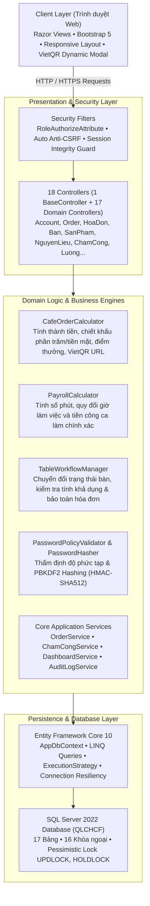

# WebQLCHCF — Hệ Thống POS Quán Cà Phê, Quản Trị Kho & Nhân Sự Đa Phân Hệ

[](https://github.com/nguyenxp3n/WebQLCHCF/actions/workflows/ci.yml)


> **WebQLCHCF** là giải pháp phần mềm quản lý toàn diện dành cho chuỗi quán cà phê và điểm bán lẻ ẩm thực (F&B). Dự án được thiết kế chuẩn mực theo kiến trúc **4-Tier Clean MVC** trên nền tảng **.NET 10 (C# 14)** kết hợp **Entity Framework Core 10** và **SQL Server 2022 Enterprise**, đóng gói hoàn chỉnh bằng **Docker Compose** và xác thực chất lượng với **355 ca kiểm thử tự động (xUnit)**.

---

## 📑 Mục Lục
- [1. Điểm Nhấn Công Nghệ (Tech Highlights)](#1-điểm-nhấn-công-nghệ-tech-highlights)
- [2. Danh Sách Tính Năng Chi Tiết (Feature Catalog)](#2-danh-sách-tính-năng-chi-tiết-feature-catalog)
  - [2.1. Phân hệ Bán Hàng & POS Tại Quầy](#21-phân-hệ-bán-hàng--pos-tại-quầy)
  - [2.2. Phân hệ Quản Lý Bàn & Điều Phối Bàn](#22-phân-hệ-quản-lý-bàn--điều-phối-bàn)
  - [2.3. Phân hệ Quản Lý Kho & Công Thức Định Lượng](#23-phân-hệ-quản-lý-kho--công-thức-định-lượng)
  - [2.4. Phân hệ Nhân Sự, Ca Làm & Bảng Lương](#24-phân-hệ-nhân-sự-ca-làm--bảng-lương)
  - [2.5. Phân hệ Khách Hàng, Khuyến Mãi & Tích Điểm](#25-phân-hệ-khách-hàng-khuyến-mãi--tích-điểm)
  - [2.6. Phân hệ Báo Cáo & Nhật Ký Kiểm Toán (Audit Log)](#26-phân-hệ-báo-cáo--nhật-ký-kiểm-toán-audit-log)
- [3. Ma Trận Phân Quyền Vai Trò (Role-Based Matrix)](#3-ma-trận-phân-quyền-vai-trò-role-based-matrix)
- [4. Kiến Trúc Phần Mềm (4-Tier Architecture)](#4-kiến-trúc-phần-mềm-4-tier-architecture)
- [5. Sơ Đồ Thực Thể CSDL (Mermaid ERD - 17 Bảng)](#5-sơ-đồ-thực-thể-csdl-mermaid-erd---17-bảng)
- [6. Tiêu Chuẩn Kỹ Thuật & Giải Pháp Chuyên Sâu](#6-tiêu-chuẩn-kỹ-thuật--giải-pháp-chuyên-sâu)
- [7. Bộ Kiểm Thử Tự Động (Automated Testing Suite)](#7-bộ-kiểm-thử-tự-động-automated-testing-suite)
- [8. Hướng Dẫn Cài Đặt & Chạy Nhanh (Quick Start)](#8-hướng-dẫn-cài-đặt--chạy-nhanh-quick-start)
- [9. Kịch Bản Trải Nghiệm Demo Trong 3 Phút](#9-kịch-bản-trải-nghiệm-demo-trong-3-phút)

---

## 1. Điểm Nhấn Công Nghệ (Tech Highlights)

* **Hiệu Năng & Khả Năng Mở Rộng (.NET 10 + EF Core 10):** Tận dụng tối đa C# 14, Asynchronous/Await không chặn I/O, LINQ tối ưu với `AsNoTracking()`, Transaction linh hoạt hỗ trợ `ExecutionStrategy` với Connection Resiliency tự động khôi phục kết nối.
* **Xử Lý Đồng Thời Chuẩn Doanh Nghiệp (Pessimistic Concurrency):** Áp dụng khóa bi quan `WITH (UPDLOCK, HOLDLOCK)` ở các giao dịch nhạy cảm (Check-out ca làm, khóa hóa đơn, thanh toán) triệt tiêu hoàn toàn rủi ro Race Condition khi nhiều nhân viên thao tác đồng thời.
* **Thanh Toán Không Tiếp Xúc VietQR Động:** Tích hợp trực tiếp chuẩn Napas 24/7 sinh mã QR chuyển khoản theo thời gian thực chứa chính xác mã đơn hàng và số tiền, cập nhật trạng thái đơn ngay tức thì.
* **Tự Động Trừ Tồn Kho Theo Định Lượng:** Mỗi khi đơn hàng hoàn tất thanh toán, hệ thống tự động tính toán theo bảng công thức pha chế (`CongThuc`) và trừ chính xác lượng tồn kho nguyên liệu (`NguyenLieu.TonKho`).
* **Bảo Mật Đa Lớp (Enterprise Security):**
  * Mã hóa mật khẩu chuẩn PBKDF2 (HMAC-SHA512, 100.000 vòng lặp) với cơ chế tự động nâng cấp mã hóa (Auto-Rehash) khi người dùng đăng nhập.
  * Bộ lọc phân quyền tĩnh và động `[RoleAuthorize]` kiểm soát truy cập từ cấp độ Controller đến Action.
  * 100% POST endpoints được bảo vệ bởi Anti-CSRF Token (`[ValidateAntiForgeryToken]`).
  * Khử toàn bộ lỗ hổng Reflected XSS, kiểm toán dữ liệu vào/ra nghiêm ngặt.
* **100% Container Hóa (Docker Compose):** Khởi chạy toàn bộ hệ sinh thái (Web Server + SQL Server 2022 + Database Seeder tự động) chỉ bằng một câu lệnh duy nhất.

---

## 2. Danh Sách Tính Năng Chi Tiết (Feature Catalog)

### 2.1. Phân hệ Bán Hàng & POS Tại Quầy
* **Giao diện bán hàng tối ưu:** Chọn món nhanh bằng hình ảnh trực quan, hỗ trợ điều chỉnh số lượng linh hoạt, áp dụng ghi chú cho từng đơn (ví dụ: ít đường, không đá).
* **Điều phối hình thức phục vụ:**
  * **Tại quán:** Tự động lọc và gợi ý bàn trống theo từng khu vực (Tầng trệt, Tầng lửng), tự động chuyển trạng thái bàn sang `Đang phục vụ`.
  * **Mang về:** Tự động gán mã bàn mang về mặc định (`BAN00`) mà không chiếm dụng bàn của quán.
* **Thanh toán linh hoạt:**
  * **Tiền mặt (Cash):** Thu ngân xác nhận thu tiền, in biên lai, đóng trạng thái đơn và tích điểm khách hàng.
  * **Chuyển khoản VietQR:** Hiển thị popup mã QR động có logo ngân hàng, số tài khoản, số tiền và nội dung chuyển khoản chuẩn format. Có nút xác nhận thanh toán an toàn.
* **Bảo toàn tính toàn vẹn đơn hàng:** Khóa bất biến đối với các đơn đã thanh toán (`DaThanhToan`), ngăn chặn mọi hành vi gian lận sửa đổi chi tiết món hoặc số tiền sau khi đã thu tiền.
* **Tự động trừ kho:** Kích hoạt cơ chế trừ kho nguyên liệu tự động ngay sau khi thanh toán thành công theo công thức định lượng của sản phẩm.

### 2.2. Phân hệ Quản Lý Bàn & Điều Phối Bàn
* **Sơ đồ bàn trực quan:** Hiển thị trực quan danh sách bàn phân loại theo khu vực (`Tầng trệt`, `Tầng lửng`), thể hiện rõ ràng trạng thái: `Trống` (xanh) hoặc `Đang phục vụ` (cam).
* **Xem đơn đang ngồi tại bàn:** Nhấp vào bàn đang có khách để xem nhanh hóa đơn chưa thanh toán, danh sách món và tổng tiền tạm tính.
* **Khôi phục bàn trống nhanh (Customer Leaves / Restore):** Khi khách thanh toán xong hoặc rời quán, thu ngân/phục vụ bấm 1 chạm nút **"Khôi phục"** để chuyển bàn về lại trạng thái `Trống`, sẵn sàng đón lượt khách tiếp theo.

### 2.3. Phân hệ Quản Lý Kho & Công Thức Định Lượng
* **Danh mục nguyên liệu (`NguyenLieu`):** Quản lý tên nguyên liệu, đơn vị tính (g, ml, gói, lon...), số lượng tồn kho thực tế và cảnh báo khi mức tồn xuống thấp.
* **Phiếu nhập kho (`PhieuNhap` & `CTPN`):** Tạo phiếu nhập hàng mới từ nhà cung cấp, ghi nhận số lượng, đơn vị giá, ngày nhập và người tạo phiếu. Tự động cập nhật số dư tồn kho nguyên liệu an toàn qua transaction.
* **Công thức pha chế (`CongThuc`):** Thiết lập định lượng chi tiết cho từng loại thức uống (ví dụ: 1 ly Bạc xỉu = 25g Cà phê hạt + 40ml Sữa đặc + 50ml Sữa tươi). Giúp chủ quán kiểm soát chính xác hao hụt và chi phí giá vốn (COGS).

### 2.4. Phân hệ Nhân Sự, Ca Làm & Bảng Lương
* **Quản lý hồ sơ nhân viên (`NhanVien`):** Lưu trữ thông tin cá nhân, chức vụ, số điện thoại, ngày sinh và liên kết bậc lương.
* **Chấm công tự động thông minh (`ChamCong`):**
  * Tự động Check-in ngay khi nhân viên đăng nhập vào hệ thống POS.
  * Hiển thị thời gian ca làm việc trực quan trên thanh tiêu đề (Header): *"Đang ca: X giờ Y phút"*.
  * Hỗ trợ nút Check-out chủ động khi kết thúc ca.
* **Bộ máy tính lương chính xác theo phút (`PayrollCalculator`):**
  * Tính tiền công ca làm chính xác tới từng phút theo công thức: `(Số phút làm việc / 60) * Đơn giá giờ`.
  * Khử triệt để sai số làm tròn thập phân giữa mã nguồn C# và cơ sở dữ liệu SQL Server.
  * Tổng hợp bảng lương hàng tháng (`LuongController`) theo từng nhân viên.

### 2.5. Phân hệ Khách Hàng, Khuyến Mãi & Tích Điểm
* **Khách hàng thân thiết (`KhachHang`):** Tìm kiếm khách hàng siêu tốc theo 3 số cuối điện thoại. Tự động cộng điểm tích lũy theo tỷ lệ 10.000 VNĐ = 1 điểm khi thanh toán thành công.
* **Chương trình khuyến mãi (`KhuyenMai`):**
  * Thiết lập mã giảm giá theo tỷ lệ phần trăm (%) hoặc số tiền cố định (VNĐ).
  * Kiểm soát thời gian hiệu lực nghiêm ngặt (Ngày bắt đầu $\le$ Ngày kết thúc). Tự động từ chối nếu mã đã hết hạn hoặc chưa tới ngày áp dụng.
  * Khi hủy đơn hàng, hệ thống tự động hoàn lại số điểm tích lũy đã cấp, bảo đảm không bị trục lợi điểm thưởng.

### 2.6. Phân hệ Báo Cáo & Nhật Ký Kiểm Toán (Audit Log)
* **Tổng quan Dashboard:** Thống kê doanh thu theo ngày/tháng, số lượng hóa đơn phát sinh, số bàn đang phục vụ và biểu đồ cơ cấu doanh thu.
* **Hệ thống Audit Log độc lập:** Tự động ghi nhận mọi hành động trọng yếu (Thêm đơn, Sửa đơn, Hủy đơn, Nhập kho, Đăng nhập sai, Đổi quyền) kèm thời gian, IP và tài khoản thao tác, phục vụ công tác thanh tra gian lận nội bộ.

---

## 3. Ma Trận Phân Quyền Vai Trò (Role-Based Matrix)

Hệ thống thiết lập 3 vai trò độc lập, phân định trách nhiệm rõ ràng:

| Phân hệ / Chức năng | Quản Lý (`QuanLy`) | Phục Vụ (`PhucVu`) | Pha Chế (`PhaChe`) | Ghi chú bảo mật |
| :--- | :---: | :---: | :---: | :--- |
| **Tổng quan Dashboard** | ✅ Toàn quyền | ❌ Chặn URL | ❌ Chặn URL | Phân tích doanh thu & KPI kinh doanh |
| **Bán hàng & POS Tại Quầy** | ✅ Hỗ trợ | ✅ Chính (Tạo & Thu) | ❌ Chặn URL | Phục vụ trực tiếp tại quầy |
| **Quản lý Hóa Đơn & Chi Tiết** | ✅ Toàn quyền | ✅ Xem & Thanh toán | ❌ Chặn URL | Khóa sửa đổi khi đã thanh toán |
| **Quản lý Bàn & Trạng thái** | ✅ Toàn quyền | ✅ Đổi bàn / Khôi phục | ❌ Chặn URL | Đồng bộ thời gian thực |
| **Khách Hàng & Điểm Thưởng** | ✅ Toàn quyền | ✅ Tra cứu / Thêm mới | ❌ Chặn URL | Tìm theo SĐT |
| **Quản lý Sản Phẩm & Loại SP** | ✅ Toàn quyền | 👁️ Chỉ xem menu | 👁️ Chỉ xem menu | Chặn sửa đơn giá |
| **Khuyến Mãi & Giảm Giá** | ✅ Toàn quyền | 👁️ Chỉ chọn mã | ❌ Chặn URL | Kiểm tra thời hạn hiệu lực |
| **Nguyên Liệu & Định Lượng Kho** | ✅ Toàn quyền | ❌ Chặn URL | ✅ Xem & Quản lý | Kiểm tra mức tồn kho pha chế |
| **Phiếu Nhập Hàng Tồn Kho** | ✅ Toàn quyền | ❌ Chặn URL | ❌ Chặn URL | Quản lý hóa đơn nhập nguyên liệu |
| **Công Thức Pha Chế** | ✅ Toàn quyền | ❌ Chặn URL | ✅ Xem công thức | Định lượng nguyên liệu thức uống |
| **Nhân Sự & Bậc Lương** | ✅ Toàn quyền | ❌ Chặn URL | ❌ Chặn URL | Quản lý thông tin & mức lương |
| **Chấm Công Cá Nhân** | ✅ Toàn quyền | ✅ Xem ca & Check-out | ✅ Xem ca & Check-out | Tự động Check-in khi đăng nhập |
| **Tài Khoản & Phân Quyền** | ✅ Toàn quyền | ❌ Chặn URL | ❌ Chặn URL | Bắt buộc mật khẩu độ phức tạp cao |
| **Nhật Ký Kiểm Toán (Audit Log)** | ✅ Toàn quyền | ❌ Chặn URL | ❌ Chặn URL | Ghi vết tự động không thể xóa |

---

## 4. Kiến Trúc Phần Mềm (4-Tier Architecture)



---

## 5. Sơ Đồ Thực Thể CSDL (Mermaid ERD - 17 Bảng)

Sơ đồ ERD đối chiếu chuẩn xác 100% theo Single Source of Truth từ [`database/init.sql`](database/init.sql):


---

## 6. Tiêu Chuẩn Kỹ Thuật & Giải Pháp Chuyên Sâu

### 1. Phân quyền đa vai trò nghiêm ngặt (Role-Based Access Control)
* Triển khai bộ lọc tùy biến `RoleAuthorizeAttribute` chặn các truy cập trái phép trực tiếp bằng URL ở tầng trước khi Controller thực thi.
* Giao diện Razor View tự động ẩn các menu điều hướng không thuộc thẩm quyền của vai trò hiện tại (ví dụ: Nhân viên Pha chế hoàn toàn không thấy menu Bán hàng, Bàn, Khách hàng).

### 2. Khóa bi quan chống tranh chấp dữ liệu (Pessimistic Concurrency Control)
* Stored Procedure `ChamCong_CheckOut` và các nghiệp vụ hóa đơn nhạy cảm sử dụng gợi ý khóa SQL Server: `WITH (UPDLOCK, HOLDLOCK)`. Điều này bảo đảm dữ liệu ca làm việc không bị ghi đè hay tính sai tiền công khi phát sinh các thao tác đồng thời.

### 3. Tương thích Connection Resiliency với Execution Strategy
* Cấu hình `EnableRetryOnFailure` trong EF Core đảm bảo hệ thống tự phục hồi khi kết nối cơ sở dữ liệu tạm thời gián đoạn.
* Toàn bộ các transaction thủ công được bao bọc chuẩn chỉnh qua `_context.Database.CreateExecutionStrategy().ExecuteAsync(...)` giải quyết dứt điểm các lỗi giao dịch không tương thích.

### 4. Tách biệt Pure Domain Engine
* Toàn bộ logic tính toán tiền nong, chiết khấu, tích điểm và giờ làm được tách riêng thành các Pure C# Class độc lập không phụ thuộc vào Web hay Database context (`CafeOrderCalculator`, `PayrollCalculator`). Cấu trúc này giúp viết Unit Test cô lập với tốc độ thực thi siêu tốc (dưới 10ms).

---

## 7. Bộ Kiểm Thử Tự Động (Automated Testing Suite)

Dự án sở hữu bộ kiểm thử tự động toàn diện được tích hợp vào đường ống CI/CD:
* **Tổng số ca kiểm thử:** **355/355 test cases đạt 100% Passed** (Thời gian chạy: ~3 giây).
* **Khung kiểm thử:** xUnit, FluentAssertions, ASP.NET Core Test Harness.

```text
Passed!  - Failed: 0, Passed: 355, Skipped: 0, Total: 355, Duration: 3 s - WebQLCHCF.Tests.dll
```

### Các nhóm kiểm thử chuyên sâu:
1. **Kiểm thử kiến trúc bằng Reflection (`SecurityArchitectureTests`):** Quét toàn bộ 18 Controllers trong ứng dụng, bảo đảm 100% Controller được gán thuộc tính `[RoleAuthorize]`, các action đọc có `[HttpGet]`, và các action cập nhật dữ liệu POST đều có `[ValidateAntiForgeryToken]`.
2. **Kiểm thử tính bất biến của hóa đơn (`InvoiceImmutabilityTests`):** Kiểm tra chặn tuyệt đối không cho phép thêm, sửa, xóa món trên hóa đơn đã ở trạng thái hoàn tất thanh toán (`DaThanhToan`).
3. **Kiểm thử luồng tích lũy & hoàn điểm (`LoyaltyPointsWorkflowTests`):** Kiểm thử quy trình cộng điểm khi thanh toán thành công và tự động trừ điểm thưởng an toàn khi đơn bị hủy.
4. **Kiểm thử tính lương chính xác theo phút (`PayrollPrecisionTests`):** Kiểm thử khớp 100% giá trị tiền công giữa C# và SQL Server qua hơn 2.400 phút ca làm việc giả lập.
5. **Kiểm thử biên & Tiêm lỗi đối kháng (`FaultInjectionBoundaryTests`):** Kiểm tra phản ứng của hệ thống khi đơn giá âm, số lượng = 0, giỏ hàng rỗng, sản phẩm ngưng bán, hoặc ngày khuyến mãi không hợp lệ.
6. **Kiểm thử mã hóa & An toàn tài khoản (`PasswordHasherServiceTests`):** Kiểm tra độ ngẫu nhiên của Salt, cơ chế băm PBKDF2 100.000 vòng, và kiểm tra tương thích ngược khi nâng cấp mật khẩu cũ.
7. **Kiểm thử ánh xạ mô hình EF Core & Database (`SqlServerIntegrationTests`):** Kiểm tra 100% khóa chính, khóa ngoại, cấu hình bảng của 17 thực thể domain.

---

## 8. Hướng Dẫn Cài Đặt & Chạy Nhanh (Quick Start)

### Yêu cầu tiên quyết
* Đã cài đặt [Docker Desktop](https://www.docker.com/products/docker-desktop/) **hoặc** [.NET 10 SDK](https://dotnet.microsoft.com/) kèm [SQL Server 2022](https://www.microsoft.com/en-us/sql-server).

### Cách 1: Chạy bằng Docker Compose (Khuyến nghị 1 chạm)

```bash
# 1. Clone repository về máy
git clone https://github.com/nguyenxp3n/WebQLCHCF.git
cd WebQLCHCF

# 2. Khởi tạo file môi trường
cp .env.example .env

# 3. Khởi chạy toàn bộ cụm container (SQL Server + Khởi tạo DB tự động + Web App)
docker compose up --build -d
```

Ứng dụng sẽ sẵn sàng hoạt động tại: **`http://localhost:8081`**

---

### Cách 2: Chạy cục bộ cho Lập trình viên (.NET CLI)

```bash
# 1. Khởi tạo database trong SQL Server Management Studio (SSMS) bằng script:
database/init.sql

# 2. Chạy bộ kiểm thử tự động
dotnet test WebQLCHCF.slnx

# 3. Chạy ứng dụng web
dotnet run --project src/WebQLCHCF/WebQLCHCF.csproj
```

---

## 9. Kịch Bản Trải Nghiệm Demo Trong 3 Phút

### Danh sách tài khoản thử nghiệm mẫu:

| Tài khoản | Mật khẩu | Nhân viên | Vai trò | Trải nghiệm gợi ý |
| :--- | :--- | :--- | :--- | :--- |
| `qly_tram` | `12345678` | NV01 (Trâm) | **Quản Lý** | Xem Dashboard doanh thu, xem bảng lương, nhật ký Audit Log |
| `pv_tu` | `12345678` | NV04 (Tú) | **Phục Vụ** | Tạo đơn tại quầy, chọn món Bạc xỉu, thanh toán VietQR, khôi phục bàn |
| `pc_mai` | `12345678` | NV02 (Mai) | **Pha Chế** | Xem danh mục nguyên liệu, kiểm tra công thức pha chế đồ uống |

### Các bước demo nhanh:
1. Đăng nhập bằng tài khoản phục vụ: `pv_tu` / `12345678`.
2. Vào **Order Tại Quầy**:
   * Chọn 2 ly **Bạc xỉu**.
   * Hệ thống tự động chọn bàn trống tiếp theo (**Bàn 01 - BAN01**).
   * Bấm **Tạo đơn hàng**.
3. Tại màn hình hóa đơn:
   * Bấm nút **VietQR** để mở popup mã QR động chuyển khoản thực tế.
   * Hoặc bấm **Tiền mặt** để hoàn tất đơn hàng.
4. Vào **Quản Lý Bàn**:
   * Kiểm tra bàn chuyển sang trạng thái cần dọn dẹp $\rightarrow$ bấm nút **Khôi phục** để đưa bàn về lại trạng thái `Trống`.
5. Đăng xuất và đăng nhập lại bằng `qly_tram` / `12345678` để xem biểu đồ doanh thu và lịch sử ghi nhận trong **Audit Log**.

---

## 👨‍💻 Thông Tin Dự Án & Tác Giả
* **Dự án:** Web Quản Lý Cửa Hàng Cà Phê (WebQLCHCF)
* **Mã nguồn:** [https://github.com/nguyenxp3n/WebQLCHCF](https://github.com/nguyenxp3n/WebQLCHCF)
* **Ngôn ngữ & Nền tảng:** C# 14 / .NET 10 / ASP.NET Core MVC / EF Core 10 / SQL Server 2022
* **Kiểm thử:** xUnit (355 Unit & Integration Tests)
* **Bản quyền:** Mã nguồn phục vụ mục đích học tập, nghiên cứu và chứng minh năng lực kỹ thuật trên CV cá nhân.
