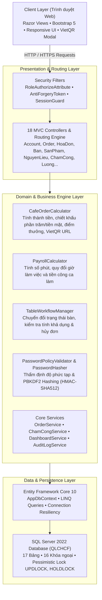
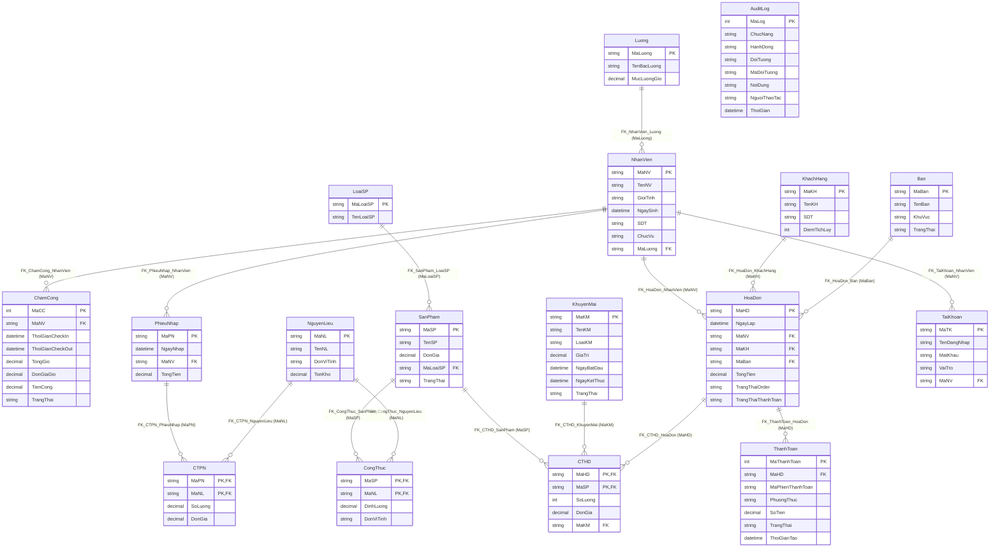

# WebQLCHCF — Hệ Thống Quản Lý Quán Cà Phê & Chấm Công POS

[](https://github.com/nguyenxp3n/WebQLCHCF/actions/workflows/ci.yml)


> **Dự án thực hành chuyên sâu:** Xây dựng hệ thống quản lý bán hàng tại quầy (POS), điều phối bàn thời gian thực, quản lý kho nguyên liệu theo định lượng công thức, chấm công tự động theo ca và tích hợp thanh toán mã động VietQR.

---

## 1. Kiến Trúc Hệ Thống (4-Tier Architecture)



---

## 2. Sơ Đồ Thực Thể Quan Hệ (Mermaid ERD - 17 Bảng)

Sơ đồ ERD đối chiếu chuẩn xác 100% theo Single Source of Truth từ [`database/init.sql`](database/init.sql):



---

## 3. Các Giải Pháp Kỹ Thuật Đã Triển Khai

1. **Phân quyền người dùng theo vai trò (Role-Based Access Control):**
   * Định danh rõ ràng 3 phân hệ: `Quản Lý`, `Pha Chế`, `Phục Vụ` qua lớp `AppRoles`.
   * Sử dụng `RoleAuthorizeAttribute` chặn truy cập trực tiếp bằng URL ở tầng bộ lọc Action Filter.
2. **Kiểm soát đồng thời (Concurrency Control):**
   * Stored Procedure `ChamCong_CheckOut` kích hoạt khóa bi quan `WITH (UPDLOCK, HOLDLOCK)` đảm bảo không bị xung đột tính ca khi nhân viên check-out đồng thời.
3. **Thanh toán VietQR động không tiếp xúc:**
   * Sinh mã chuyển khoản chuẩn định dạng VietQR kèm mã đơn hàng và số tiền chính xác, giảm thiểu sai sót đối soát.
4. **Tách biệt Domain Engine phục vụ kiểm thử:**
   * Tách logic tính giá tiền, khấu trừ khuyến mãi và tích lũy điểm thưởng thành `CafeOrderCalculator`.
   * Tách tính giờ làm và lương ca thành `PayrollCalculator`.
5. **Kiểm thử tự động đa tầng (Automated Testing Suite):**
   * Bộ kiểm thử xUnit với **354 test cases** bao phủ toàn bộ các trường hợp biên: đơn giá âm, số lượng = 0, chiết khấu vượt quá 100%, ca làm qua đêm, độ phức tạp mật khẩu và kiểm tra phân quyền.

---

## 4. Hướng Dẫn Khởi Chạy (Quick Start)

### Yêu cầu môi trường
* Đã cài đặt [Docker Desktop](https://www.docker.com/products/docker-desktop/) **hoặc** [.NET 10 SDK](https://dotnet.microsoft.com/) kèm [SQL Server 2022](https://www.microsoft.com/en-us/sql-server).

### Cách 1: Triển khai một chạm với Docker Compose (Khuyến nghị)

#### Dành cho Windows (PowerShell):
```powershell
# 1. Sao chép biến môi trường mẫu
Copy-Item .env.example .env

# 2. Khởi động toàn bộ cụm dịch vụ (SQL Server + Web)
docker compose up --build -d

# 3. Theo dõi log khởi tạo database
docker compose logs -f db-init
```

#### Dành cho Linux / macOS / Git Bash:
```bash
# 1. Sao chép biến môi trường mẫu
cp .env.example .env

# 2. Khởi động dịch vụ
docker compose up --build -d

# 3. Theo dõi log khởi tạo database
docker compose logs -f db-init
```

Truy cập ứng dụng tại: **`http://localhost:8081`**

---

### Cách 2: Chạy trực tiếp trên máy cục bộ (Local Development)

```bash
# 1. Khởi tạo database QLCHCF từ file SQL
# Mở SQL Server Management Studio (SSMS) và thực thi script: database/init.sql

# 2. Chạy bộ kiểm thử tự động
dotnet test WebQLCHCF.slnx

# 3. Chạy ứng dụng web
dotnet run --project src/WebQLCHCF/WebQLCHCF.csproj
```

---

## 5. Tài Khoản Thử Nghiệm Mẫu

| Tài khoản | Mật khẩu | Nhân viên | Vai trò | Quyền hạn chính |
| :--- | :--- | :--- | :--- | :--- |
| `qly_tram` | `12345678` | NV01 (Khánh Trâm) | **Quản Lý** | Toàn quyền: Thống kê, Báo cáo, Nhân sự, Lương, Khuyến mãi, Audit Log |
| `pc_mai` | `12345678` | NV02 (Thanh Mai) | **Pha Chế** | Quản lý định lượng nguyên liệu, xem đơn chế biến |
| `pv_tu` | `12345678` | NV04 (Thanh Tú) | **Phục Vụ** | Lập order tại quầy, quản lý bàn, thu tiền mặt & kích hoạt VietQR |

---

## 6. Bộ Kiểm Thử Tự Động & Tiêu Chuẩn Chất Lượng (QA Standards)

* **Bộ kiểm thử tự động xUnit**: **354/354 test cases Passed 100%** (Thời gian chạy: ~48ms).
* **Độ bao phủ kiểm thử**:
  * **Kiểm thử kiến trúc Reflection (`SecurityArchitectureTests`)**: Quét toàn bộ 18 Controller trong assembly, bảo đảm 100% Controller có thuộc tính `[RoleAuthorize]` (hoặc `[AllowAnonymous]`), action đọc có `[HttpGet]`, và action POST có `[ValidateAntiForgeryToken]`.
  * **Tính bất biến hóa đơn (`InvoiceImmutabilityTests`)**: Bảo vệ hóa đơn đã thanh toán (`DaThanhToan`) không thể bị sửa, thêm hoặc xóa dòng món.
  * **Quy trình điểm thưởng (`LoyaltyPointsWorkflowTests`)**: Xác nhận điểm thưởng chỉ được tích khi thanh toán hoàn tất và tự động hoàn trả khi hủy đơn.
  * **Ràng buộc khuyến mãi (`PromotionDateValidationTests`)**: Kiểm tra biên ngày bắt đầu và kết thúc.
  * **Tính lương chính xác theo phút (`PayrollPrecisionTests`)**: Khử hoàn toàn độ lệch làm tròn tiền lương giữa C# và SQL Server qua 2.400 phút mô phỏng.
  * **Kiểm thử đối kháng (`ChallengerM2EmpiricalTests`)**: Thử nghiệm tấn công vượt quyền và kiểm tra khóa bi quan chống race condition.
  * **Bảo mật & Mã hóa mật khẩu (`PasswordHasherServiceTests`, `AccountSecurityIntegrationTests`)**: Kiểm tra thuật toán PBKDF2 (HMAC-SHA512/256 + 100.000 iterations), cơ chế tương thích ngược và tự động rehash mật khẩu cũ khi đăng nhập.
  * **Kiểm thử tích hợp CSDL SQL Server (`SqlServerIntegrationTests`)**: Kiểm tra toàn vẹn mô hình 17 thực thể, khóa chính, ràng buộc và khả năng kết nối SQL Server thực tế.
* **Đường ống CI/CD**: Tự động hóa hoàn toàn với GitHub Actions, build và test trên môi trường Ubuntu container mỗi lần push hoặc tạo PR.
