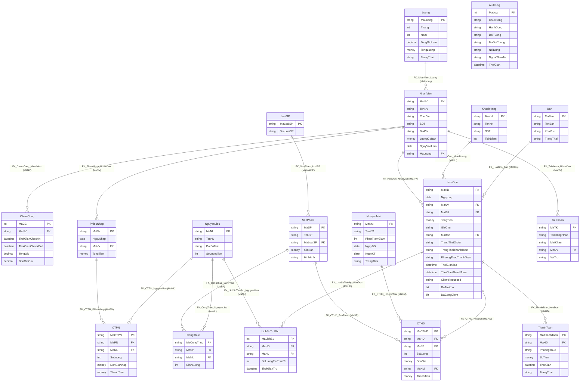
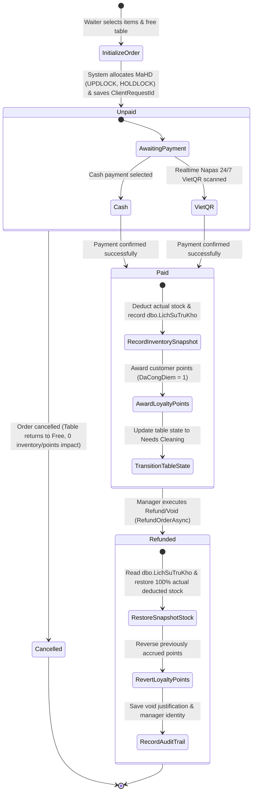

# WebQLCHCF — Multi-Subsystem Coffee Shop POS, Inventory & HR Management Platform

[](https://github.com/nguyenxp3n/WebQLCHCF/actions/workflows/ci.yml)


-brightgreen?logo=xunit)


<div align="center">

**Language / Ngôn ngữ:** [Tiếng Việt (Primary)](README.md) | **English**

</div>

> [!NOTE]
> 👥 **Project Type:** **Group Academic Project (Team of 5)**  
> 💻 **Personal Responsibility:** **System Development** (Directly architected and engineered end-to-end software solutions across ASP.NET Core MVC, developed responsive user interaction flows, streamlined POS cashier operations, integrated dynamic VietQR payment modals, visual table management, and comprehensive administrative modules).

> **WebQLCHCF** is an enterprise-grade management solution designed for coffee shop chains and food & beverage (F&B) retail outlets (a mini-ERP & POS system). The project is engineered following a strict **4-Tier Clean MVC Architecture** built on **.NET 10 (C# 14)**, **Entity Framework Core 10**, and **SQL Server 2022 Enterprise**, fully containerized via **Docker Compose**, and verified with **394 automated xUnit test cases (100% Pass Rate)** executed on GitHub Actions CI/CD pipelines.

---

## 📑 Table of Contents
- [1. Technical Highlights](#1-technical-highlights)
- [2. 18 Domain Entities Catalog](#2-18-domain-entities-catalog)
- [3. Subsystems & Feature Catalog](#3-subsystems--feature-catalog)
  - [3.1. Counter POS & Sales Subsystem](#31-counter-pos--sales-subsystem)
  - [3.2. Table Operations & Dispatching Subsystem](#32-table-operations--dispatching-subsystem)
  - [3.3. Inventory, Recipe Formulas & Immutable Snapshot Subsystem](#33-inventory-recipe-formulas--immutable-snapshot-subsystem)
  - [3.4. HR, Time Attendance & Minute-Precision Payroll Subsystem](#34-hr-time-attendance--minute-precision-payroll-subsystem)
  - [3.5. Customer Loyalty, Promotions & Idempotent Points Subsystem](#35-customer-loyalty-promotions--idempotent-points-subsystem)
  - [3.6. Reporting, Analytics & Security Audit Log Subsystem](#36-reporting-analytics--security-audit-log-subsystem)
  - [3.7. Security, Cryptography & Authentication Subsystem](#37-security-cryptography--authentication-subsystem)
- [4. Role-Based Access Control (RBAC) Matrix](#4-role-based-access-control-rbac-matrix)
- [5. Software Architecture & Design Diagrams](#5-software-architecture--design-diagrams)
  - [5.1. Clean 4-Tier Architecture Diagram](#51-clean-4-tier-architecture-diagram)
  - [5.2. Database Entity Relationship Diagram (Mermaid ERD - 18 Tables)](#52-database-entity-relationship-diagram-mermaid-erd---18-tables)
  - [5.3. Order Lifecycle & Inventory State Machine](#53-order-lifecycle--inventory-state-machine)
- [6. Technical Deep-Dive & Engineering Decisions](#6-technical-deep-dive--engineering-decisions)
- [7. Operations & CLI Command Catalog](#7-operations--cli-command-catalog)
- [8. Automated Testing Suite (394 Tests)](#8-automated-testing-suite-394-tests)
- [9. Quick Start Guide](#9-quick-start-guide)
- [10. 3-Minute Demo Walkthrough](#10-3-minute-demo-walkthrough)

---

## 1. Technical Highlights

* **High Performance & Scalability (.NET 10 + EF Core 10):** Maximizes C# 14 capabilities, non-blocking asynchronous I/O (`async/await`), optimized LINQ with `AsNoTracking()`, and resilient execution strategies with automatic connection recovery on transient faults.
* **Enterprise Concurrency Handling (Pessimistic Locking):** Employs pessimistic locking hints `WITH (UPDLOCK, HOLDLOCK)` in mission-critical transactions (non-colliding invoice code generation, payment processing, table clearing) to eliminate race conditions under concurrent cashier requests.
* **3-Tier Idempotency Token Architecture:** Tracks request idempotency via `ClientRequestId` (UUID v4 36-char) from client UI through service layer down to database level using Unique Partial Index `UX_HoaDon_ClientRequestId`, completely neutralizing double-tap or network retry duplicate orders.
* **Immutable Inventory Deduct Snapshot (`dbo.LichSuTruKho`):** Captures the exact quantity of raw materials physically deducted (`SoLuongTruThucTe`) at the moment of payment. Refund operations read exclusively from the snapshot, preventing phantom refunds when initial stock was insufficient and remaining completely decoupled from future recipe changes.
* **Idempotent Post-Payment & Loyalty Points:** Dedicated `DaTruKho` and `DaCongDiem` flags on `HoaDon` coupled with background reconciliation `ReconcilePendingPostPaymentAsync` guarantee zero duplicate point accruals or double stock subtractions during network anomalies.
* **Clear Segregation Between Order Cancellation & Refund/Void:** Strict boundary between `CancelOrderAsync` (canceling unpaid orders by Waiters/Managers) and `RefundOrderAsync` (refunding/voiding paid invoices, an exclusive privilege reserved for Managers with mandatory Audit Logging).
* **Minute-Precision Payroll Engine (`TinhTienCongTuPhut`):** Computes employee wages based on exact elapsed shift minutes, preventing fractional hour rounding biases and guaranteeing fair compensation.
* **Contactless Dynamic VietQR Integration:** Real-time generation of VietQR (Napas 24/7) containing precise invoice identifiers and net payable amounts, supporting both QR transfers and traditional cash handling.
* **Bank-Grade Security:** PBKDF2 password hashing (SHA-256, 100,000 iterations, 128-bit salt), automatic account lockout after 5 consecutive failed attempts, complete suppression of password hashes in edit views, Anti-CSRF on 100% POST endpoints, and comprehensive Audit Logging (`AuditLog`).

---

## 2. 18 Domain Entities Catalog

The domain architecture is strictly normalized across 18 domain entities mapped directly to SQL Server relational tables:

| # | Entity Model (C#) | Database Table | Primary Key (PK) | Foreign Keys (FK) & Relations | Business Responsibility |
| :-: | :--- | :--- | :--- | :--- | :--- |
| 1 | `AuditLog` | `dbo.AuditLog` | `MaLog` (int IDENTITY) | *Independent* | Security audit trail: tracks user identity, controller action, CRUD operations, client IP, and before/after JSON state snapshots. |
| 2 | `Ban` | `dbo.Ban` | `MaBan` (varchar(5)) | $1 \rightarrow N$ `HoaDon` | Physical tables catalog, location areas, and operational statuses (`Trống`, `Đang phục vụ`, `Cần dọn`). |
| 3 | `ChamCong` | `dbo.ChamCong` | `MaCC` (int IDENTITY) | `MaNV` $\rightarrow$ `NhanVien` | Shift attendance logs: tracks check-in/out timestamps, computed shift hours/minutes, and hourly wage rates. |
| 4 | `CongThuc` | `dbo.CongThuc` | `MaCongThuc` (varchar(5)) | `MaSP` $\rightarrow$ `SanPham`, `MaNL` $\rightarrow$ `NguyenLieu` | Bill of Materials (BOM) / Recipe formula: defines consumption ratio (`DinhLuong`) of each raw material per product unit. |
| 5 | `CTHD` | `dbo.CTHD` | `MaCTHD` (varchar(10)) | `MaHD` $\rightarrow$ `HoaDon`, `MaSP` $\rightarrow$ `SanPham`, `MaKM` $\rightarrow$ `KhuyenMai` | Invoice line item: sold quantity, historical unit price, applied promotion discount, and line total. Immutable once paid. |
| 6 | `CTPN` | `dbo.CTPN` | `MaCTPN` (varchar(10)) | `MaPN` $\rightarrow$ `PhieuNhap`, `MaNL` $\rightarrow$ `NguyenLieu` | Stock purchase order line item: received quantity, purchase unit cost, line total. Automatically increments stock inventory. |
| 7 | `HoaDon` | `dbo.HoaDon` | `MaHD` (varchar(9)) | `MaBan` $\rightarrow$ `Ban`, `MaNV` $\rightarrow$ `NhanVien`, `MaKH` $\rightarrow$ `KhachHang` | Central sales invoice: gross/net total, statuses (`ChuaThanhToan`, `DaThanhToan`, `DaHuy`), `ClientRequestId`, `DaTruKho`, `DaCongDiem`. |
| 8 | `KhachHang` | `dbo.KhachHang` | `MaKH` (varchar(5)) | $1 \rightarrow N$ `HoaDon` | Customer profile: contact phone number, membership tier, accumulated reward points (`TichDiem`), and purchasing history. |
| 9 | `KhuyenMai` | `dbo.KhuyenMai` | `MaKM` (varchar(5)) | $1 \rightarrow N$ `CTHD` | Marketing discount campaign: percentage discount rate (`PhanTramGiam`), start date, end date, and active status flag. |
| 10 | `LichSuTruKho` | `dbo.LichSuTruKho` | `MaLichSu` (int IDENTITY) | `MaHD` $\rightarrow$ `HoaDon`, `MaNL` $\rightarrow$ `NguyenLieu` | **Immutable Deduction Snapshot**: Records exact raw material quantities deducted (`SoLuongTruThucTe`) at payment for 100% accurate refunds. |
| 11 | `LoaiSP` | `dbo.LoaiSP` | `MaLoaiSP` (varchar(5)) | $1 \rightarrow N$ `SanPham` | Product category taxonomy (Coffee, Fruit Tea, Ice Blended, Pastries, Bottled Beverages). |
| 12 | `Luong` | `dbo.Luong` | `MaLuong` (varchar(5)) | $1 \rightarrow N$ `NhanVien` | Periodic payroll record: month/year, total working hours, net payable salary, and disbursement status. |
| 13 | `NguyenLieu` | `dbo.NguyenLieu` | `MaNL` (varchar(5)) | $1 \rightarrow N$ `CongThuc`, `CTPN`, `LichSuTruKho` | Raw material inventory: material name, unit of measurement (g, ml, pack), physical on-hand stock, and low-stock alert thresholds. |
| 14 | `NhanVien` | `dbo.NhanVien` | `MaNV` (varchar(5)) | `MaLuong` $\rightarrow$ `Luong`, $1 \rightarrow N$ `HoaDon`, `ChamCong`, `PhieuNhap` | Employee master record: full name, date of birth, job title, baseline salary, employment status. Linked 1:1 with `TaiKhoan`. |
| 15 | `PhieuNhap` | `dbo.PhieuNhap` | `MaPN` (varchar(5)) | `MaNV` $\rightarrow$ `NhanVien`, $1 \rightarrow N$ `CTPN` | Purchase receipt voucher: voucher ID, entry date, receiving staff, and supplier aggregate total. |
| 16 | `SanPham` | `dbo.SanPham` | `MaSP` (varchar(5)) | `MaLoaiSP` $\rightarrow$ `LoaiSP`, $1 \rightarrow N$ `CongThuc`, `CTHD` | Menu items catalog: product name, selling unit price, display image path, active sales availability. |
| 17 | `TaiKhoan` | `dbo.TaiKhoan` | `MaTK` (varchar(10)) | `MaNV` $\rightarrow$ `NhanVien` | User authentication account: username, 255-char PBKDF2 password hash, RBAC role (`QuanLy`, `PhaChe`, `PhucVu`), failed attempt counters. |
| 18 | `ThanhToan` | `dbo.ThanhToan` | `MaThanhToan` (varchar(10)) | `MaHD` $\rightarrow$ `HoaDon` | Transaction record: payment channel (`TienMat`, `ChuyenKhoan`), transacted amount, timestamp, and status (`DaThanhToan`, `DaHuy`). |

---

## 3. Subsystems & Feature Catalog

### 3.1. Counter POS & Sales Subsystem
* **High-Speed Counter POS Interface**: Instant keyword product search, category filtering, and cart quantity adjustments.
* **Automated Table Dispatching**: System automatically selects the nearest available clean table or allows custom waiter table assignment.
* **Collision-Free Invoice Code Generation**: Utilizes database transactions with `WITH (UPDLOCK, HOLDLOCK)` range locks on date prefixes (`HDyyyyMMdd...`) to eliminate code collision under heavy concurrency.
* **3-Tier Idempotency Token**: Browser generates UUID v4 `ClientRequestId` (36 characters); application verifies token before commit; SQL Server rejects collisions via Unique Index `UX_HoaDon_ClientRequestId`.
* **Multi-Modal Payment Handling**:
  * **Cash**: Instant change calculation based on tendered customer cash.
  * **Dynamic VietQR (Napas 24/7)**: Generates QR codes populated with exact bank credentials, invoice ID, and net amount.
* **Clear Segregation of Cancel vs. Refund/Void**:
  * Waiters may cancel **unpaid orders** immediately, clearing table occupancy.
  * Only **Managers** can perform order refunds/voids on **paid invoices**, which reverses stock deductions via snapshots, deducts loyalty points, and records full audit logs.

### 3.2. Table Operations & Dispatching Subsystem
* **3-Stage Table Lifecycle**:
  $$\text{Available (Trống)} \xrightarrow{\text{Create Order}} \text{Serving (Đang phục vụ)} \xrightarrow{\text{Payment Done}} \text{Needs Cleaning (Cần dọn)} \xrightarrow{\text{Cleaned}} \text{Available (Trống)}$$
* **Payment Guards**: Prevents clearing or resetting tables that possess open, unpaid invoices.
* **Concurrency-Safe Table Restore**: Clears EF Core change trackers and enforces transactional locks so multiple concurrent "Restore Table" clicks never throw `DbUpdateConcurrencyException`.

### 3.3. Inventory, Recipe Formulas & Immutable Snapshot Subsystem
* **Material Stock Tracking**: Real-time stock levels with measurement units (grams, milliliters) and automatic low-stock badge alerts.
* **Recipe Formulation (BOM)**: Flexible N-N mapping linking Products to Raw Materials with precise consumption ratios (e.g., 1 Milk Coffee = 25g coffee beans + 40ml condensed milk + 60ml fresh milk).
* **Purchase Orders & Automated Stock Increments**: Receive warehouse deliveries with auto-updating inventory balances.
* **Immutable Deduct Snapshots (`LichSuTruKho`)**:
  * During checkout, the system deducts available stock: $\text{actualDeduct} = \min(\text{currentStock}, \text{targetDeduct})$.
  * Ghes an immutable record into `LichSuTruKho`.
  * During order refund/void, the engine restores the exact `SoLuongTruThucTe` from the snapshot, **preventing phantom inventory gains** even if the drink formula was modified after sale.

### 3.4. HR, Time Attendance & Minute-Precision Payroll Subsystem
* **Staff Profiles & RBAC**: Centralized employee directory linked 1:1 with system credentials.
* **Shift Attendance**: Server-clock verified check-in and check-out logs with overnight shift support.
* **Minute-Precision Wage Calculation (`PayrollCalculator.TinhTienCongTuPhut`)**:
  $$\text{Wage} = \left( \frac{\text{Total Shift Minutes}}{60} \right) \times \text{Hourly Rate}$$
  Eliminates compounding decimal rounding discrepancies for fair compensation.
* **Monthly Payroll Settlement**: Aggregates verified attendance logs into monthly salary payouts.

### 3.5. Customer Loyalty, Promotions & Idempotent Points Subsystem
* **Membership Directory**: Tracks phone numbers, registration dates, and cumulative loyalty points.
* **Idempotent Points Accrual**:
  * Points are awarded proportionally upon successful payment.
  * The `DaCongDiem` flag ensures points are credited exactly once, even during payment retries or network recovery.
* **Robust Promotion Validation**:
  * Configurable percentage discount vouchers.
  * Validation rules strictly enforce $\text{NgayBD} \le \text{NgayKT}$, rejecting invalid date spans.

### 3.6. Reporting, Analytics & Security Audit Log Subsystem
* **Visual Revenue Dashboards**: Aggregates daily, monthly, and annual sales, alongside product category revenue splits.
* **Best-Seller Analytics**: Identifies high-velocity menu items to assist inventory restocking schedules.
* **Security Audit Logging (`AuditLog`)**:
  * Records critical events: Logins, Invoice Creations, Checkouts, Order Cancellations, Inventory Adjustments.
  * Stores client IP addresses, actor identities, UTC timestamps, and JSON-serialized state deltas.

### 3.7. Security, Cryptography & Authentication Subsystem
* **PBKDF2 Password Encryption**: Implements PBKDF2 with HMAC-SHA256, 100,000 iterations, and 128-bit random salt, producing 255-character hashes.
* **Strict Password Policy (`PasswordPolicyValidator`)**: Mandates 8+ characters, uppercase, lowercase, numbers, and special characters.
* **Brute-Force Account Lockout**: Locks accounts after 5 consecutive failed login attempts.
* **Zero Password Hash Leakage**: Edit screens (`Edit.cshtml`) completely suppress password hash bindings in HTML markup.
* **Full Anti-CSRF & XSS Protection**: All POST endpoints enforce `@Html.AntiForgeryToken()`, and all HTML outputs are safely encoded.

---

## 4. Role-Based Access Control (RBAC) Matrix

Access is enforced via custom authorization filter `[RoleAuthorize]`:

| Subsystem / Feature Action | Manager (`QuanLy`) | Waiter (`PhucVu`) | Barista (`PhaChe`) | Security & Architectural Notes |
| :--- | :---: | :---: | :---: | :--- |
| **View Revenue Dashboards & Financial Reports** | Full | ❌ Blocked | ❌ Blocked | Sensitive financial data is restricted to Managers. |
| **Search & Inspect Audit Logs (`AuditLog`)** | Full | ❌ Blocked | ❌ Blocked | Prevents employees from tampering with forensic audit trails. |
| **Manage User Accounts & Assign Roles** | Full | ❌ Blocked | ❌ Blocked | Account creation, role delegation, and password resets. |
| **Calculate & Settle Monthly Payroll** | Full | ❌ Blocked | ❌ Blocked | Payroll compensation data is strictly confidential. |
| **Configure Promotion Campaigns** | Full | ❌ Blocked | ❌ Blocked | Commercial discount policies are set by management. |
| **Stock Delivery Entry (`PhieuNhap`)** | Full | ❌ Blocked | Allowed | Baristas verify and log raw material deliveries. |
| **Manage Recipe Formulas (`CongThuc`)** | Full | ❌ Blocked | View & Edit | Baristas maintain drink preparation specifications. |
| **Inspect Ingredient Inventory Levels** | Full | ❌ Blocked | Full | Baristas monitor raw material stock to prevent shortages. |
| **Create Orders & Add Items at POS** | Full | Full | ❌ Blocked | Waiters and Managers register customer orders. |
| **Process Payment (Cash / VietQR)** | Full | Full | ❌ Blocked | Cashiers and Waiters collect bill payments. |
| **Cancel UNPAID Orders** | Full | Full | ❌ Blocked | Permitted when guests change minds before checkout. |
| **Refund / Void PAID Invoices (`Refund`)** | Full | ❌ Blocked | ❌ Blocked | **Manager-Only Privilege**: Restores stock & logs audit trail. |
| **Dispatch Tables & Restore Clean Status** | Full | Full | ❌ Blocked | Waiters clear finished tables for upcoming guests. |
| **Staff Self-Service Time Check-In / Out** | Full | Full | Full | All authenticated employees record shift attendance. |

---

## 5. Software Architecture & Design Diagrams

### 5.1. Clean 4-Tier Architecture Diagram

```mermaid
flowchart TD
    subgraph Tier1["1. PRESENTATION TIER (UI & Controller Layer)"]
        UI["Razor Views (HTML5 / Bootstrap 5 / Modern CSS)"]
        Controllers["ASP.NET Core Controllers (RoleAuthorize, ValidateAntiForgeryToken)"]
        UI -->|HTTP Request / Post Back| Controllers
    end

    subgraph Tier2["2. APPLICATION & DOMAIN SERVICES (Business Layer)"]
        OrderService["OrderService (Concurrency Lock, Idempotency, VietQR)"]
        PayrollCalc["PayrollCalculator (TinhTienCongTuPhut)"]
        AuditService["AuditLogService (Live IP, Payload Logging)"]
        PasswordValidator["PasswordPolicyValidator (Complexity & Length)"]
        Controllers -->|Invoke Business Commands| Tier2
    end

    subgraph Tier3["3. DATA PERSISTENCE TIER (Data Access Layer)"]
        EFCore["Entity Framework Core 10 (DbContext, LINQ, ExecutionStrategy)"]
        StoredProcs["SQL Stored Procedures (Pessimistic Locking, Safe Updates)"]
        Snapshots["Inventory Deduct Snapshot Engine (LichSuTruKho)"]
        Tier2 -->|Unit of Work & Transactions| Tier3
    end

    subgraph Tier4["4. INFRASTRUCTURE & DATABASE TIER (Infrastructure Layer)"]
        SQLServer["Microsoft SQL Server 2022 Enterprise / Linux Container"]
        DockerEnv["Docker Engine & Compose Multi-Container Orchestration"]
        PBKDF2["Crypto Provider (PBKDF2 HMAC-SHA256 100k rounds)"]
        Tier3 -->|TCP/IP TDS Protocol 1433| SQLServer
    end
```

---

### 5.2. Database Entity Relationship Diagram (Mermaid ERD - 18 Tables)

Matches 100% with the production database schema in `database/init.sql`:



---

### 5.3. Order Lifecycle & Inventory State Machine



---

## 6. Technical Deep-Dive & Engineering Decisions

### 6.1. Pessimistic Concurrency Locking via `UPDLOCK, HOLDLOCK`
In busy F&B retail environments, a frequent failure mode is two cashiers submitting orders simultaneously, risking colliding order IDs or table conflicts.
* **Engineering Solution**: In `OrderService.CreateOrderAsync`, invoice sequence lookup executes inside an exclusive transaction using range locking hints:
  ```sql
  SELECT MAX(TRY_CONVERT(int, RIGHT(MaHD, 3))) AS Value
  FROM dbo.HoaDon WITH (UPDLOCK, HOLDLOCK)
  WHERE MaHD LIKE {0}
  ```
* SQL Server acquires and holds a range lock on today's invoice prefix range until transaction commitment, mathematically eliminating sequence collision.

### 6.2. 3-Tier Idempotency Token Architecture
To handle unstable Wi-Fi connections or double-tap checkout actions:
1. **Tier 1 (Client Layer)**: Browser generates a UUID v4 `ClientRequestId` (36 characters) and attaches it to the POST payload.
2. **Tier 2 (In-Transaction Re-check)**: Once the lock is acquired, the service verifies whether `ClientRequestId` was already fulfilled. If present, it returns the existing invoice instead of generating a duplicate.
3. **Tier 3 (Database Constraint)**: Physical enforcement via SQL Server:
  ```sql
  CREATE UNIQUE INDEX UX_HoaDon_ClientRequestId
  ON dbo.HoaDon(ClientRequestId)
  WHERE ClientRequestId IS NOT NULL;
  ```
  Any rogue duplicate request bypassing the application layers is rejected with SQL error 2601/2627.

### 6.3. Solving Inventory Reversal via Immutable Deduction Snapshots
* **The Problem**: Restoring stock by multiplying sold quantities by the current recipe formula creates two critical bugs:
  1. *Insufficient initial stock*: If only 100g was in stock during sale (20g shortage), a standard refund would restore 120g $\rightarrow$ creating 20g of phantom inventory.
  2. *Post-sale formula revisions*: Updating a drink's recipe next month would corrupt current inventory balances when refunding an older order.
* **Engineering Solution**: The `dbo.LichSuTruKho` table functions as an immutable ledger snapshot:
  ```csharp
  var actualDeduct = Math.Min(Math.Max(0, currentStock), targetDeduct);
  _context.LichSuTruKhos.Add(new LichSuTruKho {
      MaHD = invoice.MaHD,
      MaNL = item.MaNL,
      SoLuongTruThucTe = actualDeduct,
      ThoiGianTru = DateTime.UtcNow
  });
  ```
* Refund operations (`RefundOrderAsync`) restore exclusively the `SoLuongTruThucTe` from the snapshot, guaranteeing 100% accounting accuracy.

---

## 7. Operations & CLI Command Catalog

Comprehensive operational command catalog covering local development, testing, and containerized deployment:

| Category | CLI Command | Purpose & Description |
| :--- | :--- | :--- |
| **Docker Compose** | `docker compose up --build -d` | Launches the multi-container ecosystem (SQL Server 2022 + auto-migration + Web App) in the background. |
| **Docker Compose** | `docker compose ps` | Checks container health status, service availability, and exposed port mappings. |
| **Docker Compose** | `docker compose logs -f webqlchcf-web` | Streams live runtime logs of the ASP.NET Core web application container. |
| **Docker Compose** | `docker compose logs -f webqlchcf-db` | Streams database initialization and migration logs from the SQL Server container. |
| **Docker Compose** | `docker compose down -v` | Stops and destroys all containers and data volumes for clean sandbox resets. |
| **Build Solution** | `dotnet build WebQLCHCF.slnx -c Release` | Compiles the entire solution in Release configuration (0 Warnings, 0 Errors enforced). |
| **Run Tests** | `dotnet test WebQLCHCF.slnx` | Executes all **394 automated xUnit test cases** across the solution. |
| **Single Test Suite** | `dotnet test --filter "FullyQualifiedName~SecurityArchitectureTests"` | Runs architecture reflection tests validating controller guards and Anti-CSRF tokens. |
| **Concurrency Tests** | `dotnet test --filter "FullyQualifiedName~OrderConcurrencyTests"` | Runs high-load concurrency tests (10 simultaneous threads creating orders on live SQL Server). |
| **Run Web Application** | `dotnet run --project src/WebQLCHCF/WebQLCHCF.csproj` | Launches Kestrel development server locally (defaulting to ports 5000/5001). |
| **Initialize Database** | `sqlcmd -S 127.0.0.1,14334 -U sa -P Password@123 -i database/init.sql` | Manually provisions all 18 tables, constraints, stored procedures, and seed data. |
| **Run Migration 001** | `sqlcmd -S 127.0.0.1,14334 -U sa -P Password@123 -i database/migrations/001_expand_password_column.sql` | Expands `MatKhau` column to `varchar(255)` for PBKDF2 hash compatibility. |
| **Run Migration 002** | `sqlcmd -S 127.0.0.1,14334 -U sa -P Password@123 -i database/migrations/002_add_client_request_id_to_hoadon.sql` | Adds `ClientRequestId` and unique partial index for idempotency protection. |
| **Run Migration 003** | `sqlcmd -S 127.0.0.1,14334 -U sa -P Password@123 -i database/migrations/003_add_inventory_snapshot_and_points_flag.sql` | Provisions `LichSuTruKho`, adds `DaCongDiem` flag, and hardens refund procedures. |
| **GitHub Actions** | `gh run list --workflow=ci.yml` | Displays recent CI pipeline workflow execution histories on GitHub. |
| **GitHub Actions** | `gh run view <run-id> --log` | Inspects full step-by-step logs of an automated CI run. |

---

## 8. Automated Testing Suite (394 Tests)

The repository features a robust automated test suite written with **xUnit**, **Moq**, **FluentAssertions**, and **Microsoft.EntityFrameworkCore.SqlServer** on live SQL Server containers:

```text
Passed!  - Failed: 0, Passed: 394, Skipped: 0, Total: 394, Duration: ~4s - WebQLCHCF.Tests.dll (net10.0)
```

### Core Testing Suites:

1. **Architecture & Security Reflection Tests (`SecurityArchitectureTests`):**
   * Verifies that 100% of controllers have class-level `[RoleAuthorize]` or explicit `[AllowAnonymous]`.
   * Asserts that 100% of HTTP POST action methods enforce `[ValidateAntiForgeryToken]`.
2. **Order Concurrency & Sequence Tests (`OrderConcurrencyTests`):**
   * Simulates 10 concurrent threads invoking `CreateOrderAsync` on real SQL Server: confirms 10 distinct, non-colliding order IDs without deadlocks.
   * Tests idempotency token reuse: resending the same `ClientRequestId` returns the original invoice without creating duplicate rows.
3. **Inventory Snapshot & Reversal Tests (`InventorySnapshotTests`):**
   * Confirms stock deductions persist accurate historical snapshots in `LichSuTruKho`.
   * Tests partial stock availability: ensures only available quantities are deducted and accurately restored on cancellation.
   * Tests post-sale recipe changes: verifies refunds honor the original snapshot rather than altered recipes.
4. **Idempotent Loyalty Points Tests (`LoyaltyPointsWorkflowTests`):**
   * Asserts payment accrues proportional membership points.
   * Simulates network retry: confirms `DaCongDiem` flag blocks double credit.
   * Asserts order refunds (`RefundOrderAsync`) decrement previously awarded points.
5. **Invoice Immutability Tests (`InvoiceImmutabilityTests`):**
   * Confirms paid (`DaThanhToan`) and cancelled (`DaHuy`) invoices reject item edits (`CTHD_Sua`), additions, or deletions at both Service and Stored Procedure levels.
6. **Minute-Precision Payroll Tests (`PayrollPrecisionTests`):**
   * Validates `TinhTienCongTuPhut` against partial minute shifts and overnight intervals with zero decimal deviation.
7. **Promotion Boundary Tests (`PromotionDateValidationTests`):**
   * Ensures rejection when $\text{NgayBD} > \text{NgayKT}$.
8. **Live Database Integration Tests (`SqlServerIntegrationTests`):**
   * Validates EF Core mapping across all **18 domain entities** against live SQL Server 2022: confirms PKs, FKs, default values, and unique constraints.

---

## 9. Quick Start Guide

### Prerequisites
* [Docker Desktop](https://www.docker.com/products/docker-desktop/) **or** [.NET 10 SDK](https://dotnet.microsoft.com/) with [SQL Server 2022](https://www.microsoft.com/en-us/sql-server).

---

### Method 1: Docker Compose (Recommended 1-Click Launch)

```bash
# 1. Clone the repository
git clone https://github.com/nguyenxp3n/WebQLCHCF.git
cd WebQLCHCF

# 2. Initialize environment configuration
cp .env.example .env

# 3. Spin up the entire multi-container stack (SQL Server + Auto Init + Web App)
docker compose up --build -d
```

The application is immediately available at: **`http://localhost:8081`**

---

### Method 2: Local Developer Run (.NET CLI)

```bash
# 1. Provision database in SQL Server Management Studio (SSMS) via:
database/init.sql

# 2. Run automated test suite
dotnet test WebQLCHCF.slnx

# 3. Start local Kestrel web server
dotnet run --project src/WebQLCHCF/WebQLCHCF.csproj
```

---

## 10. 3-Minute Demo Walkthrough

### Pre-Configured Evaluation Accounts:

> [!WARNING]
> **Security Advisory:**
> All test credentials (`qly_tram`, `pc_mai`, `pv_tu`) are intended **strictly for academic evaluation, testing, and technical audits (Sandbox Evaluation)**. When moving to a production environment, change the SA password, deactivate evaluation accounts, and enforce strong password policies.

| Account | Password | Staff Member | Role | Recommended Experience |
| :--- | :--- | :--- | :--- | :--- |
| `qly_tram` | `12345678` | NV01 (Trâm) | **Manager (Quản Lý)** | Financial dashboards, staff payroll, audit logs, order refund/void |
| `pv_tu` | `12345678` | NV04 (Tú) | **Waiter (Phục Vụ)** | Counter POS orders, drink selection, VietQR / cash checkout, table restore |
| `pc_mai` | `12345678` | NV02 (Mai) | **Barista (Pha Chế)** | Inventory raw materials, drink recipe formulation specifications |

### 3-Minute Step-by-Step Scenario:
1. **Login as Waiter**:
   * Navigate to `http://localhost:8081/Account/Login`, sign in with `pv_tu` / `12345678`.
2. **Create Counter POS Order**:
   * Open **Order Tại Quầy** $\rightarrow$ select **Bạc xỉu** (Quantity: 2 cups).
   * System auto-assigns the next clean table (**Bàn 01 - BAN01**) $\rightarrow$ click **Tạo đơn hàng**.
3. **Process Payment**:
   * Click **VietQR** to open the dynamic Napas 24/7 QR transfer popup populated with invoice ID and total.
   * Or click **Tiền mặt** $\rightarrow$ enter tendered amount $\rightarrow$ complete payment.
   * System sets invoice to `DaThanhToan`, records inventory snapshots, and flags the table as `Cần dọn` (Needs Cleaning).
4. **Table Turnover**:
   * Open **Quản Lý Bàn** $\rightarrow$ observe Table 01 in cleaning status.
   * Click **Khôi phục** after clearing $\rightarrow$ table returns to `Trống` ready for new guests.
5. **Login as Manager**:
   * Sign out and log in as `qly_tram` / `12345678`.
   * Check **Thống Kê** to inspect revenue charts and top-selling drinks.
   * Open **Nhật Ký Kiểm Toán (Audit Log)** to inspect forensic traces with client IP and timestamps.
   * Test the **Hoàn đơn (Refund/Void)** action on the receipt detail page: verifies inventory restoration from `LichSuTruKho` snapshots.

---

## 👨‍💻 Project & Team Information
* **Project:** Coffee Shop Management System (WebQLCHCF)
* **Team Structure:** Group Academic Project — **5 Members**
* **Personal Role & Core Responsibilities:** **System Developer & Automated QA / Test Engineer**
  * **System Development:** Architected and engineered end-to-end software solutions across .NET 10 / ASP.NET Core MVC, including the full user interface layer (67 Razor Views & Partials); streamlined counter POS operations, integrated dynamic Napas 24/7 VietQR modals, visual table dispatching, and core inventory/payroll management modules.
  * **Automated Testing & CI/CD:** Architected, authored, and maintained the entire **394-case automated test suite (xUnit)** covering 100% of Controllers, Domain Entities, Business Calculation Engines, Concurrency Locks, and Security Policies; configured the automated GitHub Actions CI pipeline executing against live SQL Server 2022 containers with a 100% pass rate.
* **Repository:** [https://github.com/nguyenxp3n/WebQLCHCF](https://github.com/nguyenxp3n/WebQLCHCF)
* **Stack:** C# 14 / .NET 10 / ASP.NET Core MVC / EF Core 10 / SQL Server 2022
* **Automated Tests:** xUnit (394 Unit, Integration & Concurrency Tests - 100% Passed)
* **License:** Developed for technical portfolio demonstration and academic evaluation.
