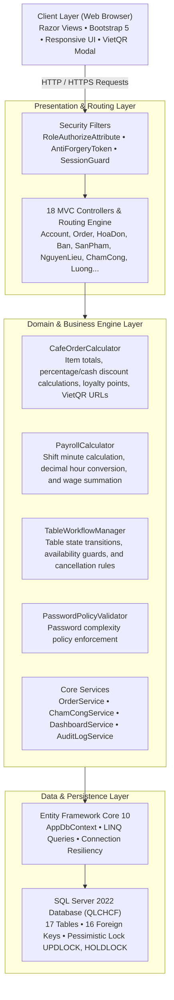
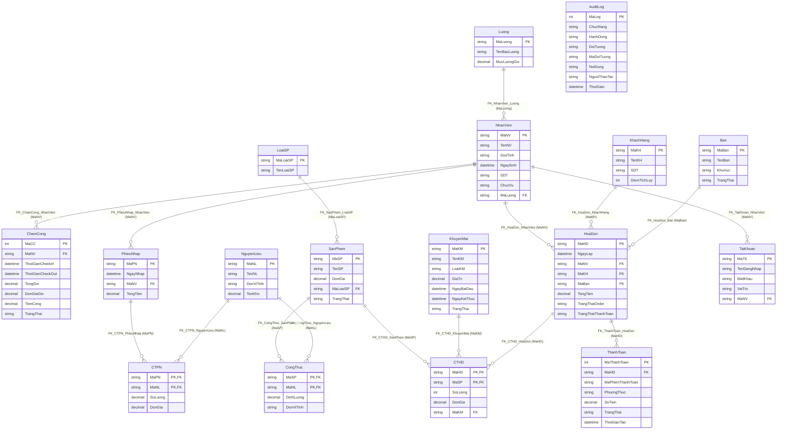

# WebQLCHCF — Coffee Shop POS & Attendance Management System

[](https://github.com/nguyenxp3n/WebQLCHCF/actions/workflows/ci.yml)


> **Enterprise Coursework Project:** A production-style coffee shop point-of-sale (POS) and operations platform featuring table dispatching, inventory recipes, shift attendance with concurrency control, dynamic VietQR contactless payments, and a 181-case automated test suite.

---

## 1. System Architecture (4-Tier Architecture)



---

## 2. Entity Relationship Diagram (Mermaid ERD - 17 Tables)



---

## 3. Engineering Highlights

1. **Role-Based Authorization Matrix:**
   * Enforces 3 distinct user roles (`Quản Lý`, `Pha Chế`, `Phục Vụ`) using `RoleAuthorizeAttribute` across controllers and views.
2. **Pessimistic Locking & Concurrency Control:**
   * Uses `WITH (UPDLOCK, HOLDLOCK)` in `ChamCong_CheckOut` stored procedure to prevent race conditions during concurrent check-out transactions.
3. **Contactless VietQR Dynamic Payment Engine:**
   * Implements standardized VietQR URL generation with exact invoice identifiers, currency rounding, and bank accounts.
4. **Isolated Business Logic Engines:**
   * Decouples calculation rules into pure domain engines: `CafeOrderCalculator`, `PayrollCalculator`, `TableWorkflowManager`, and `PasswordPolicyValidator`.
5. **High-Coverage Automated Testing:**
   * 77 xUnit test cases validating calculation boundaries, discount caps, shift intervals, authorization, and password entropy.

---

## 4. Quick Start

### Docker Compose (Recommended)

#### Windows (PowerShell):
```powershell
Copy-Item .env.example .env
docker compose up --build -d
```

#### Linux / macOS:
```bash
cp .env.example .env
docker compose up --build -d
```

Open web app at: **`http://localhost:8081`**

### Local Run:
```bash
dotnet test WebQLCHCF.slnx
dotnet run --project src/WebQLCHCF/WebQLCHCF.csproj
```

---

## 5. Seed Accounts

| Account | Password | Role | Permissions |
| :--- | :--- | :--- | :--- |
| `qly_tram` | `12345678` | **Quản Lý (Manager)** | Full management: reports, staff, payroll, promotions, audit log |
| `pc_mai` | `12345678` | **Pha Chế (Barista)** | Recipe ingredients, inventory stock, order queue |
| `pv_tu` | `12345678` | **Phục Vụ (Waiter)** | POS counter orders, table management, cash & VietQR checkout |
