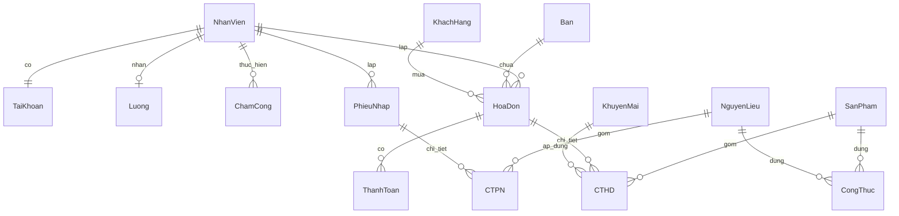

# WebQLCHCF - Hệ thống quản lý quán cà phê

Tài liệu kỹ thuật này mô tả chi tiết và toàn diện về kiến trúc hệ thống, cơ sở dữ liệu SQL Server, luồng cấu hình, bảo mật phân quyền và các quy trình nghiệp vụ cốt lõi của dự án **WebQLCHCF**. Tài liệu được biên soạn dựa trên việc đối chiếu trực tiếp với mã nguồn và tệp script cơ sở dữ liệu `QLCHCF.sql` hiện tại trong repository.

---

## 0. Hướng dẫn nhanh khi chuyển sang máy tính khác

Khi di chuyển dự án `WebQLCHCF` sang một máy tính mới, cần tuân thủ nghiêm ngặt các bước cấu hình môi trường dưới đây để đảm bảo ứng dụng vận hành chính xác và kết nối thành công tới cơ sở dữ liệu.

### 0.1 Yêu cầu môi trường hệ thống

| Thành phần | Phiên bản / Yêu cầu tối thiểu | Vai trò trong hệ thống |
|---|---|---|
| **Hệ điều hành** | Windows 10 / 11 | Môi trường triển khai và chạy thử nghiệm cục bộ. |
| **.NET SDK** | .NET SDK 10.0 (Target Framework: `net10.0`) | Trình biên dịch và chạy ứng dụng ASP.NET Core. |
| **DBMS** | SQL Server 2019 / 2022 (Express, Developer hoặc Enterprise) | Hệ quản trị cơ sở dữ liệu quan hệ lưu trữ toàn bộ dữ liệu. |
| **Công cụ quản trị** | SQL Server Management Studio (SSMS) v18+ hoặc Azure Data Studio | Thực thi script SQL, quản lý bảng, trigger và stored procedure. |
| **IDE** | Visual Studio 2022 (v17.12+) hoặc VS Code (kèm C# Dev Kit) | Môi trường phát triển và gỡ lỗi mã nguồn C#. |

### 0.2 Quy trình thiết lập cơ sở dữ liệu bằng SQL Server

1. **Mở SSMS** và kết nối tới SQL Server instance cục bộ (ví dụ: `localhost` hoặc `.\SQLEXPRESS`).
2. **Mở file script SQL chính** là `QLCHCF.sql` tại thư mục gốc của dự án.
   > [!IMPORTANT]
   > File `QLCHCF.sql` nằm ở thư mục gốc là file cơ sở dữ liệu chính thức và duy nhất của dự án. Không sử dụng file `QLCHCF_Full.sql` vì đó không phải là file chính thức hiện tại của đồ án.
3. **Xử lý cơ sở dữ liệu đã tồn tại**:
   * Nếu trên SQL Server đã có database tên là `QLCHCF`, hãy tiến hành sao lưu nếu cần thiết, sau đó drop database cũ:
     ```sql
     USE master;
     ALTER DATABASE QLCHCF SET SINGLE_USER WITH ROLLBACK IMMEDIATE;
     DROP DATABASE QLCHCF;
     ```
   * Chạy lại toàn bộ script `QLCHCF.sql` để tạo mới database cấu trúc chuẩn.
4. **Kiểm tra tính toàn vẹn của Database**:
   * Refresh **Object Explorer** trong SSMS và kiểm tra database `QLCHCF`.
   * Đảm bảo hệ thống đã tạo đủ **17 bảng chính** bao gồm: `Ban`, `KhachHang`, `KhuyenMai`, `LoaiSP`, `NhanVien`, `TaiKhoan`, `SanPham`, `HoaDon`, `CTHD`, `ThanhToan`, `NguyenLieu`, `CongThuc`, `PhieuNhap`, `CTPN`, `ChamCong`, `Luong`, `AuditLog`.
   * Đảm bảo các **Stored Procedure** cốt lõi đã tồn tại đầy đủ trong thư mục *Programmability > Stored Procedures* (ví dụ: `TaiKhoan_DangNhap`, `ChamCong_CheckIn`, `ChamCong_CheckOut`, `ThanhToan_TienMat`, `ThanhToan_TaoQR`, `ThanhToan_XacNhanQRTheoPhien`, `Ban_KhachDi`, `AuditLog_Them`,...).

### 0.3 Cấu hình chuỗi kết nối trong `appsettings.json`

File cấu hình liên kết ứng dụng với cơ sở dữ liệu nằm tại `appsettings.json`. Tùy thuộc vào cấu hình SQL Server trên máy mới, hãy chỉnh sửa giá trị `Server` trong connection string:

* **Trường hợp dùng SQL Server mặc định (Default Instance / Developer / LocalHost):**
  ```json
  "ConnectionStrings": {
    "DefaultConnection": "Server=localhost;Database=QLCHCF;Trusted_Connection=True;TrustServerCertificate=True;"
  }
  ```
* **Trường hợp dùng SQL Server Express (SQLExpress Instance):**
  ```json
  "ConnectionStrings": {
    "DefaultConnection": "Server=.\\SQLEXPRESS;Database=QLCHCF;Trusted_Connection=True;TrustServerCertificate=True;"
  }
  ```

> [!WARNING]
> Tên của connection string bắt buộc phải giữ nguyên là `DefaultConnection` vì `Program.cs` đang đọc cấu hình trực tiếp từ key này. Luôn giữ `TrustServerCertificate=True` để tránh các lỗi kết nối SSL trên môi trường local.

### 0.4 Biên dịch và vận hành ứng dụng Web

Mở PowerShell hoặc Command Prompt tại thư mục gốc dự án và thực hiện chuỗi lệnh sau:

```powershell
# Khôi phục các thư viện NuGet phụ thuộc
dotnet restore

# Biên dịch mã nguồn dự án
dotnet build

# Vận hành ứng dụng web
dotnet run
```

Theo cấu hình trong `Properties/launchSettings.json`, cổng chạy mặc định của ứng dụng web là:
* Giao thức HTTP: `http://localhost:5132`
* Giao thức HTTPS: `https://localhost:7094`

Hệ thống sẽ tự động chuyển hướng người dùng chưa đăng nhập về trang `/Account/Login`.

### 0.5 Danh sách tài khoản thử nghiệm chuẩn (Demo Accounts)

Dữ liệu tài khoản mẫu được trích xuất trực tiếp từ bảng `TaiKhoan` và `NhanVien` trong database:

| Tên đăng nhập | Mật khẩu (Plain-text) | Vai trò hệ thống | Mã nhân viên tương ứng | Tên nhân viên |
|---|---|---|---|---|
| **`qly_tram`** | `12345678` | **Quản Lý** | `NV01` | Nguyễn Khánh Trâm |
| **`pc_mai`** | `12345678` | **Pha Chế** | `NV02` | Trần Tuyết Mai |
| **`pc_bao`** | `12345678` | **Pha Chế** | `NV03` | Lê Quốc Bảo |
| **`pv_tu`** | `12345678` | **Phục Vụ** | `NV04` | Hoàng Anh Tú |
| **`pv_vy`** | `12345678` | **Phục Vụ** | `NV05` | Phạm Thảo Vy |

> [!NOTE]
> Mật khẩu trong dữ liệu mẫu hiện đang được lưu dưới dạng văn bản thuần (plain-text) để thuận tiện cho quá trình kiểm thử đồ án. Khi vận hành thực tế, cần áp dụng thuật toán mã hóa băm mật khẩu bảo mật (ví dụ: BCrypt, Argon2 hoặc PBKDF2) kèm theo muối (salt).

### 0.6 Các lỗi thường gặp và phương pháp khắc phục nhanh

* **Lỗi: `SqlException (0x80131904): Cannot open database "QLCHCF" requested by the login.`**
  * *Nguyên nhân:* Database `QLCHCF` chưa được tạo hoặc chưa chạy script `QLCHCF.sql` trên SQL Server local.
  * *Khắc phục:* Mở SSMS, kết nối tới Server, mở file `QLCHCF.sql` và chạy toàn bộ script.
* **Lỗi: `A connection was successfully established with the server, but then an error occurred during the pre-login handshake.`**
  * *Nguyên nhân:* Thiếu tham số `TrustServerCertificate=True` trong chuỗi kết nối khi làm việc với SSL tự ký.
  * *Khắc phục:* Sửa `appsettings.json`, thêm `;TrustServerCertificate=True` vào cuối chuỗi `DefaultConnection`.
* **Lỗi: `System.InvalidOperationException: Unable to resolve service for type 'WebQLCHCF.Data.AppDbContext'...`**
  * *Nguyên nhân:* Cấu hình đăng ký DbContext trong `Program.cs` bị lỗi hoặc connection string bị trống.
  * *Khắc phục:* Kiểm tra lại tên key `DefaultConnection` trong `appsettings.json` xem có khớp 100% không.
* **Lỗi: `WebQLCHCF.exe process is locked`**
  * *Nguyên nhân:* Một tiến trình web cũ đang chạy ngầm hoặc Visual Studio đang chiếm dụng file thực thi.
  * *Khắc phục:* Mở Task Manager, kết thúc tiến trình `WebQLCHCF.exe` hoặc gõ lệnh `taskkill /f /im WebQLCHCF.exe` trong cmd.

---

## 1. Tổng quan dự án

* **Tên dự án:** `WebQLCHCF` (Hệ thống Web Quản Lý Cửa Hàng Cà Phê).
* **Mục tiêu:** Xây dựng một giải pháp quản lý bán hàng, vận hành và nhân sự dành cho các mô hình quán cà phê vừa và nhỏ. Hệ thống hỗ trợ xử lý nghiệp vụ bán hàng thực tế tại quầy, quản lý khu vực bàn linh hoạt, tích hợp thanh toán VietQR động không cần thiết bị đầu cuối, chấm công nhân viên tự động theo thời gian đăng nhập thực tế, tính lương minh bạch, kiểm soát tồn kho kho nguyên liệu và ghi vết lịch sử hệ thống (Audit Log) chống gian lận.
* **Công nghệ cốt lõi:** ASP.NET Core MVC (Target Framework: .NET 10.0), Entity Framework Core, SQL Server, Stored Procedure, Bootstrap 5, Javascript, CSS3.
* **Database chính:** `QLCHCF` (được khởi tạo và seed dữ liệu bởi file script `QLCHCF.sql`).
* **Phân hệ chính:**
  1. *Quản lý Bán hàng tại quầy (Order & POS):* Lập hóa đơn, chọn món, áp dụng khuyến mãi, tích điểm thành viên, chọn bàn trống tiếp theo, hỗ trợ mang về.
  2. *Quản lý Thanh toán:* Thanh toán tiền mặt truyền thống, thanh toán qua cổng VietQR động tự sinh kèm đếm ngược hiệu lực 15 phút, mock webhook xác nhận chuyển khoản ngân hàng.
  3. *Quản lý Vận hành quán:* Quản lý sơ đồ bàn vật lý (Trống, Đang phục vụ), bàn ảo mang về (`MVE`).
  4. *Quản lý Danh mục:* CRUD Sản phẩm (Đang bán, Tạm ngưng, Ngừng bán), Loại sản phẩm, Khuyến mãi (Tiền mặt/Phần trăm), Khách hàng.
  5. *Quản lý Kho hàng & Công thức:* Quản lý Nguyên liệu tồn kho, Công thức pha chế (Định lượng chi tiết), Phiếu nhập kho, Chi tiết nhập kho, kiểm soát tự động tồn kho tối thiểu.
  6. *Quản lý Nhân sự & Chấm công:* Quản lý hồ sơ nhân viên, tài khoản phân quyền. Tự động chấm công (Check-in khi login, Check-out bắt buộc nhập mật khẩu khi logout), tính lương tháng tự động.
  7. *Thống kê báo cáo & Giám sát:* Dashboard quản lý động, báo cáo doanh thu theo ngày, món ăn bán chạy, thống kê nhập hàng và phân hệ Audit Log ghi nhận hành động thời gian thực.
* **Trạng thái hiện tại:** Dự án đã tích hợp động với database SQL Server thực tế thông qua hệ thống Stored Procedure. Toàn bộ các phân hệ POS, thanh toán QR VietQR demo, phân quyền bảo mật cấp độ Action và ghi vết Audit Log hoạt động ổn định và chính xác theo đặc tả yêu cầu trong các lượt kiểm thử trước.

---

## 2. Công nghệ và lý do sử dụng

Dự án chọn lựa các công nghệ hiện đại, ổn định và phù hợp nhất để xây dựng hệ thống quản lý có độ chịu tải tốt, giao diện trực quan và bảo mật cao:

* **ASP.NET Core MVC (.NET 10.0):** Cung cấp cấu trúc phân tách rõ ràng (Model-View-Controller), kiến trúc hướng middleware mạnh mẽ, tối ưu hóa bộ nhớ và tốc độ xử lý request. Hỗ trợ cơ chế Routing linh hoạt và Session bền vững.
* **Razor Views & Bootstrap 5:** Razor Views cho phép trộn mã C# trực tiếp vào HTML để render động phía Server (Server-side rendering), cải thiện tốc độ load trang đầu tiên. Bootstrap 5 kết hợp Bootstrap Icons giúp phát triển giao diện thích ứng (Responsive) trên mọi kích cỡ màn hình thiết bị mà không cần phụ thuộc vào jQuery.
* **Entity Framework Core (EF Core):** Đóng vai trò lớp Object-Relational Mapping (ORM) giúp lập trình viên viết truy vấn LINQ hướng đối tượng an toàn, tự động cấu hình ánh xạ khóa ngoại và composite key. Đồng thời, EF Core là cầu nối trung gian tối ưu để gọi các stored procedure SQL Server thông qua ADO.NET hoặc SQL Interpolated.
* **SQL Server & Stored Procedure:** SQL Server là hệ quản trị cơ sở dữ liệu quan hệ có độ tin cậy cao, hỗ trợ toàn vẹn dữ liệu thông qua ràng buộc (Constraints) và khóa ngoại. Toàn bộ logic nghiệp vụ nặng (như chốt ca chấm công, tính tổng lương nhân viên theo tháng, cập nhật tổng tiền hóa đơn, xử lý phiên thanh toán QR) đều được đóng gói trong **Stored Procedures** nhằm đẩy tốc độ xử lý về phía Database, giảm thiểu độ trễ đường truyền mạng và đảm bảo tính nhất quán của dữ liệu.
* **Cơ chế Session:** Lưu trữ trạng thái phiên đăng nhập của nhân viên (`MaTK`, `MaNV`, `TenNV`, `VaiTro`, `TenDangNhap`). Việc này giúp kiểm soát truy cập và cung cấp dữ liệu cho toàn bộ các chức năng mà không cần truy vấn database lặp đi lặp lại.
* **PJAX & JavaScript (Client-side):** Sử dụng kỹ thuật PJAX (PushState AJAX) trong `wwwroot/js/site.js` để cập nhật động vùng nội dung chính của trang web khi thực hiện các yêu cầu GET nội bộ, giúp hệ thống chạy mượt mà như Single Page Application (SPA), cải thiện trải nghiệm và hỗ trợ thao tác nhanh hơn. JavaScript quản lý giỏ hàng phía client trong `wwwroot/js/order-create.js` và bộ đếm ngược thời gian hết hạn QR thời gian thực.
* **Audit Log Engine:** Bộ máy tự động ghi nhận các sự kiện nghiệp vụ quan trọng trong ứng dụng web để ghi nhận thông tin vận hành hệ thống, giúp người quản lý kiểm soát được rủi ro thất thoát doanh thu hoặc thay đổi giá bán bất thường.
* **VietQR Demo Integration:** Sử dụng dịch vụ VietQR API (`img.vietqr.io`) để tự động sinh ảnh QR chứa đầy đủ mã ngân hàng thụ hưởng, số tài khoản, số tiền hóa đơn và nội dung chuyển khoản là mã phiên giao dịch. Khách hàng quét mã này sẽ tự động điền đúng số tiền và nội dung, hạn chế tối đa sai sót của phục vụ viên.

---

## 3. Kiến trúc tổng thể

Hệ thống được thiết kế theo kiến trúc 3 tầng (3-Layer Architecture) kết hợp mô hình MVC chuẩn của ASP.NET Core:

```text
[Browser / Client]
        │ (HTTP Request / AJAX / PJAX)
        ▼
[Middleware Pipeline] (Routing -> Session -> RoleAuthorize Filter)
        │
        ▼
[Controllers] (AccountController, OrderController, SanPhamController,...)
        │
        ├───► [ViewModels / InputModels] (Validate, nhận dữ liệu form)
        │
        ▼
[Services Layer] (OrderService, ChamCongService, DashboardService, AuditLogService)
        │
        ├───► [AppDbContext] (Cầu nối mapping C# Entity và Stored Procedure)
        │            │
        │            ▼ (LINQ / Raw SQL / ExecuteSqlInterpolated)
        └──────► [SQL Server Database] (Tables, Views, Persisted Computed Columns, Stored Procs)
                     │
                     ▼ (Dữ liệu trả về / Output Params / Result Set)
[Razor Views] ◄──────┴
        │ (Render HTML + CSS + JS)
        ▼
[Browser / Client] (Hiển thị UI/UX Premium, countdown QR, live charts, sidebar collapse)
```

### Cơ chế luồng hoạt động:

1. **Client / Trình duyệt:** Người dùng tương tác gửi HTTP request (GET/POST) hoặc kích hoạt PJAX request đến server.
2. **Middleware Pipeline:** Request đi qua bộ lọc kiểm tra định tuyến (Routing), thiết lập phiên làm việc (Session) và bộ lọc phân quyền tự chế `Security/RoleAuthorizeAttribute.cs`. Nếu chưa đăng nhập hoặc sai vai trò, hệ thống sẽ thực hiện redirect ngay tại đây.
3. **Controllers Layer:** Tiếp nhận dữ liệu, thực hiện kiểm tra tính hợp lệ của model đầu vào (`ModelState.IsValid`). Chuyển tiếp yêu cầu xử lý nghiệp vụ xuống tầng Service.
4. **Services Layer:** Nhận dữ liệu nghiệp vụ đã được làm sạch từ Controller. Thực hiện các logic nghiệp vụ như tính toán tạm tính lương ca làm, chuẩn bị dữ liệu hóa đơn, tích lũy điểm thưởng thành viên hoặc gửi truy vấn vào DB.
5. **AppDbContext & Database:** Gọi các câu lệnh SQL, LINQ hoặc kích hoạt Stored Procedure trong SQL Server thông qua `Data/AppDbContext.cs`. SQL Server xử lý dữ liệu thực tế tại bảng, kích hoạt trigger, cập nhật các Computed Column được tính toán vật lý (Persisted) và trả về kết quả cho EF Core.
6. **Razor Views:** Controller nhận kết quả từ Service, kết hợp với các ViewModel chuẩn dữ liệu để truyền qua Razor View. Giao diện được render động thành mã HTML thuần kết hợp CSS3/JS gửi trả lại cho trình duyệt hiển thị tới người dùng với giao diện đồng bộ.

---

## 4. `Program.cs` hoạt động như thế nào

File `Program.cs` đóng vai trò là điểm khởi đầu (Entry Point) của ứng dụng web, chịu trách nhiệm khởi dựng cấu hình dịch vụ (Services Configuration) và thiết lập đường ống xử lý HTTP request (Middleware Pipeline).

### 4.1 Khởi tạo dịch vụ và Dependency Injection (DI)

```csharp
var builder = WebApplication.CreateBuilder(args);
builder.Services.AddControllersWithViews();
builder.Services.AddSession();
builder.Services.AddHttpContextAccessor();
```

* **`AddControllersWithViews()`**: Đăng ký các dịch vụ cần thiết cho mô hình MVC (Controllers, Razor Engine, Model Binding, Validation).
* **`AddSession()`**: Đăng ký dịch vụ quản lý Session cục bộ giúp lưu trữ dữ liệu người dùng qua các request.
* **`AddHttpContextAccessor()`**: Dịch vụ giúp các lớp thuần C# (như `AuditLogService` nằm ngoài tầng Controller) vẫn có thể truy cập đầy đủ thông tin của request hiện tại như IP client, Header User-Agent và Session dữ liệu nhân viên.

```csharp
builder.Services.AddDbContext<AppDbContext>(options =>
    options.UseSqlServer(builder.Configuration.GetConnectionString("DefaultConnection"))
);
```

* **`AddDbContext<AppDbContext>()`**: Đăng ký DbContext trung tâm của hệ thống, sử dụng SQL Server Provider và đọc chuỗi kết nối từ `ConnectionStrings.DefaultConnection` trong `appsettings.json`.

```csharp
builder.Services.AddScoped<IDashboardService, DashboardService>();
builder.Services.AddScoped<IOrderService, OrderService>();
builder.Services.AddScoped<IChamCongService, ChamCongService>();
builder.Services.AddScoped<IAuditLogService, AuditLogService>();
```

* Đăng ký cơ chế Dependency Injection theo phạm vi **`Scoped`** (khởi tạo một thực thể duy nhất cho mỗi HTTP request):
  * `IDashboardService` liên kết với `DashboardService` để lấy số liệu thống kê.
  * `IOrderService` liên kết với `OrderService` xử lý nghiệp vụ POS/Bán hàng.
  * `IChamCongService` liên kết với `ChamCongService` xử lý ca làm.
  * `IAuditLogService` liên kết với `AuditLogService` ghi lịch sử hành động.

### 4.2 Thiết lập Middleware Pipeline và tầm quan trọng của thứ tự cấu hình

```csharp
var app = builder.Build();

await WarmUpEfCoreAsync(app);

if (!app.Environment.IsDevelopment())
{
    app.UseExceptionHandler("/Home/Error");
    app.UseHsts();
}
app.UseHttpsRedirection();
app.UseStaticFiles();
app.UseRouting();
app.UseSession();      // PHẢI ĐẶT TRƯỚC UseAuthorization
app.UseAuthorization();
```

> [!IMPORTANT]
> **Thứ tự của Middleware là bất di bất dịch:**
> * `UseSession()` bắt buộc phải được gọi **TRƯỚC** `UseAuthorization()`. Nếu cấu hình ngược lại, khi bộ lọc phân quyền `RoleAuthorizeAttribute` hoạt động ở tầng authorization filter, nó sẽ **không thể đọc được dữ liệu Session** (như `MaTK`, `VaiTro`) dẫn đến việc hệ thống từ chối quyền truy cập hoặc gây ra lỗi vòng lặp redirect vô tận.
> * `UseStaticFiles()` phục vụ việc tải trực tiếp các file tĩnh CSS, JS, ảnh trong thư mục `wwwroot` mà không cần đi qua bộ định tuyến MVC để tối ưu hiệu năng.

### 4.3 Định tuyến hệ thống (Routing Configuration)

```csharp
app.MapControllerRoute(name: "controller-default", pattern: "{controller}/{action=Index}/{id?}");
app.MapControllerRoute(name: "default", pattern: "{controller=Account}/{action=Login}/{id?}");
```

* **Route chung (`controller-default`)**: Định nghĩa cấu trúc URL chuẩn MVC. Khi truy cập vào một controller mà không chỉ định action, hệ thống tự động tìm action `Index`.
* **Route mặc định (`default`)**: Thiết lập trang chủ khởi tạo khi chạy web là **`AccountController > Login`**. Giúp chốt chặn ngay từ đầu, buộc mọi người dùng phải qua màn hình đăng nhập.

### 4.4 Cơ chế Warm-up EF Core khi khởi động hệ thống

```csharp
static async Task WarmUpEfCoreAsync(WebApplication app)
{
    try
    {
        using var scope = app.Services.CreateScope();
        var context = scope.ServiceProvider.GetRequiredService<AppDbContext>();

        _ = context.Model.GetEntityTypes().Count();
        await context.Database.CanConnectAsync();
    }
    catch (Exception ex)
    {
        app.Logger.LogWarning(ex, "Không thể warm-up EF Core.");
    }
}
```

* **Mục đích:** Khắc phục nhược điểm "khởi động lạnh" (Cold Start) của Entity Framework Core. Khi có request đầu tiên, EF Core mới bắt đầu dịch chuyển cấu hình DbContext và biên dịch mapping metadata rất mất thời gian.
* **Giải pháp:** Khi web vừa build xong và run, `WarmUpEfCoreAsync` sẽ chạy ngầm, gọi đếm thực thể model và kiểm tra khả năng kết nối DB (`CanConnectAsync`). Request đầu tiên từ trình duyệt khách hàng sẽ được phản hồi nhanh hơn mà không gặp hiện tượng trễ. Nếu quá trình warm-up lỗi (ví dụ chưa bật SQL Server), hệ thống chỉ ghi nhận cảnh báo log mà không làm sập ứng dụng web.

---

## 5. `appsettings.json` và `launchSettings.json`

Đây là hai file lưu trữ cấu hình môi trường và vận hành của dự án.

### 5.1 `appsettings.json`

File `appsettings.json` chứa các cấu hình chạy ở runtime:

* `ConnectionStrings`: Chứa chuỗi kết nối cơ sở dữ liệu `DefaultConnection`. Khi di chuyển máy, chỉ cần thay đổi giá trị `Server` trong này.
* `Logging`: Phân cấp ghi nhật ký hoạt động. Các log hệ thống của Microsoft được giới hạn ở mức `Warning` để tránh tràn file log, các thông báo nghiệp vụ thông thường của dự án ở mức `Information`.
* `AllowedHosts`: Đặt là `"*"` cho phép ứng dụng phản hồi mọi domain trỏ về IP của máy chủ.

### 5.2 `Properties/launchSettings.json`

File `Properties/launchSettings.json` cấu hình môi trường khởi chạy lúc phát triển:

* Profile `http`: Chạy ứng dụng thông qua môi trường Kestrel cục bộ tại địa chỉ `http://localhost:5132`.
* Profile `https`: Hỗ trợ giao thức bảo mật SSL tại địa chỉ `https://localhost:7094` song song HTTP tại cổng `5132`.
* Biến môi trường `ASPNETCORE_ENVIRONMENT`: Được đặt là `"Development"` để bật các tính năng hỗ trợ nhà phát triển như trang báo lỗi chi tiết (Developer Exception Page).

---

## 6. SQL và Database

Cơ sở dữ liệu của dự án sử dụng hệ quản trị SQL Server, đại diện bởi file script `QLCHCF.sql`.

### 6.1 Cơ cấu các bảng và ràng buộc khóa

Database được chia thành 4 phân vùng bảng nghiệp vụ chính:



1. **Danh mục:**
   * `Ban`: Quản lý danh sách bàn vật lý. Cột `TrangThai` bắt buộc nhận hai giá trị chuẩn là: **`Trống`** và **`Đang phục vụ`**.
     > [!CAUTION]
     > Nghiêm cấm ghi nhận trạng thái bàn là `ON/OFF`. Mọi logic xử lý bàn trống, chọn bàn tự động đều dựa trên từ khóa tiếng Việt có dấu là `Trống` và `Đang phục vụ`.
     * Bàn mang về được đại diện bởi bản ghi đặc biệt có mã là **`MVE`** (Mã Bàn Mang Về). Bàn mang về không chịu sự chi phối của sơ đồ bàn vật lý và không bao giờ đổi trạng thái sang `Đang phục vụ` hoặc cần dọn dẹp (trả bàn).
   * `LoaiSP`: Phân loại sản phẩm (Đồ uống, Bánh ngọt, Cà phê hạt,...).
   * `SanPham`: Quản lý danh sách món ăn, nước uống. Cột `TrangThai` nhận các giá trị: `Đang bán`, `Tạm ngưng`, `Ngừng bán`.
   * `KhachHang`: Thông tin khách hàng, số điện thoại dùng để tìm kiếm và cột tích lũy điểm (`DiemTichLuy`).
   * `KhuyenMai`: Lưu chương trình khuyến mãi. Cột `LoaiKM` nhận giá trị: `Tiền mặt` hoặc `Phần trăm`.
2. **Bán hàng & Thanh toán:**
   * `HoaDon`: Quản lý thông tin chung của hóa đơn:
     * `TrangThaiOrder` nhận các giá trị vòng đời: **`DangOrder`**, **`ChoThanhToan`**, **`HoanThanh`**, **`DaHuy`**.
     * `TrangThaiThanhToan` nhận các giá trị: **`ChuaThanhToan`**, **`ChoThanhToanQR`**, **`DaThanhToan`**, **`HetHan`**, **`DaHuy`**, **`ChoKiemTra`**.
     * `PhuongThucThanhToan` nhận giá trị: **`TienMat`** hoặc **`QR`**.
     * `ThoiGianTao`: Ghi nhận thời gian tạo hóa đơn thực tế gồm giờ và phút để in hóa đơn. (Cột `NgayLap` kiểu `Date` chỉ phục vụ gom nhóm báo cáo thống kê theo ngày, không chứa giờ phút).
     * `ThoiGianThanhToan`: Lưu trữ thời điểm giao dịch hoàn tất thành công.
   * `CTHD`: Chi tiết sản phẩm trong hóa đơn. Khóa chính phức hợp (Composite Key) gồm cặp: **`{MaHD, MaSP}`**.
   * `ThanhToan`: Quản lý các phiên giao dịch phát sinh của hóa đơn. Lưu trữ mã phiên QR VietQR (`MaPhienThanhToan`), trạng thái giao dịch (`TrangThai` đồng bộ với hóa đơn), số tiền giao dịch (`SoTien`), nội dung chuyển khoản phát sinh và mã giao dịch ngân hàng thực tế (`MaGiaoDich`).
3. **Nhân sự & Ca làm:**
   * `NhanVien`: Hồ sơ nhân viên, chức vụ và mức lương cơ bản theo giờ (`LuongTheoGio`).
   * `TaiKhoan`: Tên đăng nhập và mật khẩu đăng nhập hệ thống của nhân viên.
   * `ChamCong`: Ghi nhận ca làm việc của nhân viên khi đăng nhập vào hệ thống.
   * `Luong`: Lưu bảng lương tính toán của nhân viên.
4. **Hệ thống & Kho:**
   * `NguyenLieu`: Quản lý nguyên liệu (Cà phê hạt, sữa tươi, đường,...). Cột `SoLuongTon` có kiểu dữ liệu nullable để cho phép quản lý linh hoạt, cột `MucTonToiThieu` cảnh báo khi sắp hết hàng.
   * `CongThuc`: Định nghĩa công thức cấu thành sản phẩm. Khóa chính phức hợp **`{MaSP, MaNL}`**. Cột định lượng `DinhLuong` dùng kiểu `decimal(18,3)` để đo lường chính xác các đơn vị nhỏ như gram, ml.
   * `PhieuNhap` & `CTPN`: Quản lý việc nhập nguyên liệu từ nhà cung cấp. `CTPN` có khóa chính phức hợp **`{MaPN, MaNL}`**.
   * `AuditLog`: Bảng lưu nhật ký vận hành hệ thống. Nhận dữ liệu từ service, ghi lại thời điểm, mã nhân viên, IP, User-Agent, chức năng, hành động, trước/sau thay đổi.
     > [!IMPORTANT]
     > Theo đặc tả thiết kế bảo mật của hệ thống quản trị tài chính, bảng `AuditLog` chỉ cho phép thực thi hành động chèn dữ liệu (`INSERT`). Mọi hành vi cập nhật (`UPDATE`) hoặc xóa bỏ (`DELETE`) dữ liệu trên bảng này đều bị cấm nhằm ngăn ngừa khả năng chỉnh sửa lịch sử thao tác hoặc xóa vết đối soát tài chính.

### 6.2 Các cột tính toán tự động vật lý (Persisted Computed Columns)

Để tối ưu hóa tốc độ truy vấn và giải phóng tài nguyên tính toán cho CPU máy chủ Web, database được thiết kế với các cột tính toán tự động và được lưu trữ vật lý xuống đĩa cứng (Persisted):

* **`CTHD.ThanhTien`**:
  ```sql
  [ThanhTien] AS ([SoLuong] * [DonGia]) PERSISTED
  ```
  * *Tác dụng:* Đảm bảo thành tiền của từng món luôn bằng tích số lượng và đơn giá tại thời điểm bán, không bị sửa đổi lệch lạc bởi code C#.
* **`CTPN.ThanhTien`**:
  ```sql
  [ThanhTien] AS ([SoLuong] * [DonGia]) PERSISTED
  ```
* **`Luong.TongLuong`**:
  ```sql
  [TongLuong] AS ([LuongCoBan] + ISNULL([PhuCap], 0) + ISNULL([Thuong], 0) - ISNULL([Phat], 0)) PERSISTED
  ```
  * *Tác dụng:* Tính toán tự động tổng thực lĩnh của nhân viên dựa trên các khoản cộng trừ thưởng phạt, cập nhật tự động khi quản lý chỉnh sửa các cột thành phần.

### 6.3 Danh sách Stored Procedure cốt lõi của hệ thống

Toàn bộ các luồng xử lý dữ liệu phức tạp đều được đưa xuống stored procedure:

| Nhóm nghiệp vụ | Tên Stored Procedure | Logic nghiệp vụ chi tiết thực hiện |
|---|---|---|
| **Đăng nhập** | `TaiKhoan_DangNhap` | Nhận `TenDangNhap`, `MatKhau`. Kiểm tra tài khoản hoạt động và lấy thông tin nhân viên kèm vai trò. |
| **Chấm công** | `ChamCong_CheckIn` | Đăng ký ca làm mới cho nhân viên. Đặt trạng thái là `Đang làm` và thời gian Check-out là NULL. |
| | `ChamCong_CheckOut` | Nhận `MaNV` và `MatKhau`. Xác thực mật khẩu trùng khớp với tài khoản nhân viên, nếu đúng thì tiến hành chốt giờ Check-out, tính toán tổng số phút làm việc thực tế, nhân với `LuongTheoGio` của nhân viên để ra số `TienCong` ca làm đó và chuyển trạng thái chấm công thành `Đã chốt`. |
| | `ChamCong_KiemTraDangLam`| Kiểm tra nhân viên hiện tại có ca làm nào chưa check-out hay không để chặn quyền thực hiện order. |
| **POS & Bán hàng**| `HoaDon_Them` / `Sua` / `Xoa`| Tạo mới, điều chỉnh hoặc hủy bỏ hóa đơn bán hàng. |
| | `CTHD_Them` / `Sua` / `Xoa` | Thêm, bớt, sửa đổi chi tiết món ăn trong hóa đơn. Tự động kích hoạt gọi `HoaDon_CapNhatTongTien`. |
| | `HoaDon_CapNhatTongTien` | Quét lại toàn bộ `CTHD` của hóa đơn, tính tổng tiền, đối chiếu giá trị đơn hàng với các chương trình khuyến mãi đang áp dụng để trừ đi tiền giảm giá, cập nhật lại cột `TongTien` trong bảng `HoaDon`. |
| **Thanh toán** | `ThanhToan_TienMat` | Thực hiện thanh toán tiền mặt trực tiếp. Chuyển `TrangThaiOrder` thành `HoanThanh`, `TrangThaiThanhToan` thành `DaThanhToan`, cập nhật phương thức là `TienMat` và lưu thời điểm thanh toán. Bàn vật lý giữ nguyên `Đang phục vụ` chứ không tự động giải phóng bàn. |
| | `ThanhToan_TaoQR` | Khởi tạo phiên thanh toán QR. Tạo mã phiên ngẫu nhiên (`MaPhienThanhToan`), lưu số tiền cần thanh toán, nội dung chuyển khoản định danh và thiết lập thời gian hết hạn là **15 phút** kể từ thời điểm tạo. Chuyển trạng thái hóa đơn sang `ChoThanhToanQR`. |
| | `ThanhToan_XacNhanQRTheoPhien`| Nhận mã phiên QR, số tiền và nội dung chuyển khoản chuyển từ Ngân hàng (mô phỏng). Đối chiếu thông tin, nếu chính xác thì tiến hành chuyển hóa đơn sang `HoanThanh` và trạng thái thanh toán là `DaThanhToan`. Ghi nhận mã giao dịch ngân hàng thật. |
| | `ThanhToan_QRHetHan` | Xử lý phiên QR cụ thể bị quá 15 phút mà khách chưa thanh toán. Hủy phiên thanh toán, chuyển trạng thái hóa đơn sang `HetHan` và tự động trả bàn vật lý về `Trống` (nếu đơn Tại quán), đặt `TrangThaiOrder` của hóa đơn thành `DaHuy`. |
| | `ThanhToan_XuLyTatCaQRHetHan`| Quét định kỳ toàn bộ các phiên thanh toán QR đang ở trạng thái `ChoThanhToanQR` trong hệ thống, nếu thời gian hiện tại vượt quá `ThoiGianHetHan` thì tự động đánh dấu hết hạn, hủy hóa đơn liên quan và giải phóng các bàn vật lý tương ứng. |
| | `ThanhToan_SuaOrder` | Chuyển trạng thái hóa đơn từ chờ thanh toán QR về trạng thái chỉnh sửa món, hủy bỏ phiên QR đang chờ đó để nhân viên có thể thay đổi số lượng, món ăn trong giỏ hàng mà không cần tạo hóa đơn mới. Bàn vật lý vẫn được giữ nguyên trạng thái `Đang phục vụ`. |
| | `ThanhToan_HuyOrder` | Thực hiện hủy bỏ hóa đơn khi chưa thanh toán theo yêu cầu của nhân viên (phải truyền lý do hủy). Hóa đơn chuyển trạng thái sang `DaHuy`. Nếu là hóa đơn Tại quán, tự động giải phóng bàn vật lý liên quan về `Trống`. |
| **Vận hành** | `Ban_KhachDi` | Giải phóng bàn vật lý. Nhận `MaBan`, chuyển `TrangThai` bàn về `Trống`. Chặn hành động nếu bàn đó vẫn còn hóa đơn chưa thanh toán. |
| | `AuditLog_Them` | Thực thi chèn nhật ký hoạt động hệ thống kèm IP, User Agent. |

---

## 7. `AppDbContext.cs`

File `Data/AppDbContext.cs` là hạt nhân quản lý dữ liệu trong ứng dụng web, chịu trách nhiệm định nghĩa ánh xạ thực thể (Entities Mapping) và cấu hình các DbSet để gọi Stored Procedure.

### 7.1 Bản đồ Ánh xạ thực thể bảng (DbSet Entities)

`AppDbContext` khai báo 17 `DbSet` tương ứng với 17 bảng vật lý trong database:

```csharp
public DbSet<Ban> Bans => Set<Ban>();
public DbSet<KhachHang> KhachHangs => Set<KhachHang>();
...
public DbSet<AuditLog> AuditLogs => Set<AuditLog>();
```

### 7.2 Cấu hình Key phức hợp và Cột tính toán tự động

Trong phương thức `OnModelCreating`, EF Core thiết lập các cấu hình nâng cao không thể định nghĩa bằng Data Annotations thông thường:

```csharp
// Đăng ký Composite Key cho các bảng chi tiết và quan hệ nhiều-nhiều
b.Entity<CTHD>().HasKey(x => new { x.MaHD, x.MaSP });
b.Entity<CTPN>().HasKey(x => new { x.MaPN, x.MaNL });
b.Entity<CongThuc>().HasKey(x => new { x.MaSP, x.MaNL });

// Đăng ký cấu hình Computed Column PERSISTED đồng bộ với database SQL Server
b.Entity<Luong>()
    .Property(x => x.TongLuong)
    .HasColumnType("money")
    .ValueGeneratedOnAddOrUpdate()
    .HasComputedColumnSql("[LuongCoBan] + ISNULL([PhuCap], 0) + ISNULL([Thuong], 0) - ISNULL([Phat], 0)", true);

b.Entity<CTHD>()
    .Property(x => x.ThanhTien)
    .HasColumnType("money")
    .ValueGeneratedOnAddOrUpdate()
    .HasComputedColumnSql("[SoLuong] * [DonGia]", true);
```

* Việc cấu hình `.ValueGeneratedOnAddOrUpdate()` và tham số `true` (Persisted) trong `HasComputedColumnSql` giúp EF Core hiểu rằng đây là các cột tự sinh ở phía SQL Server. EF Core sẽ không ghi đè giá trị vào các cột này khi thực hiện lệnh `Add` hoặc `Update`, tránh phát sinh lỗi ngoại lệ từ DBMS.

### 7.3 Ánh xạ kết quả Stored Procedure không có khóa (Keyless ViewModels)

Để EF Core có thể nhận dữ liệu trả về từ các stored procedure chứa câu lệnh `JOIN` nhiều bảng hoặc tính toán thống kê, dự án đăng ký các DbSet đặc biệt không có khóa chính (**`HasNoKey()`**):

```csharp
public DbSet<LoginResultViewModel> LoginResults => Set<LoginResultViewModel>();
public DbSet<SanPhamViewModel> SanPhamResults => Set<SanPhamViewModel>();
...
b.Entity<LoginResultViewModel>().HasNoKey();
b.Entity<SanPhamViewModel>().HasNoKey();
```

Khi service thực hiện gọi procedure:
```csharp
var user = (await _context.LoginResults.FromSqlInterpolated(
    $"EXEC TaiKhoan_DangNhap {model.TenDangNhap}, {model.MatKhau}"
).ToListAsync()).FirstOrDefault();
```
EF Core sẽ tự động ánh xạ tập kết quả (Result Set) trả về từ stored procedure SQL Server vào đối tượng C# `LoginResultViewModel`.

---

## 8. Security

Hệ thống triển khai cơ chế bảo mật phân quyền đa lớp bảo vệ ứng dụng ở cả tầng giao diện (UI/UX), tầng nghiệp vụ (Controller/Action) và tầng cơ sở dữ liệu (SQL Schema).

### 8.1 `AppRoles.cs` - Quản lý tập trung các vai trò hệ thống

File `Security/AppRoles.cs` định nghĩa các hằng số chuỗi đại diện cho vai trò nhân viên:

```csharp
public static class AppRoles
{
    public const string QuanLy = "Quản Lý";
    public const string PhaChe = "Pha Chế";
    public const string PhucVu = "Phục Vụ";

    public static readonly string[] All = [QuanLy, PhaChe, PhucVu];
}
```

* **Vai trò:** Tránh việc sử dụng trực tiếp các chuỗi ký tự cứng (Magic Strings) rải rác trong code C#, giúp dễ dàng bảo trì hoặc đổi tên vai trò sau này.
* **Đồng bộ hóa:** Chuỗi hằng số trong file này bắt buộc phải khớp 100% với cột `VaiTro` trong bảng `TaiKhoan` dưới SQL Server. Nếu thay đổi giá trị trong database, bắt buộc phải cập nhật lại file này.

### 8.2 Custom Authorization Filter - `RoleAuthorizeAttribute.cs`

Đây là lá chắn bảo mật chính hoạt động ở cấp độ Request. Lớp `Security/RoleAuthorizeAttribute.cs` kế thừa từ `ActionFilterAttribute` và thực thi kiểm tra quyền hạn trước khi action chạy:

```csharp
public override void OnActionExecuting(ActionExecutingContext context)
{
    var session = context.HttpContext.Session;
    var maTK = session.GetString("MaTK");
    
    // 1. Kiểm tra trạng thái đăng nhập
    if (string.IsNullOrWhiteSpace(maTK))
    {
        context.Result = new RedirectToActionResult("Login", "Account", null);
        return;
    }

    // 2. Nếu attribute không chỉ định vai trò cụ thể, chỉ yêu cầu đăng nhập là đủ
    if (_allowedRoles.Count == 0)
    {
        base.OnActionExecuting(context);
        return;
    }

    // 3. Kiểm tra vai trò của nhân viên trong Session
    var vaiTro = session.GetString("VaiTro");
    if (string.IsNullOrWhiteSpace(vaiTro) || !_allowedRoles.Contains(vaiTro.Trim()))
    {
        // Sai vai trò -> Chuyển hướng sang trang Từ chối truy cập
        context.Result = new RedirectToActionResult("AccessDenied", "Account", null);
        return;
    }

    base.OnActionExecuting(context);
}
```

* **AccessDenied:** Khi một nhân viên cố tình truy cập vào các action bị chặn bằng cách gõ trực tiếp URL lên thanh địa chỉ trình duyệt, bộ lọc `RoleAuthorize` sẽ phát hiện và chuyển hướng request về action `AccessDenied` trong `AccountController`. Hệ thống sẽ trả về mã trạng thái **`403 Forbidden`** chuẩn HTTP để báo hiệu trình duyệt và render giao diện thông báo từ chối truy cập, bảo mật thông tin hệ thống.

### 8.3 Quản lý bảo mật thông qua Session và Role

Khi nhân viên đăng nhập thành công, các thông tin định danh được ghi vào Session của trình duyệt. 

* **Bảo vệ phía Client (UI/UX):** Trong file layout chung `Views/Shared/_Layout.cshtml`, hệ thống đọc `Context.Session.GetString("VaiTro")` để ẩn hoặc hiện các menu chức năng trên thanh sidebar:
  * Phục Vụ sẽ không nhìn thấy menu *Nhân viên, Lương, Doanh thu, Audit Log*.
  * Pha Chế không nhìn thấy menu *Tài khoản, Khuyến mãi, Doanh thu*.
* **Bảo vệ phía Server (Logic Chốt chặn):** Việc ẩn hiện menu ở layout chỉ mang tính chất nâng cao trải nghiệm người dùng (chặn tĩnh). Chốt chặn an toàn thực tế là bộ lọc `[RoleAuthorize(AppRoles.QuanLy)]` hoặc các role được chỉ định cụ thể phía trên các Class Controller hoặc Action Method. Gõ URL trực tiếp vẫn bị chặn hoàn toàn.

---

## 9. Models

Các model trong thư mục `Models` đại diện cho các bảng dữ liệu trong SQL Server:

1. **`Ban.cs`**:
   * *Thuộc tính:* `MaBan` (Khóa chính, stringLength 5), `TenBan`, `KhuVuc`, `TrangThai` (Trống / Đang phục vụ).
   * *Nghiệp vụ:* Theo dõi sơ đồ bàn. Bàn `MVE` dùng cho đơn mang đi.
2. **`HoaDon.cs`**:
   * *Thuộc tính:* `MaHD` (Khóa chính, stringLength 9), `NgayLap` (kiểu Date dùng gom nhóm thống kê), `MaNV` (Nhân viên lập), `MaKH` (Khách hàng, nullable), `TongTien` (kiểu money), `GhiChu`, `MaBan`, `TrangThaiOrder`, `TrangThaiThanhToan`, `PhuongThucThanhToan`, `ThoiGianTao`, `ThoiGianThanhToan`.
   * *Chú ý:* Tổng tiền được cập nhật thông qua procedure, không ghi đè trực tiếp từ client.
3. **`CTHD.cs`**:
   * *Thuộc tính:* `MaHD`, `MaSP` (Khóa chính phức hợp), `SoLuong`, `DonGia`, `MaKM` (Khuyến mãi áp dụng riêng cho món, nullable), `ThanhTien` (Persisted computed column).
4. **`ThanhToan.cs`**:
   * *Thuộc tính:* `MaThanhToan` (Khóa chính tự tăng int), `MaHD`, `MaPhienThanhToan` (Lưu token định danh QR), `PhuongThuc` (TienMat/QR), `SoTien`, `NoiDungChuyenKhoan`, `MaGiaoDich`, `TrangThai`, `ThoiGianTao`, `ThoiGianHetHan` (ThoiGianTao + 15 phút), `ThoiGianThanhToan`.
5. **`AuditLog.cs`**:
   * *Thuộc tính:* `MaLog` (int tự tăng), `ThoiGian` (DateTime), `MaNV`, `TenDangNhap`, `VaiTro`, `ChucNang`, `HanhDong`, `DoiTuong`, `MaDoiTuong`, `NoiDung`, `DuLieuTruoc`, `DuLieuSau`, `DiaChiIP`, `UserAgent`.
6. **`KhuyenMai.cs`**:
   * *Thuộc tính:* `MaKM` (Khóa chính stringLength 5), `TenKM`, `LoaiKM` (Tiền mặt / Phần trăm), `GiaTri`, `NgayBatDau`, `NgayKetThuc`, `TrangThai`.
7. **`SanPham.cs`**:
   * *Thuộc tính:* `MaSP` (Khóa chính stringLength 5), `TenSP`, `DonGia`, `HinhAnh`, `TrangThai` (Đang bán / Tạm ngưng / Ngừng bán), `MaLoaiSP`.
8. **`LoaiSP.cs`**:
   * *Thuộc tính:* `MaLoaiSP` (Khóa chính stringLength 5), `TenLoaiSP`.
9. **`KhachHang.cs`**:
   * *Thuộc tính:* `MaKH` (Khóa chính stringLength 5), `TenKH`, `SDT`, `DiemTichLuy` (Lưu số điểm thưởng tích lũy khi mua hàng).
10. **`NhanVien.cs`**:
    * *Thuộc tính:* `MaNV` (Khóa chính stringLength 5), `TenNV`, `SDT`, `ChucVu`, `LuongTheoGio`, `MaLuong` (Khóa ngoại trỏ tới bảng lương định mức).
11. **`TaiKhoan.cs`**:
    * *Thuộc tính:* `MaTK` (Khóa chính stringLength 5), `TenDangNhap`, `MatKhau` (Plain-text in demo), `VaiTro`, `MaNV`.
12. **`NguyenLieu.cs`**:
    * *Thuộc tính:* `MaNL` (Khóa chính stringLength 5), `TenNL`, `SoLuongTon` (Kiểu decimal nullable để quản lý đơn vị gram, ml linh hoạt), `DonViTinh`, `DonGiaNhap`, `MucTonToiThieu`.
13. **`CongThuc.cs`**:
    * *Thuộc tính:* `MaSP`, `MaNL` (Khóa chính phức hợp), `DinhLuong` (decimal 18,3).
14. **`PhieuNhap.cs`**:
    * *Thuộc tính:* `MaPN` (Khóa chính stringLength 5), `NgayNhap`, `MaNV` (Người nhập), `TongTien`.
15. **`CTPN.cs`**:
    * *Thuộc tính:* `MaPN`, `MaNL` (Khóa chính phức hợp), `SoLuong`, `DonGia`, `ThanhTien` (computed persisted).
16. **`ChamCong.cs`**:
    * *Thuộc tính:* `MaCC` (int tự tăng), `MaNV`, `ThoiGianCheckIn`, `ThoiGianCheckOut`, `TongPhut` (int), `TongGio` (decimal 10,2), `DonGiaGio`, `TienCong` (money), `TrangThai` (Đang làm / Đã chốt), `GhiChu`.
17. **`Luong.cs`**:
    * *Thuộc tính:* `MaLuong` (Khóa chính stringLength 5), `LuongCoBan` (money), `PhuCap`, `Thuong`, `Phat`, `TongLuong` (computed persisted).

---

## 10. ViewModels

Các ViewModel trong thư mục `ViewModels` đóng vai trò định dạng và vận chuyển dữ liệu giữa View và Controller, tránh phơi bày các entity database trực tiếp:

1. **`AccountViewModels.cs`**:
   * `LoginViewModel`: Nhận thông tin đăng nhập, bắt buộc nhập.
   * `LogoutConfirmViewModel`: Hiển thị ở màn xác nhận logout. Lưu thông tin nhân viên, giờ check-in, số giờ đã làm việc tam tính và yêu cầu nhập lại mật khẩu để check-out.
   * `ChangePasswordViewModel`: Dùng cho màn đổi mật khẩu. Có các thuộc tính `MatKhauHienTai`, `MatKhauMoi`, `XacNhanMatKhauMoi` với các ràng buộc kiểm tra ký tự.
2. **`OrderViewModels.cs`**:
   * `OrderCreateViewModel`: Chứa dữ liệu dựng màn hình POS bán hàng (Hình thức, bàn trống tiếp theo, giỏ hàng món ăn, khách hàng, danh sách khuyến mãi). Hỗ trợ sửa hóa đơn thông qua thuộc tính `EditMaHD`.
   * `OrderItemViewModel`: Đại diện một món ăn được chọn trong POS, lưu số lượng bán và khuyến mãi áp dụng riêng cho món đó.
   * `OrderReceiptViewModel`: Dựng màn hình hóa đơn thanh toán chi tiết. Chứa thông số hóa đơn, thông tin thanh toán VietQR động, và các cờ trạng thái điều khiển nút chức năng (`CanPay`, `CanCreateQr`, `CanEditOrder`, `CanCancelOrder`, `CanCompleteTable`).
   * `PaymentInfoViewModel`: Thông tin về các giao dịch phát sinh của hóa đơn (Tiền mặt hoặc QR).
   * `PaymentCommandResultViewModel`: Hứng kết quả trả về từ stored procedure thanh toán (Success, Message, SoHoaDonXuLy,...).
3. **`DashboardViewModels.cs`**:
   * `DashboardViewModel`: Chứa dữ liệu hiển thị các card và bảng tại màn hình Home Quản lý (Doanh thu hôm nay, doanh thu tháng, số nhân sự đang online, bàn hoạt động, sản phẩm chưa thể bán, nguyên liệu sắp hết, top sản phẩm chạy nhất, hóa đơn và phiếu nhập mới nhất).
4. **`ChamCongViewModels.cs`**:
   * `ChamCongDangLamViewModel`: Lưu thông số ca làm tạm tính thời gian thực của nhân viên đang online.
   * `ChamCongCheckoutResultViewModel`: Chứa kết quả thống kê ca làm sau khi check-out thành công.
   * `ChamCongCaLamThangViewModel`: Thống kê lịch sử ca làm của nhân viên trong tháng.
5. **`SqlResultViewModels.cs`**:
   * Chứa danh sách các Class DTO hứng tập kết quả từ Stored Procedure SQL Server như: `LoginResultViewModel`, `SanPhamViewModel`, `NhanVienViewModel`, `HoaDonViewModel`, `CTHDViewModel`, `PhieuNhapViewModel`, `CongThucViewModel`, `AuditLogViewModel`.

---

## 11. Services

Các lớp Service thực thi logic nghiệp vụ, tách biệt mã nguồn xử lý khỏi Controller để dễ dàng bảo trì:

### 11.1 `OrderService.cs` - Phân hệ Bán hàng & Thanh toán

* **Mục đích:** Xử lý vòng đời của một đơn hàng, từ khâu mở giỏ hàng, tạo hóa đơn, sửa hóa đơn, tạo QR VietQR, chốt thanh toán, hủy đơn và giải phóng bàn vật lý.
* **Các phương thức chính:**
  * `GetCreateModelAsync()`: Dựng mới model POS. Tự động chọn bàn trống nhỏ nhất phù hợp, tải danh mục sản phẩm đang bán từ stored procedure `SanPham_DS`, tải khuyến mãi từ `KhuyenMai_DangApDung`.
  * `GetCreateModelForEditAsync(maHD)`: Lấy thông tin hóa đơn cũ đưa ngược lại màn hình giỏ hàng POS để sửa món.
  * `CreateOrderAsync(model, maNV)`: Tạo hóa đơn mới. Kiểm tra nhân viên check-in, gọi proc `HoaDon_Them`, thêm các chi tiết qua `CTHD_Them`, đổi bàn vật lý sang `Đang phục vụ`, tự động tích điểm cho khách hàng (1 điểm cho mỗi 10.000đ).
  * `UpdateOrderAsync(model, maNV)`: Sửa hóa đơn. Gọi proc `HoaDon_Sua` sửa header, thực thi proc `CTHD_Xoa` toàn bộ chi tiết cũ và gọi lại `CTHD_Them` để cập nhật món mới.
  * `PayCashAsync(maHD)`: Gọi stored procedure `ThanhToan_TienMat` chốt thanh toán tiền mặt.
  * `CreateQrPaymentAsync(maHD)`: Gọi stored procedure `ThanhToan_TaoQR`. Lấy mã phiên giao dịch và số tiền, tự động dựng đường dẫn link VietQR động theo chuẩn compact2.
  * `ConfirmQrDemoAsync(maHD, maPhienThanhToan)`: Mô phỏng webhook thanh toán từ Ngân hàng chuyển về. Tự động sinh mã giao dịch định dạng `DEMO-yyyyMMddHHmmssfff-MaThanhToan` và gọi proc `ThanhToan_XacNhanQRTheoPhien`.
  * `CancelOrderAsync(maHD, lyDo)`: Gọi proc `ThanhToan_HuyOrder` để hủy đơn hàng chưa thanh toán. Tự động trả bàn vật lý về `Trống` trong SQL.
  * `CompleteTableAsync(maHD)`: Thực hiện giải phóng bàn vật lý về `Trống` khi khách rời quán. Kiểm tra bàn có hóa đơn chưa thanh toán không, nếu không có thì gọi proc `Ban_KhachDi`.

### 11.2 `DashboardService.cs` - Thống kê Vận hành

* **Mục đích:** Truy vấn từ database SQL Server các chỉ số hoạt động thời gian thực để hiển thị lên bảng điều khiển của Quản lý.
* **Các phương thức chính:**
  * `GetDashboardAsync()`: Tổng hợp tất cả các số liệu:
    * Doanh thu hôm nay/tháng này (Chỉ tính các hóa đơn có `TrangThaiThanhToan == "DaThanhToan"`).
    * Bàn đang hoạt động (loại trừ bàn mang về `MVE`).
    * Nhân viên online (Distinct `MaNV` có chấm công trạng thái `Đang làm` chưa check-out).
    * Nguyên liệu sắp hết (`SoLuongTon <= MucTonToiThieu`).
    * Top 5 sản phẩm bán chạy nhất.
    * 5 hóa đơn và 5 phiếu nhập kho gần đây nhất.

### 11.3 `ChamCongService.cs` - Kiểm soát Ca làm & Tiền công

* **Mục đích:** Quản lý giờ giấc làm việc và tự động tính toán tiền công ca làm cho nhân viên.
* **Các phương thức chính:**
  * `AutoCheckInOnLoginAsync(maNV)`: Gọi stored procedure `ChamCong_CheckIn` khi nhân viên đăng nhập thành công. Ghi nhận thời điểm bắt đầu ca làm.
  * `GetDangLamByNhanVienAsync(maNV)`: Lấy ca làm hiện tại, thực hiện tính toán tạm tính (số phút đã làm, số giờ đã làm tròn 2 chữ số thập phân, số tiền công tạm tính) hiển thị lên thanh topbar thời gian thực.
  * `CheckOutAndGetResultAsync(maNV, matKhau)`: Gọi stored procedure `ChamCong_CheckOut` để chốt ca làm khi nhân viên chọn đăng xuất. Xác thực mật khẩu nhân viên tại tầng database SQL Server trước khi chốt ca.

### 11.4 `AuditLogService.cs` - Giám sát & Ghi vết hệ thống

* **Mục đích:** Ghi nhận các thao tác nghiệp vụ nhạy cảm vào bảng `AuditLog` để phục vụ công tác đối soát dữ liệu.
* **Các phương thức chính:**
  * `LogAsync(...)`: Trích xuất thông tin nhân viên đăng nhập từ Session (`MaNV`, `TenDangNhap`, `VaiTro`), lấy thông tin kết nối từ `HttpContext` (`ClientIP`, `User-Agent`). Thực thi gọi stored procedure `AuditLog_Them` ghi nhận vào database.
  * **Cơ chế chịu lỗi (Fault Tolerance):** Toàn bộ thân hàm `LogAsync` được bao bọc trong khối `try-catch`. Nếu quá trình ghi log gặp lỗi, hệ thống ghi nhận cảnh báo Warning vào hệ thống log của web và **tuyệt đối không ném ra ngoại lệ làm hỏng hay rollback các giao dịch nghiệp vụ bán hàng chính đã thành công trước đó**.

---

## 12. Controllers và Action chính thức

Mã nguồn dự án phát triển **19 Controller** chịu trách nhiệm điều hướng request và phản hồi view tương ứng:

### 12.1 `AccountController.cs` (Đăng ký, Đăng nhập, Nhân sự)
* **Quyền hạn:** Công khai (`Login`), yêu cầu đăng nhập (`Logout`, `ChangePassword`), Quản lý (`ChangePassword`).
* **Các Action chính:**
  * `Login()` `[GET]`: Kiểm tra nếu đã có session `MaTK` hoạt động thì chuyển hướng sang trang tương ứng vai trò. Nếu chưa, hiển thị trang đăng nhập.
  * `Login(LoginViewModel model)` `[POST]`: Gọi stored procedure `TaiKhoan_DangNhap`. Nếu đúng, lưu thông tin vào Session (`MaTK`, `TenDangNhap`, `MaNV`, `TenNV`, `VaiTro`), tự động check-in ca làm bằng `ChamCongService.AutoCheckInOnLoginAsync`. Ghi nhận thông báo thành công và chuyển hướng (Quản lý về `/Home`, nhân viên khác về `/Order/Create`).
  * `Logout()` `[GET]`: Đọc session `MaNV`, lấy thông số ca làm việc hiện tại, hiển thị View xác nhận đăng xuất chốt ca `LogoutConfirm`.
  * `Logout(LogoutConfirmViewModel model)` `[POST]`: Nhận mật khẩu xác nhận. Gọi `ChamCongService.CheckOutAndGetResultAsync`. Nếu mật khẩu khớp, database thực thi chốt ca, ghi nhận thông số, lưu kết quả sang `TempData`, xóa sạch Session (`Session.Clear()`) và chuyển hướng về `/Account/Login`. Nếu mật khẩu sai hoặc có lỗi, báo lỗi và hiển thị lại trang xác nhận.
  * `CheckoutResult()` `[GET]`: Đọc dữ liệu từ `TempData` và render trang thống kê tiền công của ca làm việc vừa chốt.
  * `ChangePassword()` `[GET]`: `[RoleAuthorize]` hiển thị giao diện đổi mật khẩu.
  * `ChangePassword(ChangePasswordViewModel model)` `[POST]`: `[RoleAuthorize]` xác thực mật khẩu hiện tại. Chạy bộ validation mật khẩu mới (tối thiểu 8 ký tự, 1 số, 1 ký tự đặc biệt, không trùng tên đăng nhập). Cập nhật mật khẩu mới dưới dạng plain-text (giới hạn thử nghiệm đồ án) và gọi `AuditLogService.LogAsync` ghi vết đổi mật khẩu (không log mật khẩu mới).
  * `AccessDenied()` `[GET]`: Thiết lập mã phản hồi `403 Forbidden` và hiển thị trang thông báo từ chối truy cập.

### 12.2 `OrderController.cs` (Nghiệp vụ POS bán hàng)
* **Quyền hạn:** `[RoleAuthorize]` Yêu cầu đăng nhập. Chặn quyền bán nếu nhân viên chưa check-in ca làm việc.
* **Các Action chính:**
  * `Index()` `[GET]`: Chuyển hướng trực tiếp tới `/Order/Create`.
  * `Create(string? editMaHD)` `[GET]`: Kiểm tra check-in qua `IsEmployeeCheckedInAsync`. Tải dữ liệu giỏ hàng. Nếu có `editMaHD`, tải thông tin hóa đơn cũ qua `GetCreateModelForEditAsync` để chỉnh sửa, ngược lại khởi tạo giỏ hàng trống qua `GetCreateModelAsync`.
  * `Create(OrderCreateViewModel model)` `[POST]`: Thực hiện lưu trữ hóa đơn. Nếu `model.EditMaHD` có giá trị, gọi `UpdateOrderAsync` (sửa hóa đơn cũ), ngược lại gọi `CreateOrderAsync` (tạo hóa đơn mới). Ghi Audit Log hành động chi tiết kèm danh sách sản phẩm đã được serialize JSON. Chuyển hướng tới `/Order/Receipt` kèm mã hóa đơn.
  * `Receipt(string id)` `[GET]`: Tải dữ liệu hóa đơn chi tiết qua `GetReceiptAsync`. Đính kèm danh sách giao dịch, ảnh QR VietQR động (chuẩn compact2) và bộ đếm ngược QR.
  * `CompleteTable(string id)` `[POST]`: Giải phóng bàn vật lý. Gọi `CompleteTableAsync` để chuyển trạng thái bàn liên quan của hóa đơn sang `Trống` (nếu đơn Tại quán), ghi Audit Log.
  * `PayCash(string id, string? ghiChuThanhToan)` `[POST]`: Gọi `PayCashAsync` thực thi chốt giao dịch tiền mặt qua proc `ThanhToan_TienMat`, ghi Audit Log đối soát.
  * `CreateQrPayment(string id)` `[POST]`: Gọi `CreateQrPaymentAsync` kích hoạt stored procedure `ThanhToan_TaoQR` sinh token phiên giao dịch QR hạn 15 phút, ghi Audit Log.
  * `ConfirmQrDemo(string id, string maPhienThanhToan)` `[POST]`: Giả lập ngân hàng xác nhận giao dịch thành công. Gọi `ConfirmQrDemoAsync` kích hoạt proc `ThanhToan_XacNhanQRTheoPhien`, sinh mã giao dịch ngân hàng demo, chuyển hóa đơn sang thành công và ghi Audit Log.
  * `ExpireQr(string id)` `[POST]`: Gọi `ExpireQrAsync` thực thi proc `ThanhToan_QRHetHan` để chuyển phiên QR sang hết hạn và tự động giải phóng bàn vật lý liên quan trong SQL, ghi Audit Log.
  * `CancelOrder(string id, string lyDo)` `[POST]`: Gọi `CancelOrderAsync` kích hoạt proc `ThanhToan_HuyOrder` hủy hóa đơn chưa thanh toán kèm lý do, tự động giải phóng bàn vật lý trong SQL, ghi Audit Log.
  * `EditOrder(string id)` `[POST]`: Gọi `EditOrderAsync` thực thi proc `ThanhToan_SuaOrder` chuyển hóa đơn về giỏ hàng chỉnh sửa món, hủy phiên QR đang chờ (nếu có), bàn vật lý giữ nguyên `Đang phục vụ`. Chuyển hướng về `/Order/Create?editMaHD=...`.
  * `SearchCustomers(string keyword)` `[GET]`: Tìm kiếm khách hàng động theo số điện thoại (từ 3 ký tự trở lên), trả về JSON.
  * `QuickCreateCustomer(OrderQuickCustomerCreateViewModel model)` `[POST]`: Tạo nhanh khách hàng thành viên ngay tại POS, trả về JSON kết quả.

### 12.3 `HoaDonController.cs` (Quản lý hóa đơn)
* **Quyền hạn:** `[RoleAuthorize]` Quản Lý có quyền CRUD; Pha Chế và Phục Vụ chỉ có quyền xem (`Index`, `Details`).
* **Các Action chính:**
  * `Index()` `[GET]`: Tải danh sách hóa đơn toàn hệ thống, tự động đính kèm phiên giao dịch `ThanhToan` mới nhất qua `AttachLatestPaymentsAsync` để hiển thị trạng thái thanh toán và đếm ngược QR.
  * `Details(string? id)` `[GET]`: Hiển thị thông số chi tiết hóa đơn và danh sách `CTHD` món ăn tương ứng qua proc `CTHD_DSTheoMaHD`.
  * `Create()` `[GET]` & `Create(HoaDon model)` `[POST]`: Khởi tạo hóa đơn thủ công cấp quản lý (gọi proc `HoaDon_Them`). Tự sinh mã tiếp theo qua `NextCodeHelper.NextHoaDonAsync`.
  * `Edit(string? id)` `[GET]` & `Edit(string? id, HoaDon model)` `[POST]`: Chỉnh sửa thông tin hóa đơn cấp quản lý (gọi proc `HoaDon_Sua`).
  * `Delete(string? id)` `[GET]` & `DeleteConfirmed(string? id)` `[POST]`: Xóa hóa đơn (gọi proc `HoaDon_Xoa`).
    > [!IMPORTANT]
    > Cơ chế chốt an toàn tại database: Stored procedure `HoaDon_Xoa` và `CTHD_Xoa` sẽ kiểm tra trạng thái hóa đơn. Nếu hóa đơn đã ở trạng thái thanh toán thành công (`DaThanhToan`), database sẽ throw exception ngăn chặn hành động xóa để bảo toàn dữ liệu đối soát tài chính, Controller bắt lỗi và hiển thị thông báo chặn lên màn hình.
  * `AddDetail()`, `EditDetail()`, `DeleteDetail()` [GET/POST]: CRUD chi tiết món ăn của hóa đơn ở cấp độ quản trị. Tự động tính toán lại tổng tiền hóa đơn sau mỗi thao tác qua stored procedure.

### 12.4 `SanPhamController.cs` (Quản lý Sản phẩm)
* **Quyền hạn:** `[RoleAuthorize(AppRoles.QuanLy)]` Chỉ cho phép Quản Lý truy cập.
* **Các Action chính:**
  * `Index(string? tuKhoa, string? maLoaiSP, string? trangThai)` `[GET]`: Hiển thị danh sách sản phẩm. Tích hợp bộ lọc tìm kiếm thông minh kết hợp chuẩn hóa bỏ dấu tiếng Việt `NormalizeSearch` và tìm kiếm không phân biệt hoa thường phía server.
  * `Details(string? id)` `[GET]`: Chi tiết thông tin sản phẩm.
  * `Create()` `[GET]` & `Create(SanPham model)` `[POST]`: Thêm sản phẩm mới (gọi proc `SanPham_Them`). Tự sinh mã qua `NextCodeHelper.NextPrefixedCodeAsync` (tiền tố `SP`).
  * `Edit(string? id)` `[GET]` & `Edit(string? id, SanPham model)` `[POST]`: Sửa sản phẩm. Nếu quản lý thay đổi đơn giá bán (`DonGia`), hệ thống tự động so sánh giá trị cũ và mới, gọi `AuditLogService.LogAsync` để ghi nhận sự kiện nhạy cảm "Sửa giá sản phẩm" kèm payload chi tiết trước/sau thay đổi.
  * `Delete(string? id)` `[GET]` & `DeleteConfirmed(string? id)` `[POST]`: Xóa sản phẩm (gọi proc `SanPham_Xoa`).

### 12.5 `KhuyenMaiController.cs` (Quản lý Khuyến mãi)
* **Quyền hạn:** Xem (`Index`, `Details`) cho mọi vai trò đăng nhập; chỉnh sửa (`Create`, `Edit`, `Delete`) chỉ dành cho **Quản Lý**.
* **Các Action chính:**
  * `Index()` `[GET]`: Xem danh sách chương trình khuyến mãi.
  * `Details(string? id)` `[GET]`: Xem chi tiết điều kiện áp dụng khuyến mãi.
  * `Create()` `[GET]` & `Create(KhuyenMai model)` `[POST]`: Tạo khuyến mãi. Thực hiện kiểm tra ràng buộc giá trị: Khuyến mãi Phần trăm phải từ 0 đến 100%, khuyến mãi Tiền mặt không được vượt quá 100.000.000đ. Ghi Audit Log hành động.
  * `Edit(string? id)` `[GET]` & `Edit(string? id, KhuyenMai model)` `[POST]`: Sửa khuyến mãi, ghi Audit Log đối soát.
  * `Delete(string? id)` `[GET]` & `DeleteConfirmed(string? id)` `[POST]`: Xóa khuyến mãi, ghi Audit Log đối soát.
  * *Hàm tiện ích:* `FormatPromotionValue` tự động format giá trị khuyến mãi thêm đuôi `%` hoặc `đ` tùy theo phân loại để hiển thị đồng bộ lên giao diện.

### 12.6 `AuditLogController.cs` (Nhật ký hệ thống)
* **Quyền hạn:** `[RoleAuthorize(AppRoles.QuanLy)]` Chỉ Quản Lý được truy cập.
* **Các Action chính:**
  * `Index(AuditLogFilterViewModel filter)` `[GET]`: Tải dữ liệu nhật ký hệ thống. Gọi stored procedure `AuditLog_DS` truyền đầy đủ bộ lọc từ ngày, đến ngày, nhân viên thao tác, chức năng và đối tượng bị tác động. Giới hạn số lượng bản ghi hiển thị (Top 200 đến tối đa 1000 dòng) để bảo vệ hiệu năng máy chủ.
  * *Bảo mật:* Controller này hoàn toàn không chứa bất kỳ Action chỉnh sửa hay xóa dữ liệu nào, đảm bảo dữ liệu ghi vết hệ thống không thể bị can thiệp bởi ứng dụng.

### 12.7 `ThongKeController.cs` (Thống kê Doanh số)
* **Quyền hạn:** `[RoleAuthorize(AppRoles.QuanLy)]` Chỉ Quản Lý được truy cập.
* **Các Action chính:**
  * `Index()` `[GET]`: Định hướng chuyển tiếp tới `DoanhThuTheoNgay`.
  * `DoanhThuTheoNgay(DateTime? tuNgay, DateTime? denNgay)` `[GET]`: Gọi stored procedure `ThongKe_DoanhThuTheoNgay` hiển thị doanh số trong khoảng thời gian chỉ định (mặc định là 30 ngày gần nhất).
  * `SanPhamBanChay()` `[GET]`: Gọi stored procedure `ThongKe_SanPhamBanChay` tải danh sách thống kê món ăn bán chạy nhất.
  * `NhapHangTheoThang(int? thang, int? nam)` `[GET]`: Gọi stored procedure `ThongKe_NhapHangTheoThang` thống kê tổng chi phí và khối lượng nhập nguyên liệu thô theo tháng.

### 12.8 `BanController.cs` (Quản lý khu vực Bàn)
* **Quyền hạn:** `[RoleAuthorize]` Chỉ cho phép Quản Lý và Phục Vụ thao tác.
* **Các Action chính:**
  * `Index()` `[GET]`: Sơ đồ bàn, gọi proc `Ban_DS`.
  * `Details()`, `Create()`, `Edit()`, `Delete()` [GET/POST]: Các thao tác CRUD danh mục bàn vật lý.
  * `CustomerLeaves(string maBan)` `[POST]`: Giải phóng bàn thủ công (Trả bàn). Kiểm tra bàn không phải bàn mang đi `MVE`, bàn đang ở trạng thái `Đang phục vụ`, và không còn hóa đơn chưa thanh toán. Nếu thỏa mãn, gọi proc `Ban_KhachDi` đưa bàn về `Trống` và ghi Audit Log.

### 12.9 Các Controller danh mục còn lại
* **`TaiKhoanController.cs`**: `[RoleAuthorize(AppRoles.QuanLy)]` CRUD tài khoản đăng nhập của nhân viên. Tự sinh mã TK tiếp theo.
* **`NhanVienController.cs`**: `[RoleAuthorize(AppRoles.QuanLy)]` CRUD hồ sơ nhân sự, liên kết khóa ngoại với định mức lương trong bảng `Luong`.
* **`LuongController.cs`**: `[RoleAuthorize(AppRoles.QuanLy)]` CRUD các định mức lương thưởng phạt. Xem chi tiết bảng tổng hợp ca làm việc và thực nhận lương tháng của từng nhân viên qua proc `ChamCong_CaLamTheoThang` và `ChamCong_TongLuongNhanVienTheoThang`.
* **`NguyenLieuController.cs`**: `[RoleAuthorize(AppRoles.QuanLy, AppRoles.PhaChe)]` CRUD danh mục nguyên liệu tồn kho. Chặn hoàn toàn quyền truy cập đối với Phục Vụ.
* **`PhieuNhapController.cs`**: `[RoleAuthorize(AppRoles.QuanLy)]` Lập và quản lý phiếu nhập kho. Thao tác CRUD chi tiết phiếu nhập (`CTPN`) sẽ kích hoạt trigger hoặc logic SQL cập nhật cộng dồn số lượng tồn kho vật lý (`SoLuongTon`) trong bảng `NguyenLieu` và tính toán lại tổng chi phí phiếu nhập.
* **`CongThucController.cs`**: `[RoleAuthorize(AppRoles.QuanLy, AppRoles.PhaChe)]` CRUD định lượng công thức cấu thành sản phẩm (liên kết Sản phẩm - Nguyên liệu). Phục Vụ bị chặn hoàn toàn.
* **`LoaiSPController.cs`**: `[RoleAuthorize(AppRoles.QuanLy)]` CRUD danh mục nhóm sản phẩm.
* **`KhachHangController.cs`**: `[RoleAuthorize(AppRoles.QuanLy, AppRoles.PhucVu)]` CRUD thông tin khách hàng và điểm tích lũy thành viên.
* **`BaseController.cs`**: Lớp Controller cha cung cấp helper định dạng tiền tệ `FormatMoney` và bắt lỗi `FriendlyControllerError` cho các controller con.
* **`NextCodeHelper.cs`**: Lớp helper dùng chung hỗ trợ tự động tính toán mã định danh tiếp theo dựa trên dữ liệu hiện có trong DB để tránh trùng khóa chính khi tạo mới.

---

## 13. Views

Giao diện hệ thống được thiết kế theo phong cách Premium Dark Mode, tích hợp Bootstrap 5:

* **`Shared/_Layout.cshtml`**: Layout gốc của hệ thống. Chứa menu sidebar responsive thích ứng theo vai trò trong session, đồng hồ đếm ca làm tạm tính thời gian thực của nhân viên đang online, và tích hợp localstorage để ghi nhớ trạng thái thu gọn/mở rộng sidebar của người dùng qua các phiên tải trang.
* **`Account`**:
  * `Login.cshtml`: Trang đăng nhập tối giản.
  * `LogoutConfirm.cshtml`: Trang xác nhận đăng xuất và chấm công bắt buộc nhập mật khẩu.
  * `CheckoutResult.cshtml`: Bảng thống kê lương ca làm việc vừa chốt.
  * `ChangePassword.cshtml`: Màn hình đổi mật khẩu trực quan.
* **`Home/Index.cshtml`**: Trang Dashboard quản trị với các khối Glassmorphic Card, hệ thống cảnh báo nguyên liệu sắp hết hiển thị màu cam, top sản phẩm chạy nhất hiển thị dưới dạng bảng trực quan.
* **`Order/Create.cshtml`**: Trang POS bán hàng. Chia làm 2 cột: Cột bên trái hiển thị danh sách sản phẩm kèm bộ lọc nhanh theo loại và tìm kiếm không dấu; cột bên phải hiển thị giỏ hàng động, thông tin khách hàng tích điểm, khuyến mãi áp dụng và nút tạo hóa đơn.
* **`Order/Receipt.cshtml`**: Trang hóa đơn chi tiết. Khi chọn thanh toán QR, màn hình sẽ hiển thị VietQR động kích thước lớn cùng bộ đếm ngược 15 phút thời gian thực, nút "Xác nhận chuyển khoản (Demo)" phục vụ báo cáo thực nghiệm.
* **`HoaDon`**: Danh sách hóa đơn có cột trạng thái thanh toán hiển thị dưới dạng Badge màu sắc (Xanh: Đã thanh toán, Đỏ: Đã hủy, Vàng: Chờ thanh toán QR,...).

---

## 14. `wwwroot` CSS/JS

Các file tĩnh nằm trong `wwwroot` quyết định trải nghiệm trực quan của hệ thống:

* **`css/site.css`**:
  * Định hình ngôn ngữ thiết kế Premium Dark Mode. Sử dụng bảng màu tối dễ chịu (nền đen sương mù kết hợp xám than).
  * Ứng dụng kỹ thuật Glassmorphism (hiệu ứng kính mờ) cho các thẻ card bằng cách sử dụng `backdrop-filter: blur(10px)` kết hợp viền mờ màu trắng ngọc trai.
  * Định nghĩa hiệu ứng phát sáng nhẹ khi hover chuột vào các nút bấm chính hoặc các trường form đang active.
* **`js/site.js`**:
  * Quản lý sự kiện thu gọn/mở rộng sidebar và lưu trạng thái vào `localStorage` của trình duyệt.
  * **Bộ máy PJAX cục bộ:** Tự động bắt các sự kiện click thẻ link nội bộ có đánh dấu PJAX để tải nội dung động bằng AJAX, thay đổi địa chỉ URL bằng `history.pushState` mà không làm tải lại toàn bộ trang web (cải thiện trải nghiệm và hỗ trợ thao tác nhanh hơn).
  * **Cơ chế Countdown QR thông minh:** Quét toàn trang, nếu phát hiện thẻ hiển thị thời gian hết hạn QR, tự động kích hoạt bộ đếm ngược thời gian thực. Khi thời gian về 0, tự động gửi POST request hết hạn QR lên server và thông báo cho người dùng.
* **`js/order-create.js`**:
  * Điều khiển logic màn hình POS Bán hàng:
    * Bộ lọc tìm kiếm sản phẩm phía Client (hỗ trợ so sánh chuỗi bỏ qua dấu tiếng Việt và chữ hoa chữ thường).
    * Quản lý giỏ hàng động (thêm, bớt, tăng giảm số lượng sản phẩm).
    * Áp dụng thử khuyến mãi để hiển thị số tiền được giảm tạm tính trước khi lưu hóa đơn.
    * Tìm kiếm nhanh khách hàng thành viên bằng số điện thoại (bằng cách gọi AJAX tới `/Order/SearchCustomers`) và tự động tạo nhanh khách hàng mới ngay tại chỗ.

---

## 15. Phân quyền theo đặc tả SRS (Security Matrix)

Hệ thống triển khai phân quyền nghiêm ngặt theo vai trò để bảo vệ thông tin tài chính và vận hành:

### 15.1 Ma trận phân quyền chi tiết (Role Access Matrix)

| Phân hệ chức năng | Quản Lý | Pha Chế | Phục Vụ | Cơ chế kiểm soát |
|---|:---:|:---:|:---:|---|
| **Đăng nhập & Chấm công** | Đầy đủ | Đầy đủ | Đầy đủ | Session & Stored Procedure |
| **Đổi mật khẩu** | Đầy đủ | Đầy đủ | Đầy đủ | `[RoleAuthorize]` (Mọi role đăng nhập) |
| **Dashboard tổng quan** | **Đầy đủ** | ❌ Chặn | ❌ Chặn | `[RoleAuthorize(AppRoles.QuanLy)]` |
| **POS Bán hàng (Order)** | Đầy đủ | Đầy đủ | Đầy đủ | Yêu cầu Check-in trước khi bán |
| **Quản lý Hóa đơn** | Đầy đủ | Chỉ xem | Chỉ xem | `[RoleAuthorize(AppRoles.QuanLy)]` khi CRUD |
| **Quản lý sơ đồ Bàn** | Đầy đủ | Chỉ xem | Đầy đủ | `[RoleAuthorize(AppRoles.QuanLy, AppRoles.PhucVu)]` |
| **Sản phẩm & Công thức** | Đầy đủ | Chỉ xem | ❌ Chặn | `[RoleAuthorize(AppRoles.QuanLy, AppRoles.PhaChe)]` |
| **Quản lý Khuyến mãi** | Đầy đủ | ❌ Chặn | ❌ Chặn | `[RoleAuthorize(AppRoles.QuanLy)]` |
| **Quản lý Khách hàng** | Đầy đủ | ❌ Chặn | Đầy đủ | `[RoleAuthorize(AppRoles.QuanLy, AppRoles.PhucVu)]` |
| **Quản lý Kho nguyên liệu** | Đầy đủ | Chỉ xem | ❌ Chặn | `[RoleAuthorize(AppRoles.QuanLy, AppRoles.PhaChe)]` |
| **Nhân viên & Tài khoản** | **Đầy đủ** | ❌ Chặn | ❌ Chặn | `[RoleAuthorize(AppRoles.QuanLy)]` |
| **Lương & Chấm công tháng**| **Đầy đủ** | ❌ Chặn | ❌ Chặn | `[RoleAuthorize(AppRoles.QuanLy)]` |
| **Thống kê báo cáo** | **Đầy đủ** | ❌ Chặn | ❌ Chặn | `[RoleAuthorize(AppRoles.QuanLy)]` |
| **Lịch sử hệ thống (Audit)** | **Đầy đủ** | ❌ Chặn | ❌ Chặn | `[RoleAuthorize(AppRoles.QuanLy)]` |

### 15.2 Nguyên tắc bảo mật vận hành

* **Sidebar chỉ là phần nổi:** Việc ẩn/hiện các tab trên menu sidebar chỉ giúp giao diện gọn gàng, giảm tải thao tác người dùng.
* **Chốt chặn Action-Level:** Nếu một nhân viên Phục vụ cố tình truy cập vào các route quản trị của Quản lý. Bộ lọc `RoleAuthorizeAttribute` trên Controller sẽ chặn đứng và trả về trang `/Account/AccessDenied` (Mã lỗi 403). Gõ URL trực tiếp vẫn bị chặn.

---

## 16. Luồng nghiệp vụ chính

### 16.1 Đăng nhập & Tự động Check-in ca làm

```text
Nhân viên vào trang Web 
  -> Nhập thông tin đăng nhập 
  -> Hệ thống gọi TaiKhoan_DangNhap 
  -> Khởi tạo Session nhân viên 
  -> Tự động gọi ChamCong_CheckIn (nếu chưa có ca) 
  -> Chuyển hướng về Home (Quản lý) hoặc POS (Pha chế/Phục vụ)
```

### 16.2 Đăng xuất & Bắt buộc Check-out chốt ca

* Để nhân viên bàn giao ca chốt giờ làm chính xác, hệ thống cấu hình: khi click "Đăng xuất", nhân viên được đưa đến trang `/Account/Logout` (LogoutConfirm).
* Nhân viên nhìn thấy số giờ đã làm việc tam tính của mình trong ca hiện tại.
* **Bắt buộc nhập mật khẩu xác nhận:** Nhân viên phải nhập đúng mật khẩu tài khoản của mình. Hệ thống gửi yêu cầu POST lên server, gọi stored procedure `ChamCong_CheckOut` kiểm tra mật khẩu. Nếu chính xác, hệ thống chốt giờ Check-out, tính lương ca đó, xóa session và đăng xuất.

### 16.3 Luồng đổi mật khẩu

* Nhân viên truy cập phân hệ đổi mật khẩu.
* Hệ thống xác thực mật khẩu hiện tại trùng khớp.
* Thực hiện kiểm tra độ phức tạp của mật khẩu mới: phải có tối thiểu 8 ký tự, chứa ít nhất 1 chữ số và chứa ít nhất 1 ký tự đặc biệt, không trùng tên đăng nhập.
* Tiến hành lưu mật khẩu mới và tự động ghi Audit Log ghi nhận hành động (không ghi nhận mật khẩu thô vào log).

### 16.4 Luồng POS Bán hàng Tại quán (In-store Orders)

1. Phục vụ viên vào màn hình POS `/Order/Create`. Hệ thống kiểm tra xem nhân viên đã check-in ca làm chưa (nếu chưa, chặn quyền order).
2. Phục vụ viên chọn món, điều chỉnh số lượng. Hệ thống tự động tính tiền.
3. Tìm kiếm khách hàng thành viên theo số điện thoại (từ 3 số cuối trở lên), nếu chưa có khách hàng, có thể click tạo nhanh khách hàng ngay tại POS. Tích hợp áp dụng khuyến mãi hợp lệ.
4. **Cơ chế chọn bàn trống tự động:** Hệ thống tự quét và hiển thị bàn trống nhỏ nhất phù hợp ở khu vực hiện tại để gán cho đơn hàng.
5. Click **Tạo hóa đơn**:
   * Hệ thống ghi nhận hóa đơn vào database ở trạng thái `TrangThaiOrder = "ChoThanhToan"` và `TrangThaiThanhToan = "ChuaThanhToan"`.
   * Chuyển trạng thái bàn vật lý được chọn sang **`Đang phục vụ`**.
   * Hệ thống tự động tích điểm thưởng thành viên cho khách hàng (1 điểm cho mỗi 10.000đ hóa đơn).
   * Chuyển hướng sang trang hóa đơn chi tiết (Receipt).

### 16.5 Luồng POS Bán hàng Mang về (Take-away Orders)

* Nhân viên chọn hình thức bán hàng là **"Mang về"**.
* Hệ thống tự động gán mã bàn ảo là **`MVE`** cho đơn hàng này.
* Đơn hàng mang về được lưu vào database mà **không làm thay đổi trạng thái của bàn vật lý nào** và không cần dọn dẹp (trả bàn).

### 16.6 Quy trình Thanh toán Tiền mặt

* Tại trang Receipt hóa đơn, nhân viên click chọn phương thức "Thanh toán Tiền mặt". Có thể nhập thêm ghi chú thanh toán.
* Hệ thống kích hoạt stored procedure `ThanhToan_TienMat`:
  * Chuyển hóa đơn sang trạng thái `TrangThaiOrder = "HoanThanh"` và `TrangThaiThanhToan = "DaThanhToan"`.
  * Ghi nhận phương thức thanh toán là `TienMat`.
  * **Trạng thái bàn vật lý:** Bàn vật lý vẫn được giữ nguyên là `Đang phục vụ` chứ không tự động giải phóng về trống (giúp quán chủ động kiểm soát việc dọn dẹp bàn ghế xong xuôi trước khi đón khách mới).

### 16.7 Quy trình Thanh toán VietQR động

1. Tại trang Receipt hóa đơn, nhân viên click chọn phương thức "Thanh toán QR".
2. Hệ thống gọi stored procedure `ThanhToan_TaoQR`:
   * Chuyển trạng thái hóa đơn sang `TrangThaiThanhToan = "ChoThanhToanQR"`.
   * Sinh một phiên giao dịch trong bảng `ThanhToan` chứa mã token phiên duy nhất (`MaPhienThanhToan`), số tiền cần thanh toán và nội dung chuyển khoản là mã phiên giao dịch đó.
   * Thiết lập thời gian hết hạn cho phiên QR là **15 phút**.
3. **Hiển thị giao diện thanh toán:**
   * Hệ thống tự động sinh và hiển thị ảnh QR động kích thước lớn từ VietQR API chứa đầy đủ thông tin thụ hưởng và số tiền.
   * Kích hoạt bộ đếm ngược countdown thời gian thực (15 phút) trên trình duyệt client.
4. **Mô phỏng xác nhận chuyển khoản ngân hàng (Demo Confirmation):**
   * Hệ thống cung cấp nút bấm **"Xác nhận chuyển khoản (Demo)"** phục vụ chạy thử nghiệm.
   * Khi click, hệ thống gửi yêu cầu lên server gọi stored procedure `ThanhToan_XacNhanQRTheoPhien`.
   * Server xác nhận thông tin khớp, sinh mã giao dịch ngân hàng giả lập, chốt hóa đơn thành công (`HoanThanh` / `DaThanhToan` / `QR`).

### 16.8 Quy trình điều chỉnh sửa món khi đang chờ thanh toán QR

* Khi hóa đơn đang ở trạng thái chờ thanh toán QR (`ChoThanhToanQR`), nếu khách hàng muốn thay đổi số lượng hoặc thêm/bớt món ăn, nhân viên click nút **"Sửa order"** tại trang Receipt.
* Hệ thống sẽ kích hoạt gọi stored procedure `ThanhToan_SuaOrder`:
  * Hủy bỏ phiên giao dịch QR cũ đang chờ trong bảng `ThanhToan`.
  * Chuyển trạng thái hóa đơn về sửa món.
  * **Giữ nguyên sơ đồ vận hành:** Trạng thái bàn vật lý vẫn được duy trì là `Đang phục vụ`.
  * Chuyển hướng nhân viên về màn hình POS `/Order/Create?editMaHD=...` tải lại toàn bộ giỏ hàng cũ để tiếp tục điều chỉnh mà không cần tạo hóa đơn mới.

### 16.9 Quy trình Hủy hóa đơn chưa thanh toán

* Đối với các hóa đơn chưa được thanh toán (chờ tiền mặt hoặc chờ QR), nếu khách hàng hủy đơn ra về, nhân viên click chọn **"Hủy hóa đơn"** và nhập lý do hủy.
* Hệ thống gọi stored procedure `ThanhToan_HuyOrder`:
  * Đặt trạng thái hóa đơn sang `DaHuy` và `TrangThaiOrder = "DaHuy"`.
  * Ghi nhận lý do hủy đơn vào cột ghi chú.
  * **Giải phóng bàn vật lý tự động:** SQL Server tự động chuyển trạng thái bàn vật lý liên quan của hóa đơn đó về **`Trống`** ngay lập tức để đón khách mới.

### 16.10 Quy trình Xử lý Hết hạn phiên QR (QR Expiration)

* Khi bộ đếm ngược 15 phút của phiên QR trên giao diện client kết thúc (về 0), hoặc khi chạy bộ quét quét định kỳ tự động thông qua proc `ThanhToan_XuLyTatCaQRHetHan`:
  * Phiên giao dịch QR được đánh dấu trạng thái là `HetHan`.
  * Hóa đơn liên quan bị chuyển trạng thái `DaHuy`.
  * **Giải phóng bàn vật lý tự động:** SQL Server tự động đưa trạng thái bàn vật lý liên quan về **`Trống`** để giải phóng tài nguyên bàn (áp dụng cho đơn Tại quán, đơn mang về `MVE` không thay đổi).

### 16.11 Quy trình Khách đi & Giải phóng Bàn thủ công (Trả bàn)

* Sau khi khách hàng đã thanh toán hóa đơn thành công (bằng tiền mặt hoặc QR) và dọn đồ ra về.
* Nhân viên dọn dẹp sạch sẽ bàn ghế vật lý, sau đó quay lại trang hóa đơn Receipt click nút **"Trả bàn"**.
* Hệ thống gọi stored procedure `Ban_KhachDi`:
  * Chuyển trạng thái bàn vật lý về **`Trống`**.
  * Ghi nhận lịch sử giải phóng bàn vào Audit Log hệ thống.
  * *Ràng buộc an toàn:* Nếu bàn ghế chưa dọn xong hoặc hóa đơn chưa thanh toán, hệ thống sẽ ngăn chặn không cho phép giải phóng bàn về trống.

---

## 17. Kiểm thử và chất lượng hệ thống

> [!NOTE]
> Các kết quả dưới đây là kết quả ghi nhận từ các lượt kiểm thử trước. Vì lượt này chỉ cập nhật README nên không chạy build hoặc runtime test mới. Trước khi demo hoặc chuyển máy, cần chạy lại build và test runtime các luồng chính trên database cục bộ của máy đó.

* **Biên dịch hệ thống (Build):** Đã kiểm tra thực thi lệnh `dotnet build` biên dịch thành công trong các lượt chạy trước, không phát sinh lỗi biên dịch nào trên target framework `net10.0`.
* **Kiểm thử Dashboard & Khuyến mãi:** Giao diện dashboard tải động dữ liệu ổn định. Khuyến mãi hiển thị đúng loại tiền tệ `%` hoặc `đ` linh hoạt.
* **Kiểm thử Ghi vết hệ thống (Audit Log):** Đã kiểm tra ghi vết các thao tác nghiệp vụ nhạy cảm như đổi mật khẩu, sửa giá bán sản phẩm, lập order, hủy đơn, trả bàn. Hệ thống tự động ghi nhận đầy đủ Client IP, User-Agent và dữ liệu Payload trước/sau thay đổi vào database. Trang xem lịch sử `/AuditLog` hiển thị dữ liệu đối soát nhanh chóng.
* **Kiểm thử Phân quyền (Authorization):** Đã kiểm tra thử nghiệm dùng tài khoản Phục vụ truy cập vào các route quản trị của Quản lý. Hệ thống chặn đứng tại bộ lọc `RoleAuthorizeAttribute` và chuyển hướng về trang lỗi 403 Access Denied.
* **Kiểm thử tìm kiếm Sản phẩm:** Bộ lọc tìm kiếm sản phẩm tại POS hoạt động bình thường, hỗ trợ tìm kiếm không dấu nhờ thuật toán chuẩn hóa chuỗi phía Client.
* **Kiểm thử Đổi mật khẩu:** Thử nghiệm đổi mật khẩu với các case mật khẩu yếu, trùng tên đăng nhập, thiếu số hoặc ký tự đặc biệt đều bị hệ thống bắt lỗi chuẩn xác tại tầng Model Validation. Khi đổi thành công, hệ thống ghi log và cho phép đăng nhập bằng mật khẩu mới bình thường.

---

## 18. Web động và mức độ dữ liệu thật

* **Mức độ tích hợp dữ liệu:** Phần lớn dữ liệu nghiệp vụ chính được truy vấn động từ cơ sở dữ liệu SQL Server. Điểm đánh giá mức độ web động đạt khoảng **96–98/100** điểm kỹ thuật (phù hợp phạm vi đồ án/demo).
* **Các mô-đun dữ liệu thực:** Các phân hệ chính bao gồm POS Bán hàng (Order), Hóa đơn, Sản phẩm, Bàn, Khuyến mãi, Dashboard, AuditLog, Chấm công và Lương hoạt động trực tiếp trên dữ liệu database thật thông qua Stored Procedure và EF Core. Không còn POS mock nghiệp vụ.
* **Các hằng số nghiệp vụ hợp lệ:** Một số giá trị bất biến mang tính đặc tả nghiệp vụ được định nghĩa dưới dạng hằng số C# trong code (như mã bàn ảo mang về `MVE`, các từ khóa trạng thái hóa đơn `ChoThanhToan`, `DaThanhToan` trong `OrderWorkflowConstants`, cấu hình thông tin số tài khoản VietQR thụ hưởng, các text nhãn UI). Đây là các hằng số kiến trúc hợp lệ giúp mã nguồn rõ ràng, tường minh.

---

## 19. Giới hạn hiện tại của hệ thống

* **Plain-text Password:** Mật khẩu của các tài khoản thử nghiệm chuẩn hiện đang được lưu dưới dạng văn bản thuần trong SQL Server để phục vụ quá trình test đồ án nhanh chóng. Cần áp dụng mã hóa mật khẩu bảo mật trước khi đưa vào vận hành thực tế.
* **Độ phức tạp tài khoản mẫu:** Các tài khoản seed mẫu sẵn (như `pv_tu`, `pv_vy`) và mật khẩu demo (`12345678`) được giữ ở mức đơn giản để tiện cho việc kiểm thử và chạy thử nhanh, chưa hoàn toàn đạt các tiêu chuẩn chính sách mật khẩu mạnh và độ dài User ID từ 6-20 ký tự của SRS. Màn hình `ChangePassword` đã được cấu hình bộ validation mật khẩu mới mạnh hơn để minh chứng tính năng.
* **Cơ chế Webhook VietQR:** Phân hệ thanh toán QR hiện đang hoạt động theo cơ chế VietQR Demo (sử dụng nút bấm giả lập ngân hàng chuyển khoản để xác nhận thanh toán). Khi đưa vào thực tế, cần tích hợp với API ngân hàng thật để nhận thông báo biến động số dư tự động qua Webhook.
* **Trừ tồn kho nguyên liệu tự động:** Logic trừ số lượng tồn kho nguyên liệu tự động khi bán sản phẩm (dựa trên bảng định lượng `CongThuc`) hiện chưa tự động trừ kho âm tức thời tại transaction bán hàng POS để tránh hiện tượng khóa bảng dữ liệu khi đông khách; chủ yếu kiểm soát tồn kho ở luồng phiếu nhập hàng thô và đối soát công thức.
* **Giao dịch Audit Log:** Audit log ghi nhận sau khi thao tác nghiệp vụ chính thực hiện thành công. Nếu quá trình ghi log gặp lỗi, hệ thống chỉ ghi nhận cảnh báo Warning vào logger để tránh gây rollback hoặc làm hỏng giao dịch bán hàng chính của khách hàng.
* **Chuyển đổi máy tính:** Khi chuyển sang máy tính khác, cần kiểm tra và cập nhật lại thông số Server trong connection string của `appsettings.json` cho tương thích với môi trường mới.

---

## 20. Kịch bản luồng demo đề xuất cho buổi báo cáo

Để chứng minh đầy đủ các tính năng vận hành và sự tích hợp của hệ thống trong buổi bảo vệ đồ án, đề xuất thực hiện luồng demo gồm **19 bước** khép kín sau:

1. **Khởi tạo:** Mở SSMS, chạy file script `QLCHCF.sql` để làm sạch và khởi dựng dữ liệu mới.
2. **Khởi động:** Mở Terminal, gõ `dotnet run` chạy ứng dụng web và mở địa chỉ `http://localhost:5132`.
3. **Đăng nhập:** Đăng nhập bằng tài khoản Quản lý `qly_tram` / mật khẩu `12345678`.
4. **Dashboard:** Chỉ ra các số liệu doanh thu hôm nay hiện đang bằng 0đ, sơ đồ bàn trống.
5. **Đổi mật khẩu:** Truy cập trang Đổi mật khẩu, thực hiện đổi mật khẩu tài khoản quản lý và đăng nhập lại để chứng minh tính năng hoạt động.
6. **Mở POS:** Hệ thống hiển thị thông báo "Tự động check-in ca làm việc khi đăng nhập" và hiển thị đồng hồ ca làm tạm tính trên topbar.
7. **Bán hàng Tại quán:** Lập một đơn hàng Tại quán. Chọn món nước, tìm kiếm nhanh khách hàng thành viên bằng số điện thoại, chọn áp dụng khuyến mãi giảm giá.
8. **Bàn tự động:** Chỉ ra rằng hệ thống đã tự động gán bàn trống nhỏ nhất phù hợp cho đơn hàng này. Ấn "Tạo hóa đơn".
9. **Receipt:** Giao diện chuyển sang trang Receipt. Chỉ ra rằng bàn vật lý đã tự động chuyển sang trạng thái màu đỏ (`Đang phục vụ`) trên sơ đồ.
10. **Thanh toán Tiền mặt:** Chọn phương thức thanh toán tiền mặt và ấn hoàn thành. Trực quan hóa việc hóa đơn chuyển trạng thái sang màu xanh (`HoanThanh` / `DaThanhToan`), chỉ ra rằng bàn vật lý vẫn giữ nguyên màu đỏ (`Đang phục vụ`) để nhân viên dọn dẹp.
11. **Trả bàn:** Click nút "Trả bàn" thủ công, chỉ ra bàn vật lý đã quay về trạng thái màu xanh (`Trống`).
12. **Bán hàng VietQR:** Tạo tiếp một đơn hàng mới, chọn hình thức thanh toán là "QR".
13. **Countdown QR:** Chỉ ra ảnh QR động được sinh tự động chứa đúng số tiền hóa đơn, và bộ đếm ngược 15 phút đang chạy lùi thời gian thực.
14. **Sửa món khi chờ QR:** Giả định khách muốn đổi món. Click "Sửa order", hệ thống hủy phiên QR cũ, đưa về giỏ hàng, sửa số lượng món và lưu lại. Sinh lại mã QR mới.
15. **Xác nhận QR:** Click nút "Xác nhận chuyển khoản (Demo)". Chỉ ra hóa đơn chuyển sang trạng thái thành công.
16. **Hủy đơn:** Tạo thử một đơn hàng mới, click "Hủy hóa đơn" và nhập lý do "Khách đổi ý ra về". Chỉ ra bàn vật lý tự động chuyển ngay về trống.
17. **Xem đối soát:** Vào trang Danh sách Hóa đơn để chỉ ra các badge trạng thái thanh toán hiển thị chuẩn xác.
18. **Audit Log:** Vào trang Nhật ký hệ thống (Audit Log), chứng minh mọi hành động tạo đơn, sửa đơn, hủy đơn, trả bàn đều được ghi lại chính xác từng mili-giây kèm Client IP và User Agent.
19. **Đăng xuất:** Click "Đăng xuất". Nhập mật khẩu xác nhận để chốt ca làm việc. Hệ thống hiển thị bảng chấm công chốt ca chi tiết kèm số tiền công thực tế được nhận trong ca làm đó.

---

## 21. Kết luận

Hệ thống **WebQLCHCF** là một giải pháp quản trị quán cà phê hoàn chỉnh, vận hành dựa trên kiến trúc ASP.NET Core MVC kết hợp với sức mạnh xử lý dữ liệu của stored procedure SQL Server. 

Tài liệu kỹ thuật này phản ánh cấu trúc thư mục, tệp tin và logic nghiệp vụ thực tế của repository hiện tại. Khi triển khai hoặc chấm điểm đồ án trên máy tính khác, cần tuân thủ đúng quy trình thiết lập môi trường và cấu hình kết nối DB tại Mục 0 để hệ thống vận hành đúng đặc tả.

---

> [!NOTE]
> *Báo cáo phát hiện lỗi kỹ thuật:*
> Trong phạm vi đọc source và cập nhật README, tài liệu chưa ghi nhận lỗi lớn cần sửa ngay. Hệ thống đang ở trạng thái vận hành ổn định trong phạm vi kiểm thử đồ án. Lượt này chỉ thực hiện chỉnh sửa và cập nhật duy nhất file tài liệu `README QLCHCF.md` đúng theo quy định bắt buộc của người dùng.
